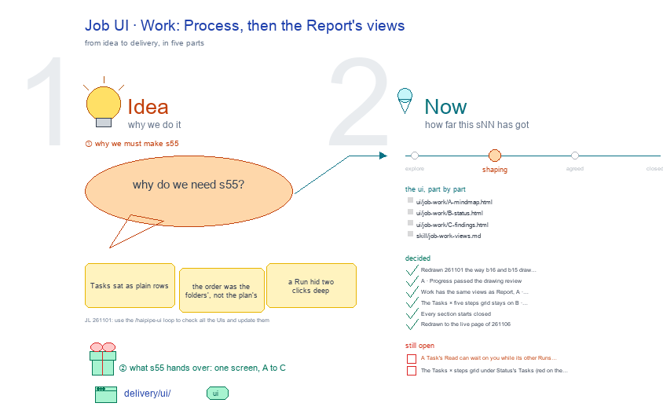

# s55 · Job UI: Work <!-- root #31bef5 -->

**Tags:** `Job UI`
**Stage:** shaping

- For <!-- @for #f78806 -->
  - a deck, and the work Job's Work … <!-- @for/0 #f1f9c3 -->
    a deck, and the work Job's Work screen on the focus page (`delivery/ui/job-work`), for the people who build the workbench
- Delivery type <!-- @delivery-type #58a44f -->
  - ui <!-- @delivery-type/0 #636117 -->
- Covers <!-- @covers #a6c44a -->
  - a Job's Work: the same views as … <!-- @covers/0 #47f75a -->
    a Job's Work: the same views as its Report, A · MindMap, B · Status, C · Findings, each ⚙️ Process first (🚧 Tasks not finished, 🧰 the skills that do it), then 📊 Results, the Report's view by the same code (Status adds each Task's output and the Interaction button); 🙋 Interaction each view's last section.
  - Red, a kept proposal: each Task against … <!-- @covers/1 #556e17 -->
    Red, a kept proposal: each Task against the five steps of a Task's life.
- Excluded <!-- @excluded #980495 -->
  - the other eight cells of the 3 … <!-- @excluded/0 #a5f0a1 -->
    the other eight cells of the 3 × 3 (j03's other sNN); what every work page shares (b17-s04).
- Topic <!-- @topic #7e13bd -->
  - A Job's Work: Process, then the Report's … <!-- @topic/0 #d7a5ff -->
    A Job's Work: Process, then the Report's views; one cell of the work theme's 3 × 3, the work Job × Work (do) (JL 261031: "I think you should focus on the things like ... b16_theme_paper ... studio ...
  - UI and think about how you should … <!-- @topic/1 #bd6501 -->
    UI and think about how you should update the work_theme's workbench UI").
  - Its drawing is haipipe-studio's five parts, drawn … <!-- @topic/2 #1528fc -->
    Its drawing is haipipe-studio's five parts, drawn by `build_s55_job_ui_work.py` through j03's `work_ui_cells.py`;
  - Its Design is its section's views, lettered … <!-- @topic/3 #7111ff -->
    Its Design is its section's views, lettered A, B …, each one full screen (haipipe-ui "one view, one screen"), every review round in `review/`.
- Feeds <!-- @feeds #ffe8e9 -->
  - none: a work Block keeps no Questions … <!-- @feeds/0 #bf8e2a -->
    none: a work Block keeps no Questions (JL 261031, r01 Q5)
- Files <!-- @files #6ce6c5 -->
  - [py] [build_s55_job_ui_work.py](build_s55_job_ui_work.py) <!-- @files/0 #78fb49 -->
  - delivery/ <!-- @files/1 #404761 -->
  - result/ <!-- @files/2 #d4a42c -->
  - review/ <!-- @files/3 #7928fb -->
  - [excalidraw] [s55-job-ui-work.excalidraw](s55-job-ui-work.excalidraw) <!-- @files/4 #dd8516 -->
  - [md] [s55-job-ui-work.md](s55-job-ui-work.md) <!-- @files/5 #c41022 -->
  - [png] [s55-job-ui-work.png](s55-job-ui-work.png) <!-- @files/6 #c71923 -->
    
- Decided <!-- @decided #55615a -->
  - s55-D01 · Redrawn 261101 the way b16 … <!-- @decided/0 #6889a5 -->
    s55-D01 · Redrawn 261101 the way b16 and b15 draw theirs: each view one step of the work, input → who works → output, your part, then the results (JL 261101: "the UI you have here is not that good. please check" b16's Block UI and b15's Task UI); the steps are haipipe-task's life, plan ▶ build ▶ run ▶ read ▶ close (ref/lifecycle.md). The earlier screens' rounds stay in `review/` (r01, r02).
  - s55-D02 · A · Progress passed the … <!-- @decided/1 #90ce9b -->
    s55-D02 · A · Progress passed the drawing review (stage 1), mean 8.7/10 in `review/A-s1-r04.md` (rounds: `review/A-s1-r03.md`, `review/A-s1-r04.md`); today's page scored 8.0 and failed Phone 6 and Salience 6. Proposed by the agent; it waits for JL's one look in `runs/r02_collect_job_work_views` (261101).
  - s55-D03 · Work has the same views … <!-- @decided/2 #6ac9fc -->
    s55-D03 · Work has the same views as Report, A · MindMap, B · Status, C · Findings, each ⚙️ Process then 📊 Results; the A · Progress view is gone, and with it its Where it stands sentence and its own Runs (asked 261104: "why we have the progress? it should have the same view to the report"; redrawn 261105).
  - s55-D04 · The Tasks × five steps … <!-- @decided/3 #6d229d -->
    s55-D04 · The Tasks × five steps grid stays on B · Status, under its Tasks, in red, as an open proposal: no 261104 ask overruled it (261105).
  - s55-D05 · Every section starts closed (asked … <!-- @decided/4 #07124a -->
    s55-D05 · Every section starts closed (asked 261104: "默认的话，大家都是合着的"); 🙋 Interaction shows once, as each view's last section, never a Process step (decided for this round, 261105).
- Open <!-- @open #cf9b77 -->
  - Your one look: `../runs/r02_collect_job_work_views` asks whether to … <!-- @open/0 #2b249c -->
    Your one look: `../runs/r02_collect_job_work_views` asks whether to keep the red Tasks × steps grid, beside today's page.
  - Still open after the redraw's reviews: <!-- @open/1 #b639b1 -->
  - A Task's Read can wait on you … <!-- @open/2 #e60df9 -->
    A Task's Read can wait on you while its other Runs still run, as t01's does (r04 asks).
  - The Tasks × steps grid under Status's … <!-- @open/3 #eea4cc -->
    The Tasks × steps grid under Status's Tasks (red on the drawing).
  - The earlier questions, my picks now drawn … <!-- @open/4 #795ee8 -->
    The earlier questions, my picks now drawn in, are in `../runs/r02_collect_job_work_views/passes/p01-1031/` and the round 2 screens' form in `passes/p02-1101/`; the full proposal is `result/views-proposal.md`; the 261101 screens' form is in `passes/p03-1101/`.
