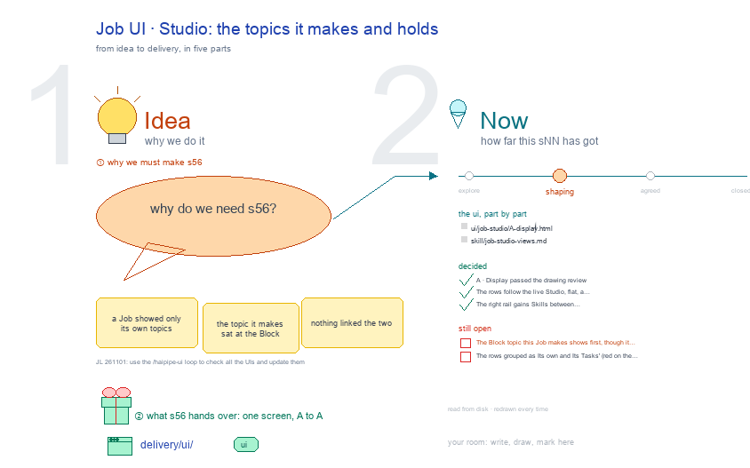

# s56 · Job UI: Studio <!-- root #0fd2cc -->

**Tags:** `Job UI`
**Stage:** shaping

- For <!-- @for #f78806 -->
  - a deck, and the work Job's Studio … <!-- @for/0 #3ab24a -->
    a deck, and the work Job's Studio screen on the focus page (`delivery/ui/job-studio`), for the people who build the workbench
- Delivery type <!-- @delivery-type #58a44f -->
  - ui <!-- @delivery-type/0 #636117 -->
- Covers <!-- @covers #a6c44a -->
  - a Job's Studio: one view per group, … <!-- @covers/0 #12309f -->
    a Job's Studio: one view per group, its topics as flat rows as the live page draws them, 🙋 Interaction on a topic whose form waits.
  - Red, kept proposals: This Job makes (its … <!-- @covers/1 #5d65c9 -->
    Red, kept proposals: This Job makes (its Block topic's card, large, Answer when it waits), the rows grouped as Its own and Its Tasks'.
- Excluded <!-- @excluded #980495 -->
  - the other eight cells of the 3 … <!-- @excluded/0 #a5f0a1 -->
    the other eight cells of the 3 × 3 (j03's other sNN); what every work page shares (b17-s04).
- Topic <!-- @topic #7e13bd -->
  - A Job's Studio: the topics it makes; … <!-- @topic/0 #b19cd7 -->
    A Job's Studio: the topics it makes; one cell of the work theme's 3 × 3, the work Job × Studio (think) (JL 261031: "I think you should focus on the things like ... b16_theme_paper ... studio ...
  - UI and think about how you should … <!-- @topic/1 #bd6501 -->
    UI and think about how you should update the work_theme's workbench UI").
  - Its drawing is haipipe-studio's five parts, drawn … <!-- @topic/2 #b24847 -->
    Its drawing is haipipe-studio's five parts, drawn by `build_s56_job_ui_studio.py` through j03's `work_ui_cells.py`;
  - Its Design is its section's views, lettered … <!-- @topic/3 #7111ff -->
    Its Design is its section's views, lettered A, B …, each one full screen (haipipe-ui "one view, one screen"), every review round in `review/`.
- Feeds <!-- @feeds #ffe8e9 -->
  - none: a work Block keeps no Questions … <!-- @feeds/0 #bf8e2a -->
    none: a work Block keeps no Questions (JL 261031, r01 Q5)
- Files <!-- @files #6ce6c5 -->
  - [py] [build_s56_job_ui_studio.py](build_s56_job_ui_studio.py) <!-- @files/0 #57a81d -->
  - delivery/ <!-- @files/1 #404761 -->
  - result/ <!-- @files/2 #d4a42c -->
  - review/ <!-- @files/3 #7928fb -->
  - [excalidraw] [s56-job-ui-studio.excalidraw](s56-job-ui-studio.excalidraw) <!-- @files/4 #0df96c -->
  - [md] [s56-job-ui-studio.md](s56-job-ui-studio.md) <!-- @files/5 #d063c3 -->
  - [png] [s56-job-ui-studio.png](s56-job-ui-studio.png) <!-- @files/6 #de4c92 -->
    
- Decided <!-- @decided #55615a -->
  - s56-D01 · A · Display passed the … <!-- @decided/0 #d0a9b9 -->
    s56-D01 · A · Display passed the drawing review (haipipe-ui Design loop, stage 1) in round 2, mean 9.1/10: `review/A-s1-r02.md` (round 1: `review/A-s1-r01.md`); today's page scored 7.5 and did not pass (`review/today-261101.md`). Proposed by the agent; it waits for JL's one look in `runs/r03_collect_job_studio_views` (261101).
  - s56-D02 · The rows follow the live … <!-- @decided/1 #0c995e -->
    s56-D02 · The rows follow the live Studio, flat, a topic whose form waits flagged 🙋 Interaction (redrawn 261105). This Job makes and the level groups, Its own and Its Tasks', stay in red, as open proposals: no 261104 ask overruled them.
- Open <!-- @open #cf9b77 -->
  - Your one look: `../runs/r03_collect_job_studio_views` asks whether to … <!-- @open/0 #9e9857 -->
    Your one look: `../runs/r03_collect_job_studio_views` asks whether to build the red parts (This Job makes, the level groups), beside today's page.
  - Still open after the review (its reviewers' … <!-- @open/1 #27a61b -->
    Still open after the review (its reviewers' asks):
  - The Block topic this Job makes shows … <!-- @open/2 #3360d8 -->
    The Block topic this Job makes shows first, though it sits at the Block (r02 asks).
  - The rows grouped as Its own and … <!-- @open/3 #4acc2a -->
    The rows grouped as Its own and Its Tasks' (red on the drawing).
  - The earlier questions, my picks now drawn … <!-- @open/4 #93776d -->
    The earlier questions, my picks now drawn in, are in `../runs/r03_collect_job_studio_views/passes/p01-1031/`; the full proposal is `result/views-proposal.md`; the 261101 screens' form is in `passes/p02-1101/`.
