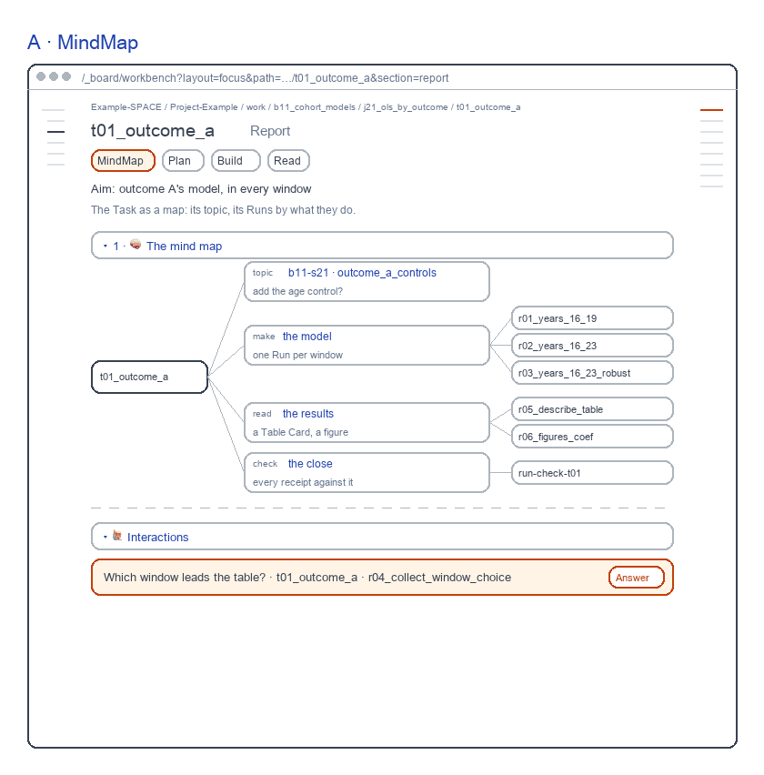
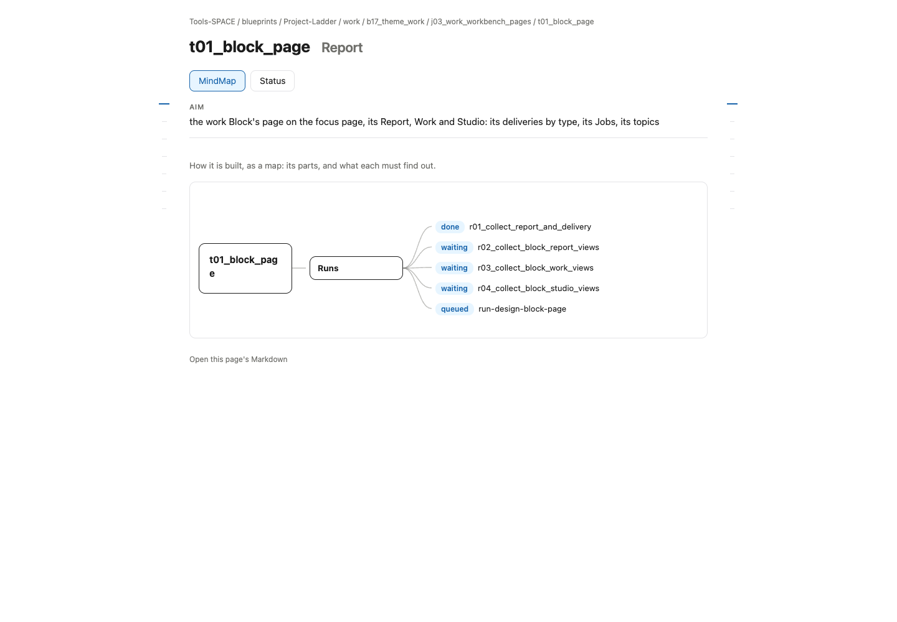
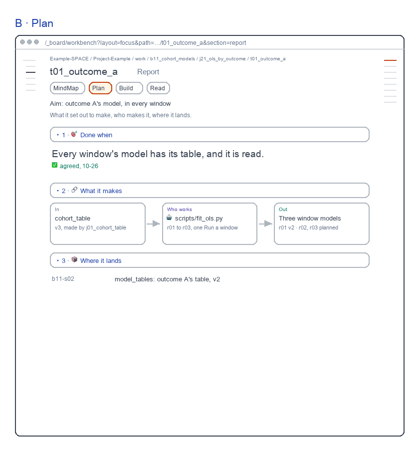
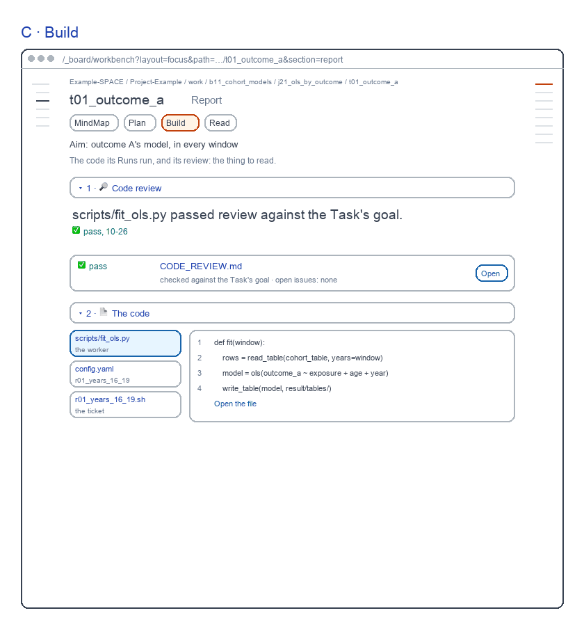
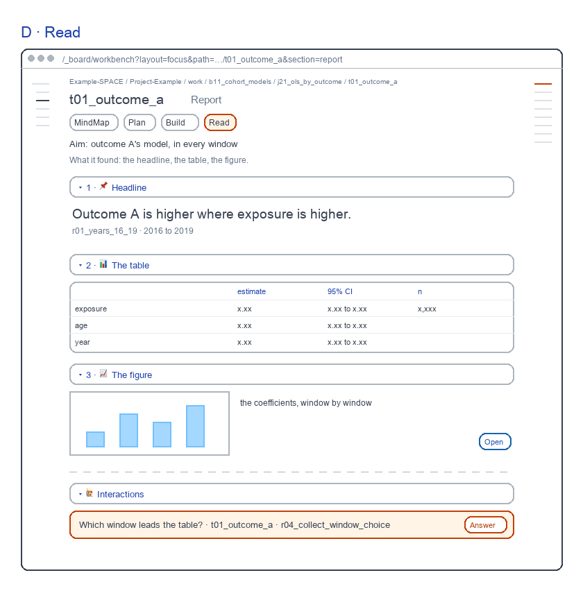

# Task Report screens

for: b17.j03.t03-s57:theme_work.work_workbench_pages.task_page @ task_ui_report

<!-- One card per question: ## QN · title, one short why, **the question?**, then - [x] A · my pick and
     - [ ] B · another, each with its picture, then Why A: one line. collect.py check holds the limits. The earlier
     question sets are in passes/p01-1031/ and passes/p02-1101/. -->

The Task's Report, redrawn the way b16 and b15 draw theirs: each view one step of the work. Each screen sits beside today's page.

## Q1 · A · MindMap

A · MindMap: its topic and its Runs by what they do. A fresh reviewer passed it, 9.4 of 10; today's page scored 7.8 and failed One job 5 and Salience 6.

**Build A · MindMap as drawn?**

- [x] A · Yes: build it as drawn.
  
- [ ] B · No: keep today's page.
  

Why A: Each view is one step of the work, as b15 draws its Task UI.

## Q2 · B · Plan

B · Plan: done when, what it makes and who makes it. A fresh reviewer passed it, 9.1 of 10; today's page scored 7.8 and failed One job 5 and Salience 6.

**Build B · Plan as drawn?**

- [x] A · Yes: build it as drawn.
  
- [ ] B · No: keep today's page.
  

Why A: Each view is one step of the work, as b15 draws its Task UI.

## Q3 · C · Build

C · Build: the code review, how the code was built. A fresh reviewer passed it, 8.9 of 10; today's page scored 7.8 and failed One job 5 and Salience 6.

**Build C · Build as drawn?**

- [x] A · Yes: build it as drawn.
  
- [ ] B · No: keep today's page.
  

Why A: Each view is one step of the work, as b15 draws its Task UI.

## Q4 · D · Read

D · Read: the headline, the Table Card, the coefficient plot. A fresh reviewer passed it, 9.1 of 10; today's page scored 7.8 and failed One job 5 and Salience 6.

**Build D · Read as drawn?**

- [x] A · Yes: build it as drawn.
  
- [ ] B · No: keep today's page.
  

Why A: Each view is one step of the work, as b15 draws its Task UI.
