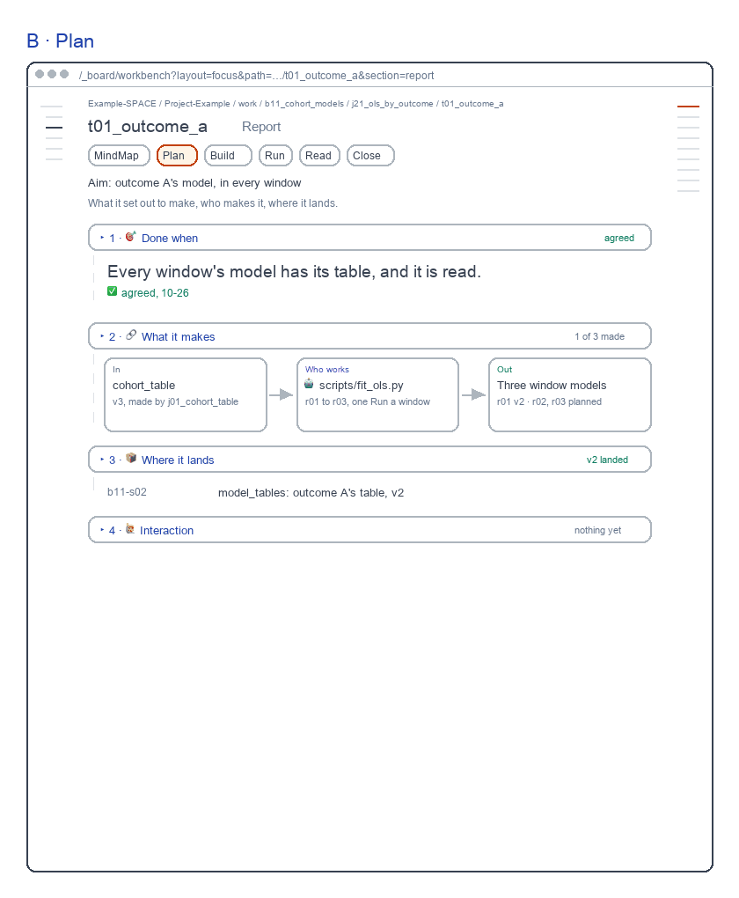
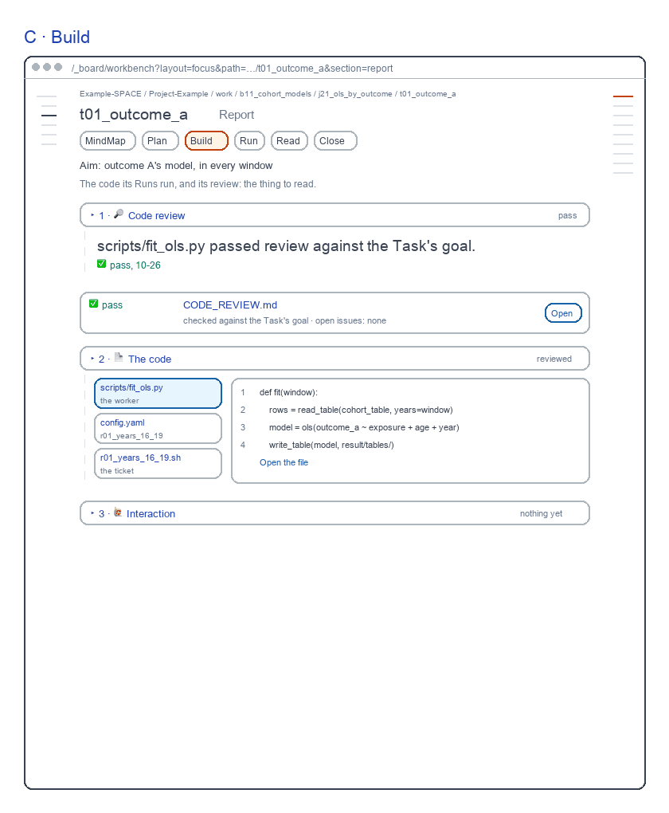
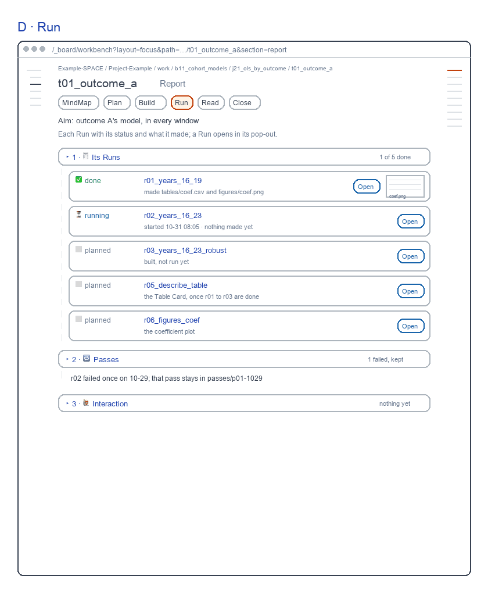
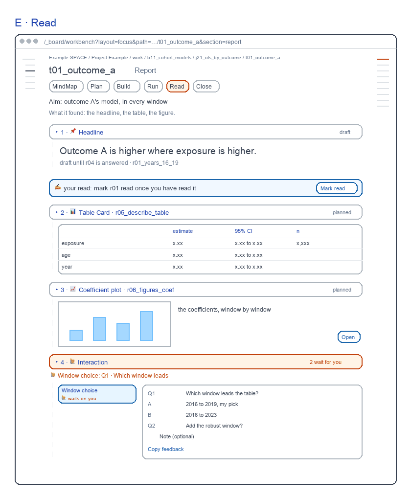
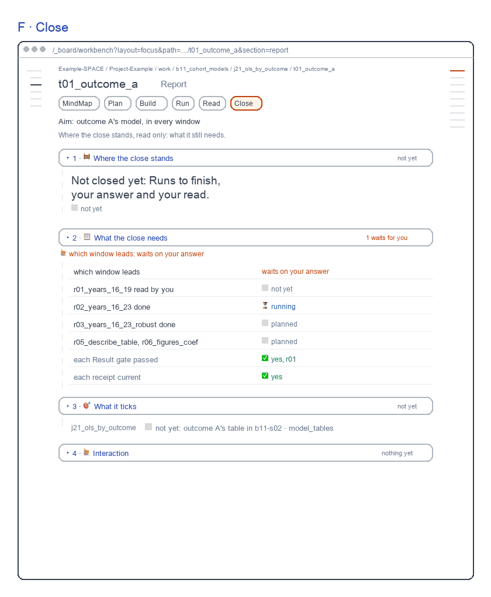
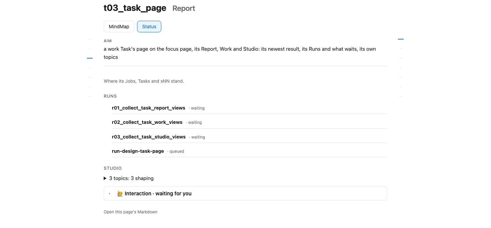

# Task Report screens

for: b17.j03.t03-s57:theme_work.work_workbench_pages.task_page @ task_ui_report

<!-- One card per question: ## QN · title, one short why, **the question?**, then - [x] A · my pick and
     - [ ] B · another, each with its picture, then Why A: one line. collect.py check holds the limits; collect.py build
     renders the form. The earlier question sets are in passes/p01-1031/ and passes/p02-1101/ and passes/p03-1101/. -->

A Task's Report: the MindMap, then five step views, the target. Redrawn 261106: each bar its word, each Run's words on the map (Q6), forms by step (Q7).

## Q1 · B · Plan

B · Plan: done when, what it makes, where it lands; drawn closed, 🙋 Interaction last. It passed review on 261101 at 9.1.

**Build B · Plan as drawn?**

- [x] A · Yes: build it as drawn.
  
- [ ] B · No: keep today's page.
  

Why A: Each step shows its own results; today's page shows only Status.

## Q2 · C · Build

C · Build: the code review, then the code as side tabs. It passed review on 261101 at 8.9.

**Build C · Build as drawn?**

- [x] A · Yes: build it as drawn.
  
- [ ] B · No: keep today's page.
  

Why A: Each step shows its own results; today's page shows only Status.

## Q3 · D · Run

D · Run, new: each Run with its status and what it made; Open pops the Run out. Not reviewed yet.

**Build D · Run as drawn?**

- [x] A · Yes: build it as drawn.
  
- [ ] B · No: keep today's page.
  

Why A: Each step shows its own results; today's page shows only Status.

## Q4 · E · Read

E · Read, was D: the headline, mark read, the Table Card, the plot. It passed review on 261101 at 9.1.

**Build E · Read as drawn?**

- [x] A · Yes: build it as drawn.
  
- [ ] B · No: keep today's page.
  

Why A: Each step shows its own results; today's page shows only Status.

## Q5 · F · Close

F · Close, new: the close checklist's state, read only, and what it ticks. Not reviewed yet.

**Build F · Close as drawn?**

- [x] A · Yes: build it as drawn.
  
- [ ] B · No: keep today's page.
  

Why A: Each step shows its own results; today's page shows only Status.

## Q6 · A · MindMap

A · MindMap now draws each Run with what it says, as the live page does since 261106; D · Run keeps each Run's mark.

```text
A  Runs ── r01 · the model, 2016 to 2019 ── r04 · Window choice
B  Runs ── ✅ r01_years_16_19 ── ⏳ r02_years_16_23
```

**What does a Task's map show for each Run?**

- [x] A · What the Run says it finds out or makes, as drawn.
- [ ] B · Its mark, as drawn on 261105.

Why A: The map says what each Run is for; D · Run shows where each stands.

## Q7 · Where forms show

Today's Task page shows every form in MindMap's 🙋 Interaction. On the six views, the drawing puts Window choice in E · Read, whose headline waits on it.

```text
A  E · Read     4 · 🙋 Interaction   2 wait for you
   A · MindMap  🙋 Interaction       nothing yet
B  A · MindMap  🙋 Interaction       2 wait for you
   E · Read     4 · 🙋 Interaction   nothing yet
```

**Where does a Task's form show?**

- [x] A · In the step its answer changes; MindMap keeps the rest.
- [ ] B · In MindMap, every form, as today's page.

Why A: You answer it beside the headline it changes.
