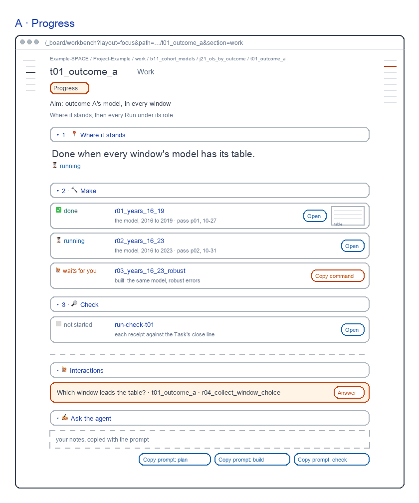
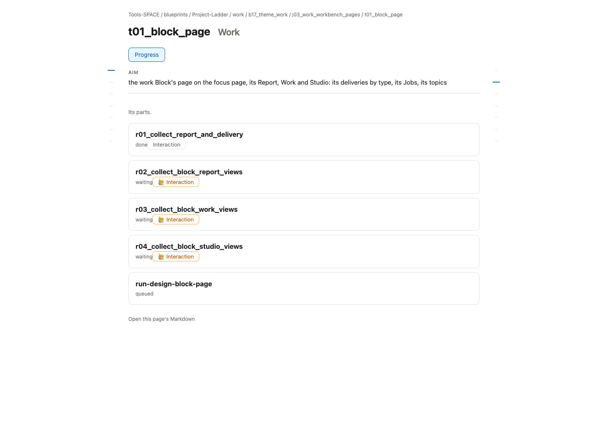

# Task Work screen

for: b17.j03.t03-s58:theme_work.work_workbench_pages.task_page @ task_ui_work

<!-- One card per question: ## QN · title, one short why, **the question?**, then - [x] A · my pick and
     - [ ] B · another, each with its picture, then Why A: one line. collect.py check holds the limits; collect.py build
     renders the form. The earlier questions (261031) are in passes/p01-1031/. -->

The Task's Work, redrawn as one screen per view on a made-up example Block. Each passed a fresh review; today's page is beside it.

## Q1 · A · Progress

A · Progress: where it stands, every Run under its role, the helpers last. A fresh reviewer passed it in round 2, 8.7 of 10; today's page scored 8.8 and failed Salience 5.

**Build A · Progress as drawn?**

- [x] A · Yes: build it as drawn.
  
- [ ] B · No: keep today's page.
  

Why A: It passed every rubric; today's page did not.
