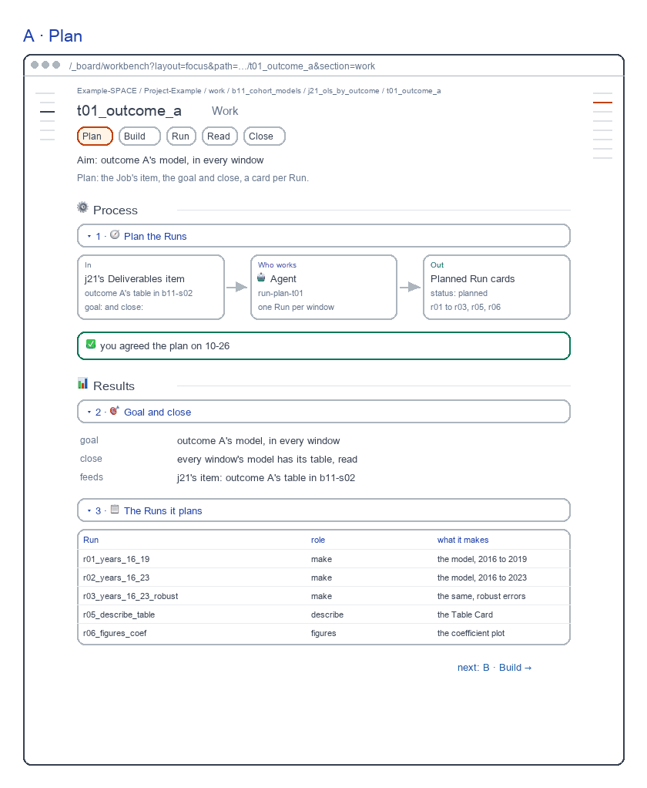
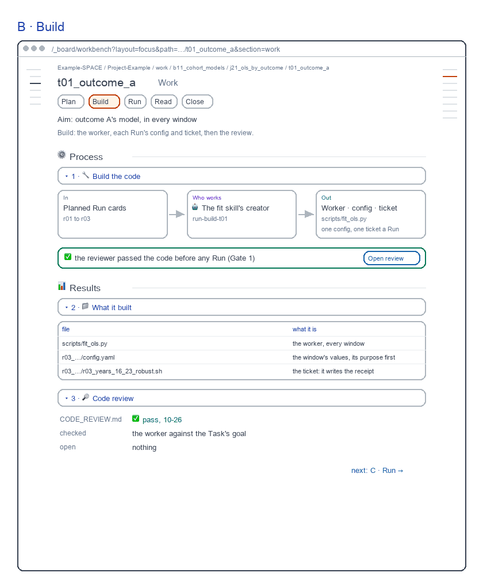
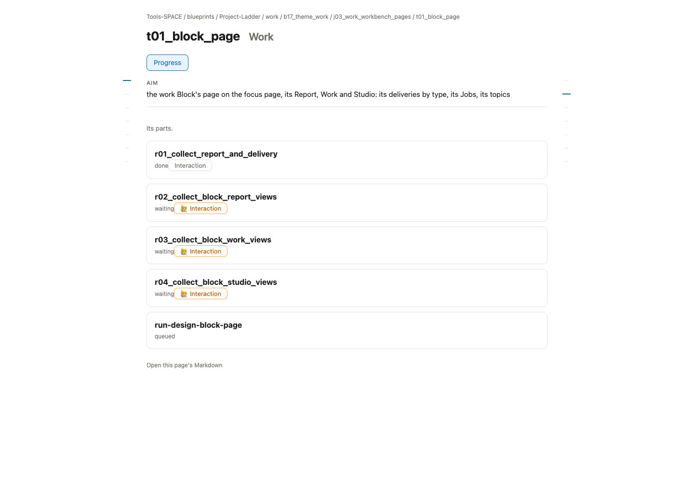
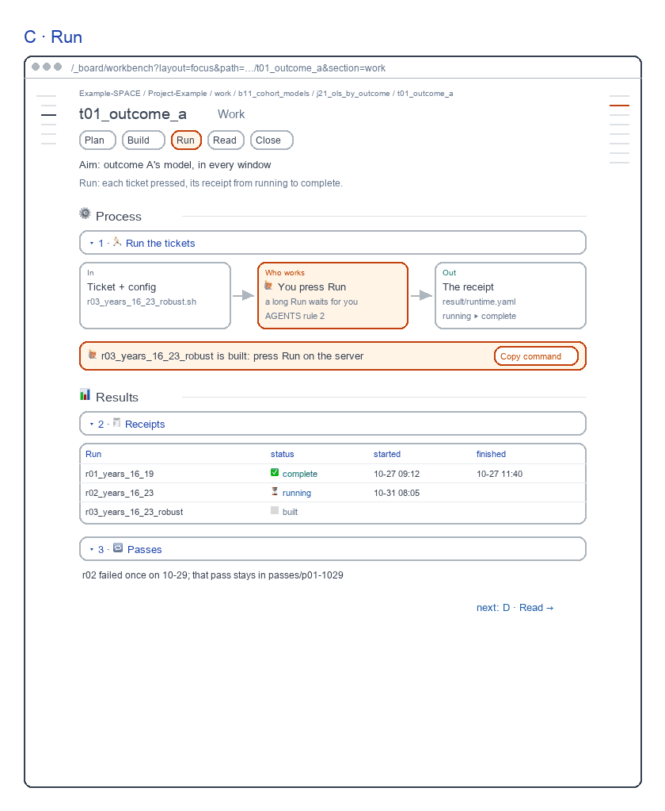
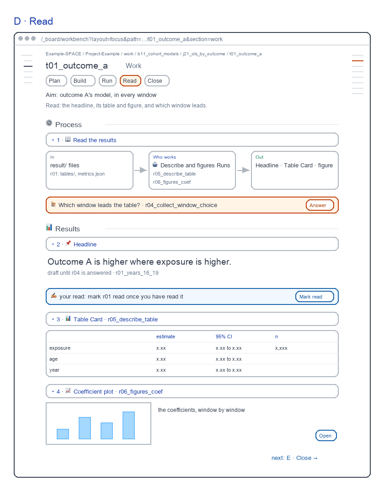
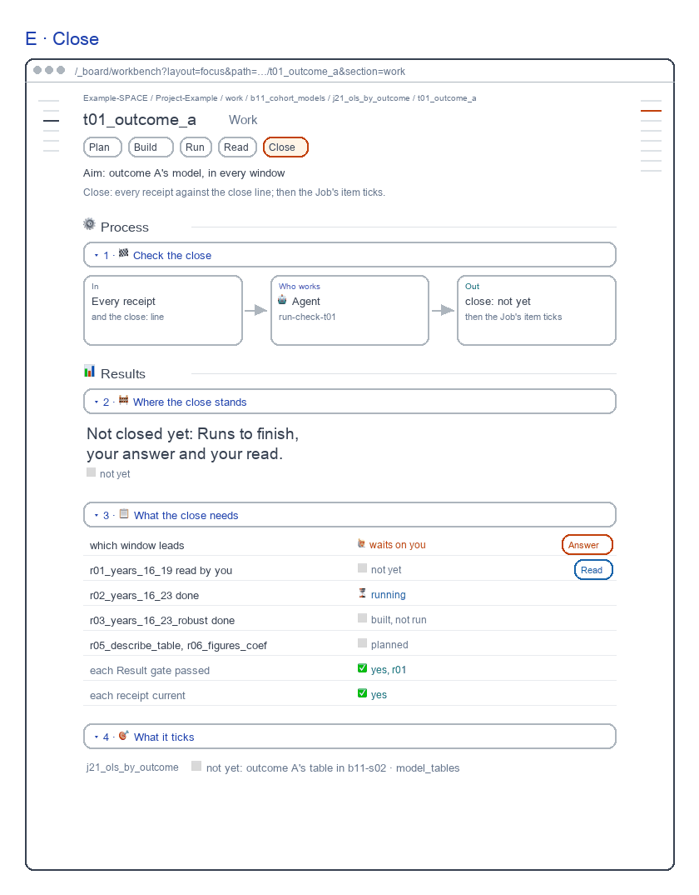

# Task Work screens

for: b17.j03.t03-s58:theme_work.work_workbench_pages.task_page @ task_ui_work

<!-- One card per question: ## QN · title, one short why, **the question?**, then - [x] A · my pick and
     - [ ] B · another, each with its picture, then Why A: one line. collect.py check holds the limits. The earlier
     question sets are in passes/p01-1031/ and passes/p02-1101/. -->

The Task's Work, redrawn the way b16 and b15 draw theirs: each view one step of the work. Each screen sits beside today's page.

## Q1 · A · Plan

A · Plan: the Job's item, goal and close, a card per Run. A fresh reviewer passed it, 8.3 of 10; today's page scored 8.8 and failed Salience 5.

**Build A · Plan as drawn?**

- [x] A · Yes: build it as drawn.
  
- [ ] B · No: keep today's page.
  

Why A: Each view is one step of the work, as b15 draws its Task UI.

## Q2 · B · Build

B · Build: the worker, its config and ticket, the review. A fresh reviewer passed it, 8.4 of 10; today's page scored 8.8 and failed Salience 5.

**Build B · Build as drawn?**

- [x] A · Yes: build it as drawn.
  
- [ ] B · No: keep today's page.
  

Why A: Each view is one step of the work, as b15 draws its Task UI.

## Q3 · C · Run

C · Run: you press Run; each Run's receipt. A fresh reviewer passed it, 9.0 of 10; today's page scored 8.8 and failed Salience 5.

**Build C · Run as drawn?**

- [x] A · Yes: build it as drawn.
  
- [ ] B · No: keep today's page.
  

Why A: Each view is one step of the work, as b15 draws its Task UI.

## Q4 · D · Read

D · Read: the headline, its table and plot, which window leads. A fresh reviewer passed it, 8.7 of 10; today's page scored 8.8 and failed Salience 5.

**Build D · Read as drawn?**

- [x] A · Yes: build it as drawn.
  
- [ ] B · No: keep today's page.
  

Why A: Each view is one step of the work, as b15 draws its Task UI.

## Q5 · E · Close

E · Close: what still stands between it and the close. A fresh reviewer passed it, 8.9 of 10; today's page scored 8.8 and failed Salience 5.

**Build E · Close as drawn?**

- [x] A · Yes: build it as drawn.
  
- [ ] B · No: keep today's page.
  

Why A: Each view is one step of the work, as b15 draws its Task UI.

## Q6 · Step buttons

A draft Task's buttons carry each step's state word, and its Work opens on the step in progress. The drawn screens show plain names.

```text
A  [Plan agreed] [Build passed] [Run running] [Read waits] [Close not yet]
B  [Plan] [Build] [Run] [Read] [Close]
```

**Should a work Task's step buttons do the same?**

- [x] A · Yes: Plan agreed · Run running …, opening on the step in progress.
- [ ] B · No: plain step names, opening on Plan.

Why A: You see where the Task is before you open a step.
