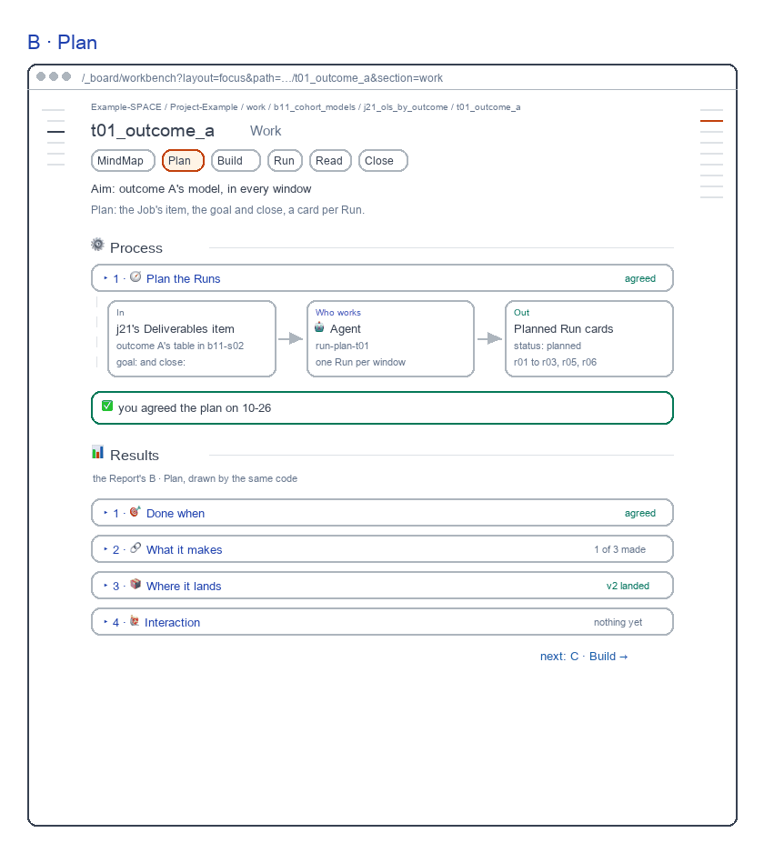
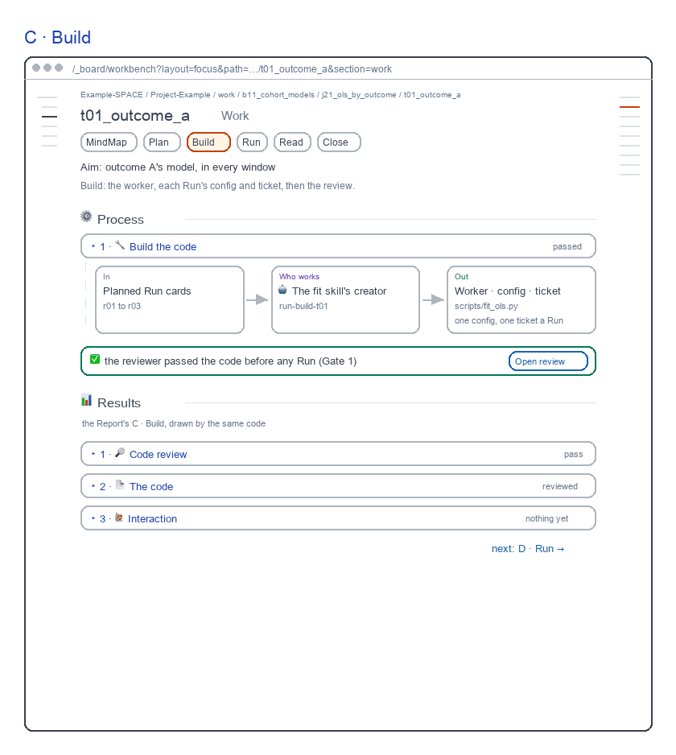
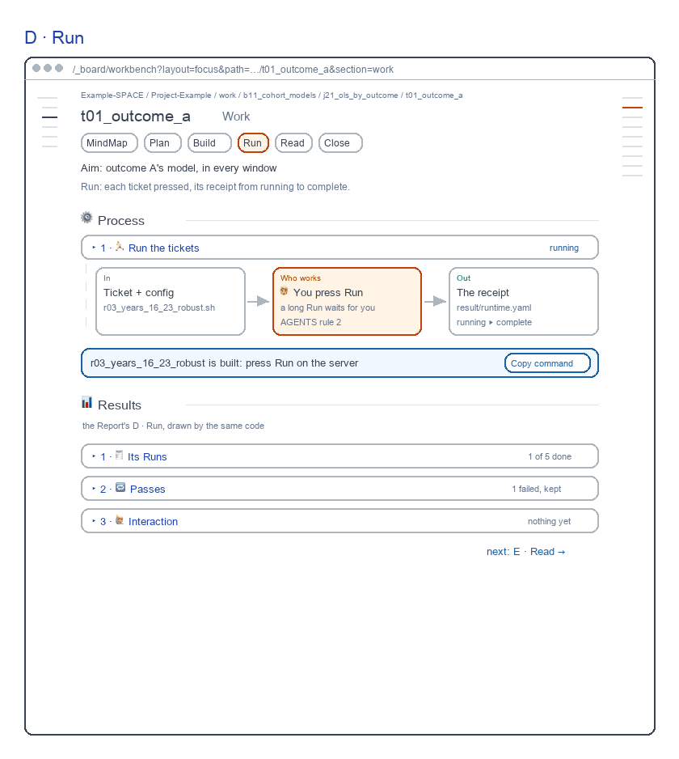
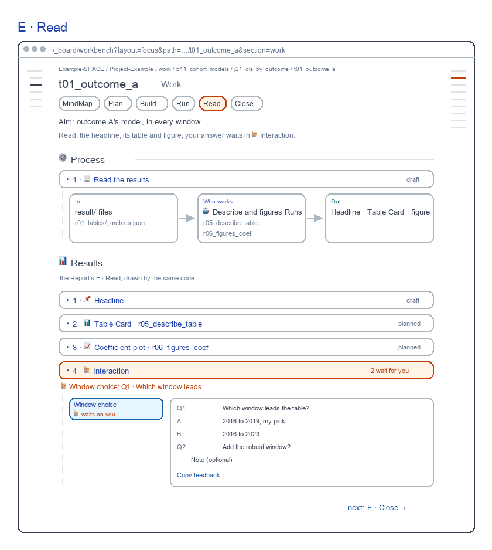
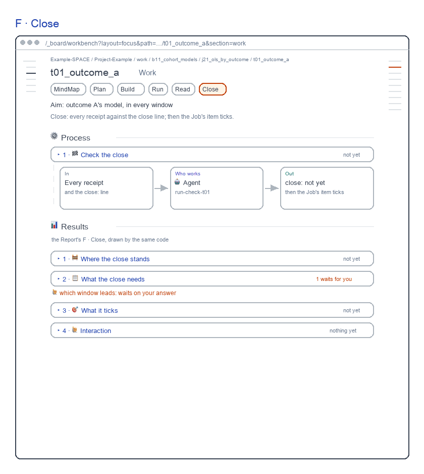
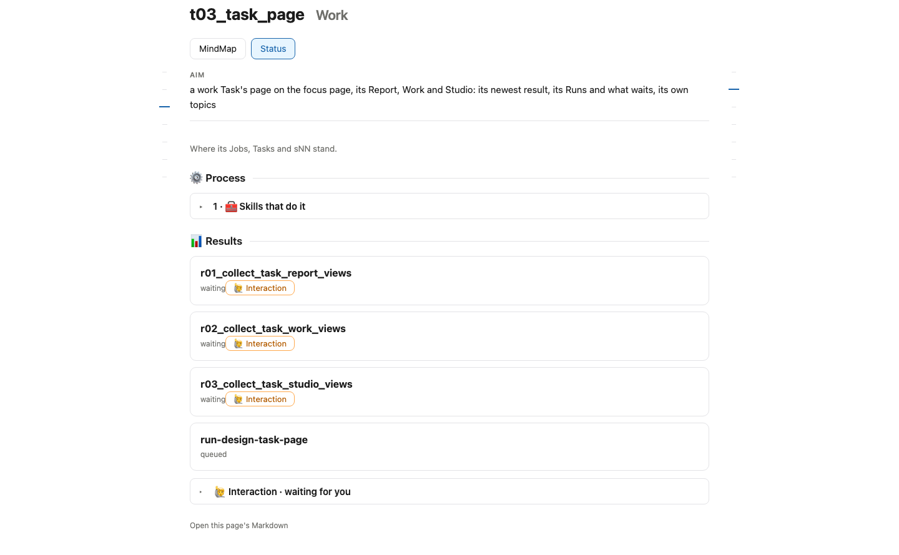

# Task Work screens

for: b17.j03.t03-s58:theme_work.work_workbench_pages.task_page @ task_ui_work

<!-- One card per question: ## QN · title, one short why, **the question?**, then - [x] A · my pick and
     - [ ] B · another, each with its picture, then Why A: one line. collect.py check holds the limits; collect.py build
     renders the form. The earlier question sets are in passes/p01-1031/ and passes/p02-1101/ and passes/p03-1101/. -->

A Task's Work: the Report's six views, Process first; the steps are the target. Redrawn 261106: skills on the rail, each bar its word, Read holds the window choice.

## Q1 · B · Plan

B · Plan, was A: the plan's flow, then the Report's Plan as its Results. It passed review on 261101 at 8.3.

**Build B · Plan as drawn?**

- [x] A · Yes: build it as drawn.
  
- [ ] B · No: keep today's page.
  

Why A: Each step shows its own results; today's page shows only Status.

## Q2 · C · Build

C · Build, was B: the build's flow and the code review, then the Report's Build. It passed review at 8.4.

**Build C · Build as drawn?**

- [x] A · Yes: build it as drawn.
  
- [ ] B · No: keep today's page.
  

Why A: Each step shows its own results; today's page shows only Status.

## Q3 · D · Run

D · Run, was C: you press Run, now a plain row; then the Report's Run. It passed review at 9.0.

**Build D · Run as drawn?**

- [x] A · Yes: build it as drawn.
  
- [ ] B · No: keep today's page.
  

Why A: Each step shows its own results; today's page shows only Status.

## Q4 · E · Read

E · Read, was D: the read's flow; your answer waits in 🙋 Interaction. It passed review at 8.7.

**Build E · Read as drawn?**

- [x] A · Yes: build it as drawn.
  
- [ ] B · No: keep today's page.
  

Why A: Each step shows its own results; today's page shows only Status.

## Q5 · F · Close

F · Close, was E: the close's check, then the Report's Close. It passed review at 8.9.

**Build F · Close as drawn?**

- [x] A · Yes: build it as drawn.
  
- [ ] B · No: keep today's page.
  

Why A: Each step shows its own results; today's page shows only Status.

## Q6 · Step buttons

A draft Task's buttons carry each step's state word, and its Work opens on the step in progress. The drawn screens show plain names.

```text
A  [Plan agreed] [Build passed] [Run running] [Read waits] [Close not yet]
B  [Plan] [Build] [Run] [Read] [Close]
```

**Should a work Task's step buttons do the same?**

- [x] A · Yes: Plan agreed · Run running …, opening on the step in progress.
- [ ] B · No: plain step names, opening on Plan.

Why A: You see where the Task is before you open a step.
