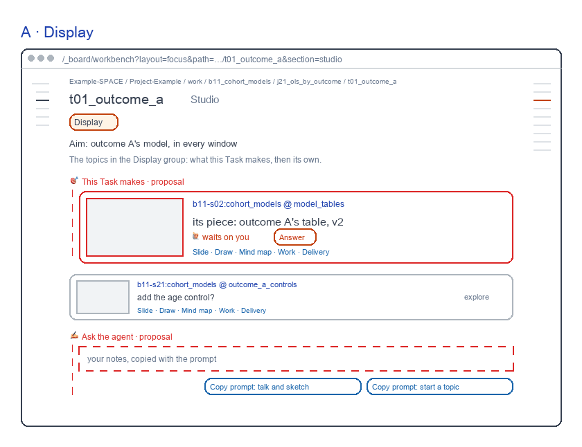
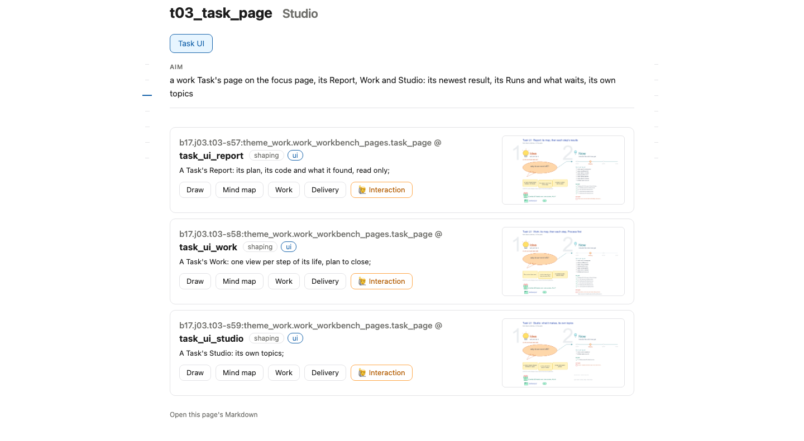

# Task Studio screens

for: b17.j03.t03-s59:theme_work.work_workbench_pages.task_page @ task_ui_studio

<!-- One card per question: ## QN · title, one short why, **the question?**, then - [x] A · my pick and
     - [ ] B · another, each with its picture, then Why A: one line. collect.py check holds the limits; collect.py build
     renders the form. The earlier question sets are in passes/p01-1031/ and passes/p02-1101/. -->

A Task's Studio: flat rows as live; two reviewed parts stay red. Redrawn 261106: Skills on the right rail, as live.

## Q1 · A · Display

A · Display: the rows as live, with two reviewed parts in red: This Task makes, its Block topic's card, and Ask the agent at the bottom.

**Build A · Display's red parts as drawn?**

- [x] A · Yes: This Task makes first, Ask the agent last.
  
- [ ] B · No: flat rows only, as today's page.
  

Why A: The piece it makes leads; a prompt starts a topic here.
