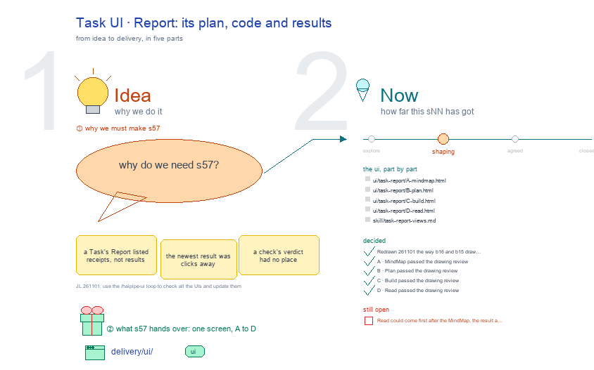

# s57 · Task UI: Report <!-- root #1f6b42 -->

**Tags:** `Task UI`
**Stage:** shaping

- For <!-- @for #f78806 -->
  - a deck, and the work Task's Report … <!-- @for/0 #0a835a -->
    a deck, and the work Task's Report screen on the focus page (`delivery/ui/task-report`), for the people who build the workbench
- Delivery type <!-- @delivery-type #58a44f -->
  - ui <!-- @delivery-type/0 #636117 -->
- Covers <!-- @covers #a6c44a -->
  - a Task's Report: A · MindMap (its … <!-- @covers/0 #df3c34 -->
    a Task's Report: A · MindMap (its topic, its Runs by what they do), then each step's results, read only: B · Plan (done when, large; what it makes, who makes it; where it lands), C · Build (the code review, large; how it was built; the review), D · Read (the headline, the Table Card, the coefficient plot);
  - Run and Close stay in Work <!-- @covers/1 #f763dd -->
- Excluded <!-- @excluded #980495 -->
  - the other eight cells of the 3 … <!-- @excluded/0 #a5f0a1 -->
    the other eight cells of the 3 × 3 (j03's other sNN); what every work page shares (b17-s04).
- Topic <!-- @topic #7e13bd -->
  - A Task's Report: its plan, its code … <!-- @topic/0 #c1361b -->
    A Task's Report: its plan, its code and what it found, read only; one cell of the work theme's 3 × 3, the work Task × Report (check) (JL 261031: "I think you should focus on the things like ... b16_theme_paper ... studio ...
  - UI and think about how you should … <!-- @topic/1 #bd6501 -->
    UI and think about how you should update the work_theme's workbench UI").
  - Its drawing is haipipe-studio's five parts, drawn … <!-- @topic/2 #4f9e52 -->
    Its drawing is haipipe-studio's five parts, drawn by `build_s57_task_ui_report.py` through j03's `work_ui_cells.py`;
  - Its Design is its section's views, lettered … <!-- @topic/3 #7111ff -->
    Its Design is its section's views, lettered A, B …, each one full screen (haipipe-ui "one view, one screen"), every review round in `review/`.
- Feeds <!-- @feeds #ffe8e9 -->
  - none: a work Block keeps no Questions … <!-- @feeds/0 #bf8e2a -->
    none: a work Block keeps no Questions (JL 261031, r01 Q5)
- Files <!-- @files #6ce6c5 -->
  - [py] [build_s57_task_ui_report.py](build_s57_task_ui_report.py) <!-- @files/0 #b00392 -->
  - delivery/ <!-- @files/1 #404761 -->
  - result/ <!-- @files/2 #d4a42c -->
  - review/ <!-- @files/3 #7928fb -->
  - [excalidraw] [s57-task-ui-report.excalidraw](s57-task-ui-report.excalidraw) <!-- @files/4 #7fe90a -->
  - [md] [s57-task-ui-report.md](s57-task-ui-report.md) <!-- @files/5 #64bed6 -->
  - [png] [s57-task-ui-report.png](s57-task-ui-report.png) <!-- @files/6 #91bd67 -->
    
- Decided <!-- @decided #55615a -->
  - s57-D01 · Redrawn 261101 the way b16 … <!-- @decided/0 #fe9050 -->
    s57-D01 · Redrawn 261101 the way b16 and b15 draw theirs: each view one step of the work, input → who works → output, your part, then the results (JL 261101: "the UI you have here is not that good. please check" b16's Block UI and b15's Task UI); the steps are haipipe-task's life, plan ▶ build ▶ run ▶ read ▶ close (ref/lifecycle.md). The earlier screens' rounds stay in `review/` (r01, r02).
  - s57-D02 · A · MindMap passed the … <!-- @decided/1 #b72969 -->
    s57-D02 · A · MindMap passed the drawing review (stage 1), mean 9.4/10 in `review/A-s1-r03.md` (rounds: `review/A-s1-r03.md`); today's page scored 7.8 and failed One job 5 and Salience 6. Proposed by the agent; it waits for JL's one look in `runs/r01_collect_task_report_views` (261101).
  - s57-D03 · B · Plan passed the … <!-- @decided/2 #71f9ec -->
    s57-D03 · B · Plan passed the drawing review (stage 1), mean 9.1/10 in `review/B-s1-r05.md` (rounds: `review/B-s1-r03.md`, `review/B-s1-r04.md`, `review/B-s1-r05.md`); today's page scored 7.8 and failed One job 5 and Salience 6. Proposed by the agent; it waits for JL's one look in `runs/r01_collect_task_report_views` (261101).
  - s57-D04 · C · Build passed the … <!-- @decided/3 #3b003d -->
    s57-D04 · C · Build passed the drawing review (stage 1), mean 8.9/10 in `review/C-s1-r06.md` (rounds: `review/C-s1-r03.md`, `review/C-s1-r04.md`, `review/C-s1-r05.md`, `review/C-s1-r06.md`); today's page scored 7.8 and failed One job 5 and Salience 6. Proposed by the agent; it waits for JL's one look in `runs/r01_collect_task_report_views` (261101).
  - s57-D05 · D · Read passed the … <!-- @decided/4 #e207d0 -->
    s57-D05 · D · Read passed the drawing review (stage 1), mean 9.1/10 in `review/D-s1-r03.md` (rounds: `review/D-s1-r03.md`); today's page scored 7.8 and failed One job 5 and Salience 6. Proposed by the agent; it waits for JL's one look in `runs/r01_collect_task_report_views` (261101).
- Open <!-- @open #cf9b77 -->
  - Your one look: `../runs/r01_collect_task_report_views` shows each screen … <!-- @open/0 #5d1dc5 -->
    Your one look: `../runs/r01_collect_task_report_views` shows each screen beside today's page: build it as drawn, or keep today's.
  - Still open after the redraw's reviews: <!-- @open/1 #b639b1 -->
  - Read could come first after the MindMap, … <!-- @open/2 #3a7244 -->
    Read could come first after the MindMap, the result a reader wants most; drawn in the life's order.
  - The earlier questions, my picks now drawn … <!-- @open/3 #30c912 -->
    The earlier questions, my picks now drawn in, are in `../runs/r01_collect_task_report_views/passes/p01-1031/` and the round 2 screens' form in `passes/p02-1101/`; the full proposal is `result/views-proposal.md`.
