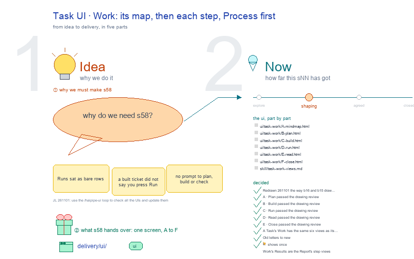

# s58 · Task UI: Work <!-- root #6d67d7 -->

**Tags:** `Task UI`
**Stage:** shaping

- For <!-- @for #f78806 -->
  - a deck, and the work Task's Work … <!-- @for/0 #8acd41 -->
    a deck, and the work Task's Work screen on the focus page (`delivery/ui/task-work`), for the people who build the workbench
- Delivery type <!-- @delivery-type #58a44f -->
  - ui <!-- @delivery-type/0 #636117 -->
- Covers <!-- @covers #a6c44a -->
  - a Task's Work, the target built after … <!-- @covers/0 #2d7bd0 -->
    a Task's Work, the target built after the person's look (the live Task page is MindMap · Status today): the same six views as its Report, A · MindMap, B · Plan, C · Build, D · Run, E · Read, F · Close; each ⚙️ Process (In → who works → Out, your part), then 📊 Results, the Report's view, then the next step; 🙋 Interaction each view's last section;
  - P, a Run's pop-out, opens from any … <!-- @covers/1 #698163 -->
    P, a Run's pop-out, opens from any Run row.
- Excluded <!-- @excluded #980495 -->
  - the other eight cells of the 3 … <!-- @excluded/0 #a5f0a1 -->
    the other eight cells of the 3 × 3 (j03's other sNN); what every work page shares (b17-s04).
- Topic <!-- @topic #7e13bd -->
  - A Task's Work: its map, then each … <!-- @topic/0 #cc0370 -->
    A Task's Work: its map, then each step of its life, Process first; one cell of the work theme's 3 × 3, the work Task × Work (do) (JL 261031: "I think you should focus on the things like ... b16_theme_paper ... studio ...
  - UI and think about how you should … <!-- @topic/1 #bd6501 -->
    UI and think about how you should update the work_theme's workbench UI").
  - Its drawing is haipipe-studio's five parts, drawn … <!-- @topic/2 #eef773 -->
    Its drawing is haipipe-studio's five parts, drawn by `build_s58_task_ui_work.py` through j03's `work_ui_cells.py`;
  - Its Design is its section's views, lettered … <!-- @topic/3 #7111ff -->
    Its Design is its section's views, lettered A, B …, each one full screen (haipipe-ui "one view, one screen"), every review round in `review/`.
- Feeds <!-- @feeds #ffe8e9 -->
  - none: a work Block keeps no Questions … <!-- @feeds/0 #bf8e2a -->
    none: a work Block keeps no Questions (JL 261031, r01 Q5)
- Files <!-- @files #6ce6c5 -->
  - [py] [build_s58_task_ui_work.py](build_s58_task_ui_work.py) <!-- @files/0 #f2e71b -->
  - delivery/ <!-- @files/1 #404761 -->
  - result/ <!-- @files/2 #d4a42c -->
  - review/ <!-- @files/3 #7928fb -->
  - [excalidraw] [s58-task-ui-work.excalidraw](s58-task-ui-work.excalidraw) <!-- @files/4 #175436 -->
  - [md] [s58-task-ui-work.md](s58-task-ui-work.md) <!-- @files/5 #af33ec -->
  - [png] [s58-task-ui-work.png](s58-task-ui-work.png) <!-- @files/6 #27bdc4 -->
    
- Decided <!-- @decided #55615a -->
  - s58-D01 · Redrawn 261101 the way b16 … <!-- @decided/0 #b3449b -->
    s58-D01 · Redrawn 261101 the way b16 and b15 draw theirs: each view one step of the work, input → who works → output, your part, then the results (JL 261101: "the UI you have here is not that good. please check" b16's Block UI and b15's Task UI); the steps are haipipe-task's life, plan ▶ build ▶ run ▶ read ▶ close (ref/lifecycle.md). The earlier screens' rounds stay in `review/` (r01, r02).
  - s58-D02 · A · Plan passed the … <!-- @decided/1 #152024 -->
    s58-D02 · A · Plan passed the drawing review (stage 1), mean 8.3/10 in `review/A-s1-r03.md` (rounds: `review/A-s1-r03.md`); today's page scored 8.8 and failed Salience 5. Proposed by the agent; it waits for JL's one look in `runs/r02_collect_task_work_views` (261101).
  - s58-D03 · B · Build passed the … <!-- @decided/2 #e40873 -->
    s58-D03 · B · Build passed the drawing review (stage 1), mean 8.4/10 in `review/B-s1-r03.md` (rounds: `review/B-s1-r03.md`); today's page scored 8.8 and failed Salience 5. Proposed by the agent; it waits for JL's one look in `runs/r02_collect_task_work_views` (261101).
  - s58-D04 · C · Run passed the … <!-- @decided/3 #07117d -->
    s58-D04 · C · Run passed the drawing review (stage 1), mean 9.0/10 in `review/C-s1-r03.md` (rounds: `review/C-s1-r03.md`); today's page scored 8.8 and failed Salience 5. Proposed by the agent; it waits for JL's one look in `runs/r02_collect_task_work_views` (261101).
  - s58-D05 · D · Read passed the … <!-- @decided/4 #aa9e92 -->
    s58-D05 · D · Read passed the drawing review (stage 1), mean 8.7/10 in `review/D-s1-r04.md` (rounds: `review/D-s1-r03.md`, `review/D-s1-r04.md`); today's page scored 8.8 and failed Salience 5. Proposed by the agent; it waits for JL's one look in `runs/r02_collect_task_work_views` (261101).
  - s58-D06 · E · Close passed the … <!-- @decided/5 #801da2 -->
    s58-D06 · E · Close passed the drawing review (stage 1), mean 8.9/10 in `review/E-s1-r05.md` (rounds: `review/E-s1-r03.md`, `review/E-s1-r04.md`, `review/E-s1-r05.md`); today's page scored 8.8 and failed Salience 5. Proposed by the agent; it waits for JL's one look in `runs/r02_collect_task_work_views` (261101).
  - s58-D07 · A Task's Work has the … <!-- @decided/6 #63a21d -->
    s58-D07 · A Task's Work has the same six views as its Report: A · MindMap, B · Plan, C · Build, D · Run, E · Read, F · Close; each ⚙️ Process first, then 📊 Results, the Report's step view (asked 261104: "it should have the same view to the report"; decided for this round, 261105). P stays the Run's pop-out.
  - s58-D08 · Old letters to new: old … <!-- @decided/7 #0d9ff8 -->
    s58-D08 · Old letters to new: old A Plan → B Plan, old B Build → C Build, old C Run → D Run, old D Read → E Read, old E Close → F Close; A · MindMap is new. The old reviews keep their files and letters in `review/` (261105).
  - s58-D09 · 🙋 shows once: the Process … <!-- @decided/8 #18b328 -->
    s58-D09 · 🙋 shows once: the Process rows "🙋 press Run" and "🙋 which window leads" leave Process; press Run is a plain row, and the question waits in 🙋 Interaction, the view's last section (decided for this round, 261105).
  - s58-D10 · Work's Results are the Report's … <!-- @decided/9 #1c56fb -->
    s58-D10 · Work's Results are the Report's step views: Plan's goal-and-close and Runs table, Build's file table and Run's receipts give way to the Report's sections (asked 261104: "it should have the same view to the report"; 261105).
- Open <!-- @open #cf9b77 -->
  - Your one look: `../runs/r02_collect_task_work_views` shows each step's … <!-- @open/0 #1f1cbd -->
    Your one look: `../runs/r02_collect_task_work_views` shows each step's redrawn screen beside today's page: build it as drawn, or keep today's.
  - Still open after the redraw's reviews: <!-- @open/1 #b639b1 -->
  - Step buttons could carry each step's state … <!-- @open/2 #d0ade8 -->
    Step buttons could carry each step's state word and Work open on the step in progress, as a draft Task's do (r03 asks); asked in the form.
  - Read could put its headline above the … <!-- @open/3 #776dfb -->
    Read could put its headline above the flow (r04 asks on D); the shared step shape keeps the flow first.
  - The earlier questions, my picks now drawn … <!-- @open/4 #b7fee5 -->
    The earlier questions, my picks now drawn in, are in `../runs/r02_collect_task_work_views/passes/p01-1031/` and the round 2 screens' form in `passes/p02-1101/`; the full proposal is `result/views-proposal.md`; the 261101 screens' form is in `passes/p03-1101/`.
