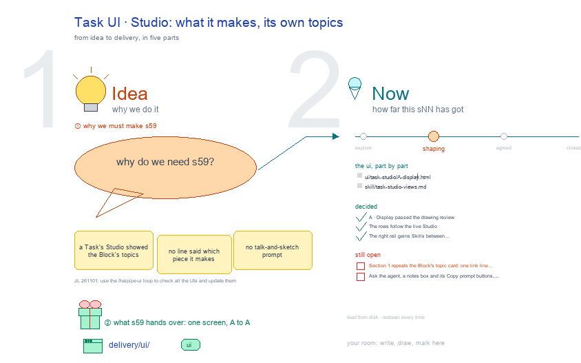

# s59 · Task UI: Studio <!-- root #de0e1a -->

**Tags:** `Task UI`
**Stage:** shaping

- For <!-- @for #f78806 -->
  - a deck, and the work Task's Studio … <!-- @for/0 #c4a984 -->
    a deck, and the work Task's Studio screen on the focus page (`delivery/ui/task-studio`), for the people who build the workbench
- Delivery type <!-- @delivery-type #58a44f -->
  - ui <!-- @delivery-type/0 #636117 -->
- Covers <!-- @covers #a6c44a -->
  - a Task's Studio: one view per group, … <!-- @covers/0 #4fcbe7 -->
    a Task's Studio: one view per group, its topics as flat rows as the live page draws them.
  - Red, kept proposals: This Task makes (its … <!-- @covers/1 #3d597d -->
    Red, kept proposals: This Task makes (its Block topic's card, large), ✍️ Ask the agent at the bottom.
  - No 🙋 Interaction here: a Studio has … <!-- @covers/2 #da2507 -->
    No 🙋 Interaction here: a Studio has none on the live page.
- Excluded <!-- @excluded #980495 -->
  - the other eight cells of the 3 … <!-- @excluded/0 #a5f0a1 -->
    the other eight cells of the 3 × 3 (j03's other sNN); what every work page shares (b17-s04).
- Topic <!-- @topic #7e13bd -->
  - A Task's Studio: its own topics; one … <!-- @topic/0 #311448 -->
    A Task's Studio: its own topics; one cell of the work theme's 3 × 3, the work Task × Studio (think) (JL 261031: "I think you should focus on the things like ... b16_theme_paper ... studio ...
  - UI and think about how you should … <!-- @topic/1 #bd6501 -->
    UI and think about how you should update the work_theme's workbench UI").
  - Its drawing is haipipe-studio's five parts, drawn … <!-- @topic/2 #fc914d -->
    Its drawing is haipipe-studio's five parts, drawn by `build_s59_task_ui_studio.py` through j03's `work_ui_cells.py`;
  - Its Design is its section's views, lettered … <!-- @topic/3 #7111ff -->
    Its Design is its section's views, lettered A, B …, each one full screen (haipipe-ui "one view, one screen"), every review round in `review/`.
- Feeds <!-- @feeds #ffe8e9 -->
  - none: a work Block keeps no Questions … <!-- @feeds/0 #bf8e2a -->
    none: a work Block keeps no Questions (JL 261031, r01 Q5)
- Files <!-- @files #6ce6c5 -->
  - [py] [build_s59_task_ui_studio.py](build_s59_task_ui_studio.py) <!-- @files/0 #4aa8b9 -->
  - delivery/ <!-- @files/1 #404761 -->
  - result/ <!-- @files/2 #d4a42c -->
  - review/ <!-- @files/3 #7928fb -->
  - [excalidraw] [s59-task-ui-studio.excalidraw](s59-task-ui-studio.excalidraw) <!-- @files/4 #732586 -->
  - [md] [s59-task-ui-studio.md](s59-task-ui-studio.md) <!-- @files/5 #9797f7 -->
  - [png] [s59-task-ui-studio.png](s59-task-ui-studio.png) <!-- @files/6 #9176b9 -->
    
- Decided <!-- @decided #55615a -->
  - s59-D01 · A · Display passed the … <!-- @decided/0 #b61bc5 -->
    s59-D01 · A · Display passed the drawing review (haipipe-ui Design loop, stage 1) in round 2, mean 8.9/10: `review/A-s1-r02.md` (round 1: `review/A-s1-r01.md`); today's page scored 7.6 and did not pass (`review/today-261101.md`). Proposed by the agent; it waits for JL's one look in `runs/r03_collect_task_studio_views` (261101).
  - s59-D02 · The rows follow the live … <!-- @decided/1 #b55883 -->
    s59-D02 · The rows follow the live Studio (redrawn 261105); the 🙋 Interactions helper leaves, since a Studio has no Interaction section on the live page. This Task makes and Ask the agent stay in red, as open proposals: no 261104 ask overruled them.
- Open <!-- @open #cf9b77 -->
  - Your one look: `../runs/r03_collect_task_studio_views` asks whether to … <!-- @open/0 #1c34ea -->
    Your one look: `../runs/r03_collect_task_studio_views` asks whether to build the red parts (This Task makes, Ask the agent), beside today's page.
  - Still open after the review (its reviewers' … <!-- @open/1 #27a61b -->
    Still open after the review (its reviewers' asks):
  - Section 1 repeats the Block's topic card; … <!-- @open/2 #c7302e -->
    Section 1 repeats the Block's topic card; one link line could do (r02 asks).
  - Ask the agent, a notes box and … <!-- @open/3 #6ef81a -->
    Ask the agent, a notes box and its Copy prompt buttons, at the bottom of a Task's Studio (red on the drawing).
  - The earlier questions, my picks now drawn … <!-- @open/4 #3051d5 -->
    The earlier questions, my picks now drawn in, are in `../runs/r03_collect_task_studio_views/passes/p01-1031/`; the full proposal is `result/views-proposal.md`; the 261101 screens' form is in `passes/p02-1101/`.
