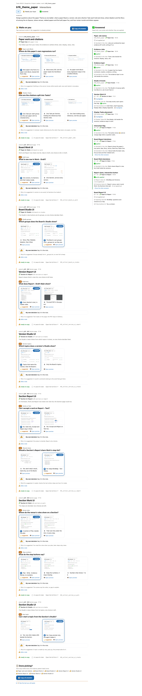
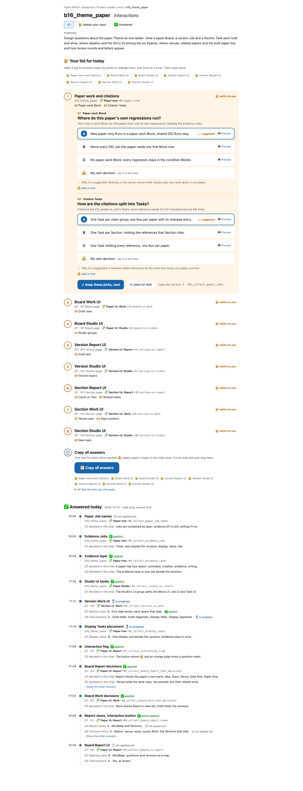

# Interactions page design

for: b17-s04:theme_work @ workbench_page_structure

Three designs for the Interactions page, each answering every waiting form on one page with one Copy. Real b16 items inside.

## Q1 · Page design

Today the page lists eight forms you open one by one. Each design below answers them all here, then copies once.

**Which design should the Interactions page use?**

- [ ] A · A questionnaire grouped by the page that asked; a fixed copy bar.
  [preview](option-q1-a.html)
- [ ] B · Two lanes, waits on you and answered; pick an option by its picture.
  [preview](option-q1-b.html)
- [x] C · A checklist: one form open at a time, keep or leave, then copy.
  [preview](option-q1-c.html)

Why C: One form at a time, and nothing is agreed by accident.

## Q2 · Option pictures

In B you pick an option by tapping its preview picture; in C a Preview button opens it.

**Should options show their preview pictures inline?**

- [x] A · Yes: B's pictures inside the chosen design.
  
- [ ] B · No: a Preview button opens each one.
  

Why A: You see the option itself, not only its name.
