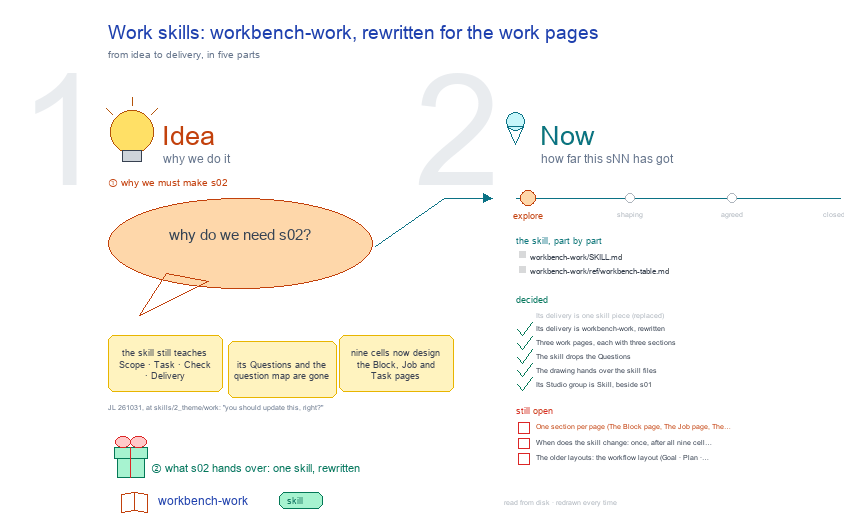

# s02 · work skills: workbench-work

workbench-work's SKILL.md and its ref, rewritten for the three work pages; each section comes from the cell or topic that designs it.

- [why] Today the skill teaches screens that are gone <!-- n01 -->
  → So what should it teach instead?
  - [today] It opens a Block on Scope · Task · Check · Delivery <!-- n02 -->
    `skills/2_theme/work/workbench-work/SKILL.md` 0.8.4: Open · Spaces and Views · RoadMap Draw · Continue with a session.
  - [gone] Its Questions and the question map leave: a work Block keeps none <!-- n03 -->
    s02-D04 and s51-D04 (JL 261031, r01_collect_report_and_delivery Q5: "we will not have the questions").
  - [ask] JL pointed at the work skills: update this one <!-- n04 -->
    JL 261031, at `skills/2_theme/work`: "you should update this, right?" (s02-D02).
- [idea] Three pages, each with Report, Work and Studio <!-- n05 -->
  → What does every page share, before its own sections?
  - [pages] A work Block, Job and Task each get one page <!-- n06 -->
    Designed by j03's nine cells s51 to s59, one per page and section (s02-D03).
  - [verbs] Report checks, Work does, Studio thinks <!-- n07 -->
  - [none] A Run and a Studio topic get no page of their own <!-- n08 -->
    A Run is a row on its Task's Work, opened in the pop-out; a topic is a card where it sits, opened by its tags (JL 261031: "run will not get its page, and also the studio will not has its own page as well").
- [first] What every page shares is written once <!-- n09 -->
  → Then what does each page show?
  - [open] A page opens at its folder, layout focus, one section <!-- n10 -->
    `/_board/workbench?path=<folder>&layout=focus&section=report|work|studio`; a Block opens on Report, a Job and a Task on Work (b17-s04, haipipe-ui).
  - [shared] Path, title-&-section, view buttons, goal-line, both rails <!-- n11 -->
    b17-s04 designs them and haipipe-ui names them; the skill only names them and points there.
  - [card] The sNN card and its six tags <!-- n12 -->
    From s51 and s53: picture, address, one word, one line; Slide · Draw · Mind map · Work · Delivery · Interaction.
- [Block] The Block page: three cells at j03 t01_block_page <!-- n13 -->
  → And one level down, the Job page?
  - [s51] Report: the MindMap, then a view per delivery type <!-- n14 -->
    Its form: `../j03_work_workbench_pages/t01_block_page/runs/r02_collect_block_report_views/`.
  - [s52] Work: what waits, each Job with its Tasks, its own Runs <!-- n15 -->
    Its form: `../j03_work_workbench_pages/t01_block_page/runs/r03_collect_block_work_views/`.
  - [s53] Studio: a button per group, cards by where they sit <!-- n16 -->
    Its form: `../j03_work_workbench_pages/t01_block_page/runs/r04_collect_block_studio_views/`.
- [Job] The Job page: three cells at j03 t02_job_page <!-- n17 -->
  → And at the bottom, the Task page?
  - [s54] Report: the MindMap, then its type: the delivery and its pieces <!-- n18 -->
    Its form: `../j03_work_workbench_pages/t02_job_page/runs/r01_collect_job_report_views/`.
  - [s55] Work: what waits, then a row per Task with its Runs <!-- n19 -->
    Its form: `../j03_work_workbench_pages/t02_job_page/runs/r02_collect_job_work_views/`.
  - [s56] Studio: what waits, what this Job makes, each Task's topics <!-- n20 -->
    Its form: `../j03_work_workbench_pages/t02_job_page/runs/r03_collect_job_studio_views/`.
- [Task] The Task page: three cells at j03 t03_task_page <!-- n21 -->
  → What closes the skill?
  - [s57] Report: the MindMap, then its type: a row per current Run <!-- n22 -->
    Its form: `../j03_work_workbench_pages/t03_task_page/runs/r01_collect_task_report_views/`.
  - [s58] Work: what waits, the Runs by role, Ask the agent <!-- n23 -->
    Its form: `../j03_work_workbench_pages/t03_task_page/runs/r02_collect_task_work_views/`.
  - [s59] Studio: what this Task makes, its topics, Ask the agent <!-- n24 -->
    Its form: `../j03_work_workbench_pages/t03_task_page/runs/r03_collect_task_studio_views/`.
- [last] What waits, the older layouts, the boundary, the ref <!-- n25 -->
  → What is still open?
  - [waits] What waits is orange and first; the state words are ⏳ ✅ ⬜ 🙋 ❗ <!-- n26 -->
    From s52, s55 and s58; JL 261029: no other status mark.
  - [older] The workflow layout and the classic page get a paragraph each <!-- n27 -->
    Goal · Plan · Execution · Results (LLMRec b01 and b02) and Scope · Task · Check · Delivery, until b17-s04's Phase C; Open 3.
  - [boundary] It only shows: focus_page.py is design_b02_workbench's <!-- n28 -->
  - [ref] ref/workbench-table.md: a row per page, section, view and Run type <!-- n29 -->
    table-workbench's eight columns; `render_workbench_table.py --check` names an agent or skill that does not exist.
- [open] Three questions for JL <!-- n30 -->
  - [?] One section per page, or one per section? <!-- n31 -->
    Leaning: one per page, as j03's three Tasks build them, the shared rules once before them.
  - [?] Page by page as the forms come back, or once after all nine? <!-- n32 -->
    Leaning: page by page; the first pass also takes out what is already decided gone.
  - [?] The older layouts: a paragraph each, or dropped now? <!-- n33 -->
    Leaning: a paragraph each, until the focus page is the default.
- [since] Before 261031, s02 asked where the work skills live <!-- n34 -->
  - [history] Which 1_base/task skills move to the work theme, and b04's move list <!-- n35 -->
    Set aside on 261031 (s02-D02); kept in `result/skill-homes-261031/` and `result/old-slides-261031/`.
- Files <!-- @files #6ce6c5 -->
  - [py] [build_s02_work_skills.py](build_s02_work_skills.py) <!-- @files/0 #22bd8e -->
  - delivery/ <!-- @files/1 #404761 -->
  - result/ <!-- @files/2 #d4a42c -->
  - [excalidraw] [s02-work-skills.excalidraw](s02-work-skills.excalidraw) <!-- @files/3 #209794 -->
  - [md] [s02-work-skills.ideas.md](s02-work-skills.ideas.md) <!-- @files/4 #8bef07 -->
  - [md] [s02-work-skills.md](s02-work-skills.md) <!-- @files/5 #552919 -->
  - [png] [s02-work-skills.png](s02-work-skills.png) <!-- @files/6 #aab0a3 -->
    
  - [html] [s02-work-skills.slides.html](s02-work-skills.slides.html) <!-- @files/7 #c4f230 -->
  - [json] [s02-work-skills.slides.json](s02-work-skills.slides.json) <!-- @files/8 #519274 -->
  - [pptx] [s02-work-skills.slides.pptx](s02-work-skills.slides.pptx) <!-- @files/9 #0eaf0b -->
