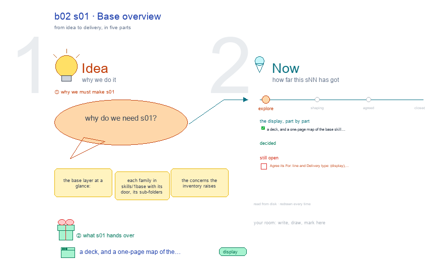

# b02 s01 · Base overview <!-- root #7c46f1 -->

**Stage:** explore

- For <!-- @for #f78806 -->
  - a deck, and a one-page map of … <!-- @for/0 #181bb4 -->
    a deck, and a one-page map of the base skill layer, its families, agents, tests and concerns, for the people who write the toolkit skills
- Delivery type <!-- @delivery-type #58a44f -->
  - display <!-- @delivery-type/0 #59b189 -->
- Topic <!-- @topic #7e13bd -->
  - the base layer at a glance: each … <!-- @topic/0 #eb36b7 -->
    the base layer at a glance: each family in `skills/1_base` with its door, its sub-folders and skills, where its agents are, its tests and the skills with no CHANGELOG; the concerns the inventory raises (red) and the four Questions, each with the drawing that answers it.
- Source <!-- @source #6da13a -->
  - read from disk every build (the skills … <!-- @source/0 #6b5510 -->
    read from disk every build (the skills tree, `../board.md`); drawn with b04's helpers (`../../b04_skill_folder/studio/_build/sketch.py`) through b03's canvas writer, so marks survive a rebuild.
- Feeds <!-- @feeds #ffe8e9 -->
  - all four reports; it is the map … <!-- @feeds/0 #bb99b4 -->
    all four reports; it is the map the other topics start from.
- Files <!-- @files #6ce6c5 -->
  - [py] [build_s01_base_overview.py](build_s01_base_overview.py) <!-- @files/0 #dad6a4 -->
  - delivery/ <!-- @files/1 #404761 -->
  - [excalidraw] [s01-base-overview.excalidraw](s01-base-overview.excalidraw) <!-- @files/2 #d286a8 -->
  - [md] [s01-base-overview.md](s01-base-overview.md) <!-- @files/3 #ba4275 -->
  - [png] [s01-base-overview.png](s01-base-overview.png) <!-- @files/4 #e133d9 -->
    
- The studio topics <!-- @the-studio-topics #9f639b -->
  - s01-base-overview: this drawing, the map <!-- @the-studio-topics/0 #bedb63 -->
  - s02-base-map (Q01): each base family x who … <!-- @the-studio-topics/1 #9b4c71 -->
    s02-base-map (Q01): each base family x who calls it (themes, other base families, servers).
  - s03-base-shape (Q02): one row per family: door, … <!-- @the-studio-topics/2 #b97f2a -->
    s03-base-shape (Q02): one row per family: door, ref/, cli/ or scripts/, agents, tests, CHANGELOG.
  - s04-not-base (Q03): each candidate that may not … <!-- @the-studio-topics/3 #8525b5 -->
    s04-not-base (Q03): each candidate that may not be base, with its proposed home.
  - s05-workbench-skills (Q04): page's three workbench skills beside … <!-- @the-studio-topics/4 #5a946e -->
    s05-workbench-skills (Q04): page's three workbench skills beside servers/workbench.
- Open <!-- @open #cf9b77 -->
  - Agree its **For:** line and **Delivery type:** … <!-- @open/0 #eb3bab -->
    Agree its **For:** line and **Delivery type:** (display), proposed by the agent 261030?
