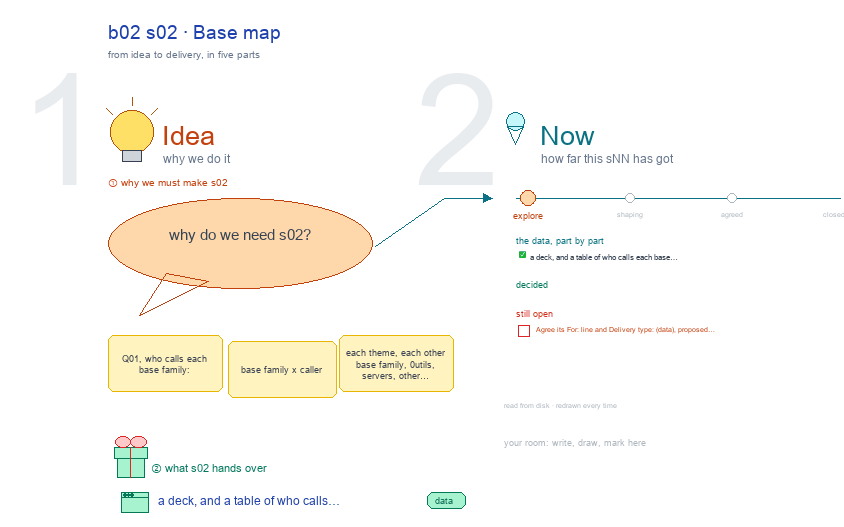

# b02 s02 · Base map <!-- root #67f70e -->

**Stage:** explore

- For <!-- @for #f78806 -->
  - a deck, and a table of who … <!-- @for/0 #9a483b -->
    a deck, and a table of who calls each base skill family, for the people who write the toolkit skills
- Delivery type <!-- @delivery-type #58a44f -->
  - data <!-- @delivery-type/0 #a17c9a -->
- Topic <!-- @topic #7e13bd -->
  - Q01, who calls each base family: base … <!-- @topic/0 #f1c3b1 -->
    Q01, who calls each base family: base family x caller (each theme, each other base family, 0_utils, servers, other plugins), theme x theme (should be empty), base skills named by only one theme, and base skills nobody outside their family names.
- Source <!-- @source #6da13a -->
  - read from disk every build by `callmap.py`, … <!-- @source/0 #f462d2 -->
    read from disk every build by `callmap.py`, an index of which files name which skill (`name`, /name, "name", skill: name, or a whole hyphenated name; history left out).
  - Drawn with b04's helpers through b03's canvas … <!-- @source/1 #00c3d0 -->
    Drawn with b04's helpers through b03's canvas writer, so marks survive a rebuild.
- Feeds <!-- @feeds #ffe8e9 -->
  - `../reports/q01_base_map/` (answer drafted), and Q03's candidates <!-- @feeds/0 #fa3023 -->
- Files <!-- @files #6ce6c5 -->
  - [py] [build_s02_base_map.py](build_s02_base_map.py) <!-- @files/0 #c86832 -->
  - [py] [callmap.py](callmap.py) <!-- @files/1 #febe48 -->
  - delivery/ <!-- @files/2 #404761 -->
  - [excalidraw] [s02-base-map.excalidraw](s02-base-map.excalidraw) <!-- @files/3 #15abf9 -->
  - [md] [s02-base-map.md](s02-base-map.md) <!-- @files/4 #44ddea -->
  - [png] [s02-base-map.png](s02-base-map.png) <!-- @files/5 #192ae1 -->
    
- Open <!-- @open #cf9b77 -->
  - Agree its **For:** line and **Delivery type:** … <!-- @open/0 #2c67d5 -->
    Agree its **For:** line and **Delivery type:** (data), proposed by the agent 261030?
