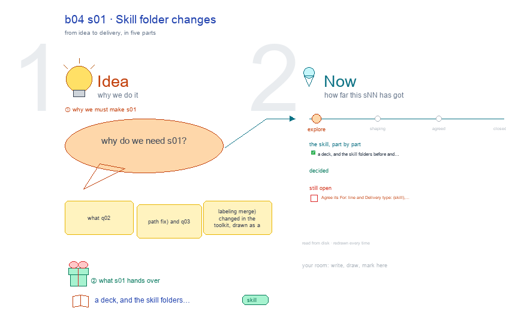

# b04 s01 · Skill folder changes <!-- root #c21b6c -->

**Stage:** explore

- For <!-- @for #f78806 -->
  - a deck, and the skill folders before … <!-- @for/0 #9dff9e -->
    a deck, and the skill folders before and after the path fix and the labeling merge, for the people who write the toolkit skills
- Delivery type <!-- @delivery-type #58a44f -->
  - skill <!-- @delivery-type/0 #34b33e -->
- Topic <!-- @topic #7e13bd -->
  - what q02 (path fix) and q03 (labeling … <!-- @topic/0 #78279e -->
    what q02 (path fix) and q03 (labeling merge) changed in the toolkit, drawn as a results scratch: the folders before and after, who moved what, the kinds of broken path and their fix, the checks, and the open choices per question.
- Source <!-- @source #6da13a -->
  - every fact is read when the builder … <!-- @source/0 #4fb110 -->
    every fact is read when the builder runs. "Before" is `git ls-tree` of Tools HEAD; "now" is the disk (layers, families and their SKILL.md counts, server folders); the check lines are the Checks sections of `../reports/q02_path_fix/` and `../reports/q03_merge_subjective_label/`; the question rows come from `../board.md`.
- Feeds <!-- @feeds #ffe8e9 -->
  - `reports/` q02_path_fix · q03_merge_subjective_label (and q01_skill_layers' choices) <!-- @feeds/0 #165e1c -->
- Files <!-- @files #6ce6c5 -->
  - [py] [build_s01_skill_folder_changes.py](build_s01_skill_folder_changes.py) <!-- @files/0 #ab119c -->
  - delivery/ <!-- @files/1 #404761 -->
  - [excalidraw] [s01-skill-folder-changes.excalidraw](s01-skill-folder-changes.excalidraw) <!-- @files/2 #2720ec -->
  - [md] [s01-skill-folder-changes.md](s01-skill-folder-changes.md) <!-- @files/3 #06cc2a -->
  - [png] [s01-skill-folder-changes.png](s01-skill-folder-changes.png) <!-- @files/4 #c5355b -->
    
- Other topics <!-- @other-topics #d7c4b5 -->
  - s02-skill-layers: q01's layers, how servers pair with … <!-- @other-topics/0 #e4a001 -->
    s02-skill-layers: q01's layers, how servers pair with them, and its three open choices.
  - s03-path-lookup: how code finds a skill now, … <!-- @other-topics/1 #d9c930 -->
    s03-path-lookup: how code finds a skill now, and what the next move must fix again.
  - s04-theme-shape: whether every theme folder has the … <!-- @other-topics/2 #c1526a -->
    s04-theme-shape: whether every theme folder has the same shape.
  - The work theme's skills are asked in … <!-- @other-topics/3 #f1dfa5 -->
    The work theme's skills are asked in b17 (`../../b17_theme_work/s02-work-skills/`).
  - Rebuild every drawing: `../_build/make.sh` <!-- @other-topics/4 #b96b6d -->
- Open <!-- @open #cf9b77 -->
  - Agree its **For:** line and **Delivery type:** … <!-- @open/0 #09a2ba -->
    Agree its **For:** line and **Delivery type:** (skill), proposed by the agent 261030?
