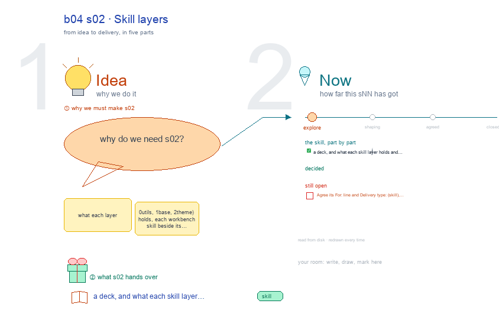

# b04 s02 · Skill layers <!-- root #e0780a -->

**Stage:** explore

- For <!-- @for #f78806 -->
  - a deck, and what each skill layer … <!-- @for/0 #489457 -->
    a deck, and what each skill layer holds and each workbench skill beside its server, for the people who write the toolkit skills
- Delivery type <!-- @delivery-type #58a44f -->
  - skill <!-- @delivery-type/0 #34b33e -->
- Topic <!-- @topic #7e13bd -->
  - what each layer (0_utils, 1_base, 2_theme) holds, … <!-- @topic/0 #e69b29 -->
    what each layer (0_utils, 1_base, 2_theme) holds, each workbench skill beside its server, and q01's three open choices.
- Source <!-- @source #6da13a -->
  - read from disk every build: each layer's … <!-- @source/0 #fb837b -->
    read from disk every build: each layer's families and skills, the workbench-* skills and their server folders, folder names that occur twice.
  - Concerns and open questions are red text <!-- @source/1 #67bb30 -->
  - JL's choices are pink notes <!-- @source/2 #8e6884 -->
  - Drawn with `../_build/sketch.py` through b03's canvas writer, … <!-- @source/3 #30dd41 -->
    Drawn with `../_build/sketch.py` through b03's canvas writer, so marks survive a rebuild.
- Feeds <!-- @feeds #ffe8e9 -->
  - `../reports/q01_skill_layers/` <!-- @feeds/0 #4785b9 -->
- Files <!-- @files #6ce6c5 -->
  - [py] [build_s02_skill_layers.py](build_s02_skill_layers.py) <!-- @files/0 #04ab61 -->
  - delivery/ <!-- @files/1 #404761 -->
  - [excalidraw] [s02-skill-layers.excalidraw](s02-skill-layers.excalidraw) <!-- @files/2 #853bc4 -->
  - [md] [s02-skill-layers.md](s02-skill-layers.md) <!-- @files/3 #a0bb65 -->
  - [png] [s02-skill-layers.png](s02-skill-layers.png) <!-- @files/4 #81fa41 -->
    
- Open <!-- @open #cf9b77 -->
  - Agree its **For:** line and **Delivery type:** … <!-- @open/0 #09a2ba -->
    Agree its **For:** line and **Delivery type:** (skill), proposed by the agent 261030?
