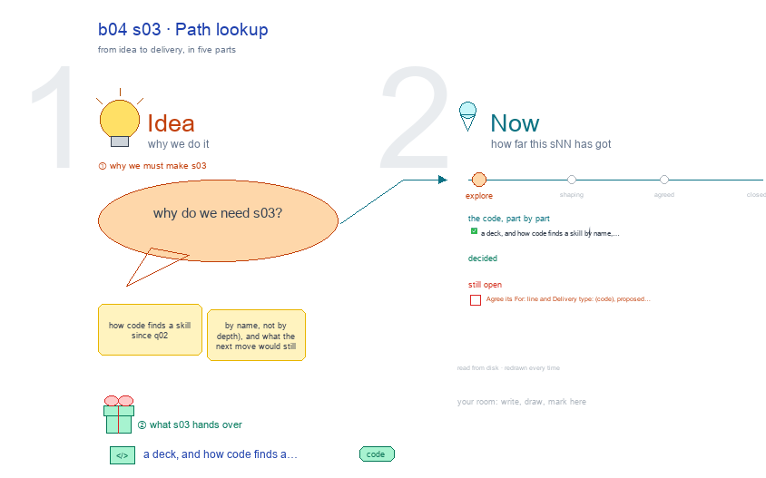

# b04 s03 · Path lookup <!-- root #42c91d -->

**Stage:** explore

- For <!-- @for #f78806 -->
  - a deck, and how code finds a … <!-- @for/0 #8993c3 -->
    a deck, and how code finds a skill by name, not by folder depth, for the people who write the toolkit skills
- Delivery type <!-- @delivery-type #58a44f -->
  - code <!-- @delivery-type/0 #e6fb06 -->
- Topic <!-- @topic #7e13bd -->
  - how code finds a skill since q02 … <!-- @topic/0 #757ef7 -->
    how code finds a skill since q02 (by name, not by depth), and what the next move would still have to fix.
- Source <!-- @source #6da13a -->
  - counted from disk every build: lookups in … <!-- @source/0 #f1d61b -->
    counted from disk every build: lookups in use, literal layer paths in code and Markdown, Pages with an old-form structure-source, exported delivery scripts, moved paths git does not know yet, the venue submodule's name and path.
  - Concerns and open questions are red text <!-- @source/1 #67bb30 -->
  - JL's choices are pink notes <!-- @source/2 #8e6884 -->
  - Drawn with `../_build/sketch.py` through b03's canvas writer, … <!-- @source/3 #30dd41 -->
    Drawn with `../_build/sketch.py` through b03's canvas writer, so marks survive a rebuild.
- Feeds <!-- @feeds #ffe8e9 -->
  - `../reports/q02_path_fix/` <!-- @feeds/0 #7b60ea -->
- Files <!-- @files #6ce6c5 -->
  - [py] [build_s03_path_lookup.py](build_s03_path_lookup.py) <!-- @files/0 #43ee9a -->
  - delivery/ <!-- @files/1 #404761 -->
  - [excalidraw] [s03-path-lookup.excalidraw](s03-path-lookup.excalidraw) <!-- @files/2 #26acca -->
  - [md] [s03-path-lookup.md](s03-path-lookup.md) <!-- @files/3 #aac1f8 -->
  - [png] [s03-path-lookup.png](s03-path-lookup.png) <!-- @files/4 #740153 -->
    
- Open <!-- @open #cf9b77 -->
  - Agree its **For:** line and **Delivery type:** … <!-- @open/0 #173eaa -->
    Agree its **For:** line and **Delivery type:** (code), proposed by the agent 261030?
