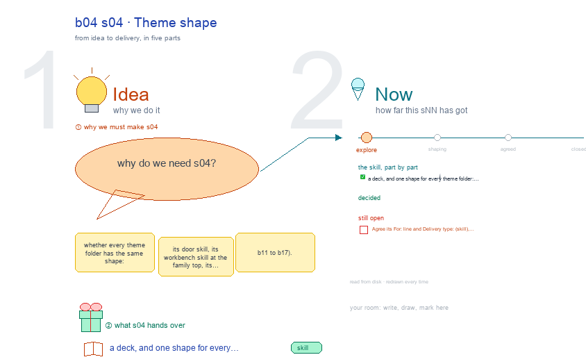

# b04 s04 · Theme shape <!-- root #fbdd82 -->

**Stage:** explore

- For <!-- @for #f78806 -->
  - a deck, and one shape for every … <!-- @for/0 #26f54e -->
    a deck, and one shape for every theme folder: door skill, workbench skill, server, agents, for the people who write the toolkit skills
- Delivery type <!-- @delivery-type #58a44f -->
  - skill <!-- @delivery-type/0 #34b33e -->
- Topic <!-- @topic #7e13bd -->
  - whether every theme folder has the same … <!-- @topic/0 #4507f7 -->
    whether every theme folder has the same shape: its door skill, its workbench skill at the family top, its server, its agents, its design Block (b11 to b17).
- Source <!-- @source #6da13a -->
  - read from disk every build, one row … <!-- @source/0 #338f24 -->
    read from disk every build, one row per theme in skills/2_theme; work's row reads 1_base/task while 2_theme/work is empty.
  - Concerns and open questions are red text <!-- @source/1 #67bb30 -->
  - JL's choices are pink notes <!-- @source/2 #8e6884 -->
  - Drawn with `../_build/sketch.py` through b03's canvas writer, … <!-- @source/3 #30dd41 -->
    Drawn with `../_build/sketch.py` through b03's canvas writer, so marks survive a rebuild.
- Feeds <!-- @feeds #ffe8e9 -->
  - a proposed b04 question, "Is every theme … <!-- @feeds/0 #780da1 -->
    a proposed b04 question, "Is every theme folder the same shape?" (not opened yet), and q03.
- Files <!-- @files #6ce6c5 -->
  - [py] [build_s04_theme_shape.py](build_s04_theme_shape.py) <!-- @files/0 #85e794 -->
  - delivery/ <!-- @files/1 #404761 -->
  - [excalidraw] [s04-theme-shape.excalidraw](s04-theme-shape.excalidraw) <!-- @files/2 #d47482 -->
  - [md] [s04-theme-shape.md](s04-theme-shape.md) <!-- @files/3 #c51e00 -->
  - [png] [s04-theme-shape.png](s04-theme-shape.png) <!-- @files/4 #a2c98c -->
    
- Open <!-- @open #cf9b77 -->
  - Agree its **For:** line and **Delivery type:** … <!-- @open/0 #09a2ba -->
    Agree its **For:** line and **Delivery type:** (skill), proposed by the agent 261030?
