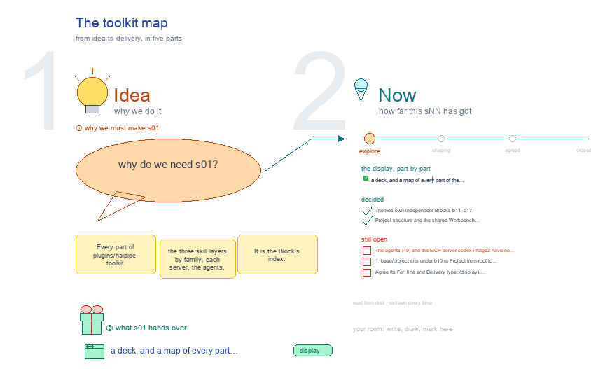

# s01 · The toolkit map <!-- root #6d3116 -->

**Stage:** explore

- For <!-- @for #f78806 -->
  - a deck, and a map of every … <!-- @for/0 #51a79a -->
    a deck, and a map of every part of the toolkit plugin with its size and owning Block, for the people who write the toolkit skills
- Delivery type <!-- @delivery-type #58a44f -->
  - display <!-- @delivery-type/0 #59b189 -->
- Topic <!-- @topic #7e13bd -->
  - Every part of `plugins/haipipe-toolkit` (the three skill … <!-- @topic/0 #c67b95 -->
    Every part of `plugins/haipipe-toolkit` (the three skill layers by family, each server, the agents, the MCP server) with its size, and the shared Job or independent Theme Block that owns its design questions.
  - It is the Block's index: when a … <!-- @topic/1 #647020 -->
    It is the Block's index: when a part has no blueprint owner, the map shows it in red.
  - Counted from disk on every rebuild (261009) <!-- @topic/2 #38bcac -->
- Feeds <!-- @feeds #ffe8e9 -->
  - `reports/` q01_blueprints_organized <!-- @feeds/0 #1918b8 -->
- Files <!-- @files #6ce6c5 -->
  - [py] [build_s01_toolkit_map.py](build_s01_toolkit_map.py) <!-- @files/0 #99af0d -->
  - delivery/ <!-- @files/1 #404761 -->
  - [excalidraw] [s01-toolkit-map.excalidraw](s01-toolkit-map.excalidraw) <!-- @files/2 #3e98ce -->
  - [md] [s01-toolkit-map.md](s01-toolkit-map.md) <!-- @files/3 #3ce4d8 -->
  - [png] [s01-toolkit-map.png](s01-toolkit-map.png) <!-- @files/4 #034e6f -->
    
- Decided <!-- @decided #55615a -->
  - s01-D01 · Themes own independent Blocks b11–b17; … <!-- @decided/0 #7c03fc -->
    s01-D01 · Themes own independent Blocks b11–b17; b01 keeps shared foundation Jobs (261010).
  - s01-D02 · Project structure and the shared … <!-- @decided/1 #49ca8f -->
    s01-D02 · Project structure and the shared Workbench move from j03 to independent b10; the map links their new owner (261010).
- Open <!-- @open #cf9b77 -->
  - The agents (19) and the MCP server … <!-- @open/0 #2b177f -->
    The agents (19) and the MCP server codex-image2 have no blueprint owner: give agents to their theme's Block, or a Job of their own?
  - 1_base/project sits under b10 (a Project from … <!-- @open/1 #dd4d84 -->
    1_base/project sits under b10 (a Project from root to Run) and the other 1_base families under j02: keep that split?
  - Agree its **For:** line and **Delivery type:** … <!-- @open/2 #eb3bab -->
    Agree its **For:** line and **Delivery type:** (display), proposed by the agent 261030?
