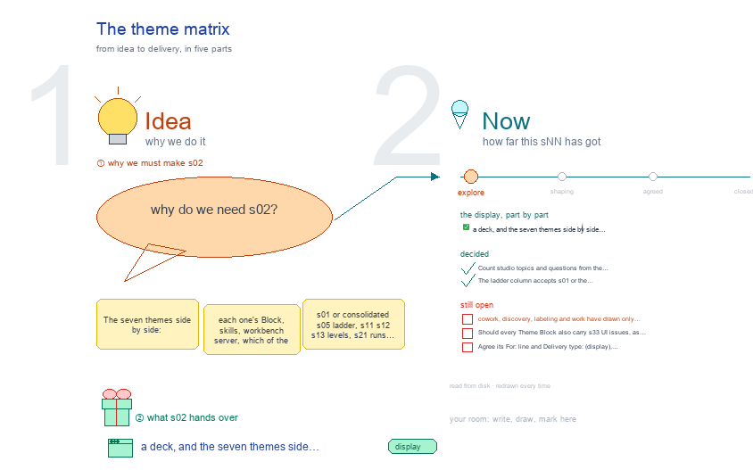

# s02 · The theme matrix <!-- root #763f26 -->

**Stage:** explore

- For <!-- @for #f78806 -->
  - a deck, and the seven themes side … <!-- @for/0 #c940d2 -->
    a deck, and the seven themes side by side with their skills, servers and drawn topics, for the people who write the toolkit skills
- Delivery type <!-- @delivery-type #58a44f -->
  - display <!-- @delivery-type/0 #59b189 -->
- Topic <!-- @topic #7e13bd -->
  - The seven themes side by side: each … <!-- @topic/0 #72f9be -->
    The seven themes side by side: each one's Block, skills, workbench server, which of the shared studio topics its Block has drawn (s01 or consolidated s05 ladder, s11 s12 s13 levels, s21 runs and skills, s31 Guide, s32 element UI, s33 UI issues), and its question count.
  - It is the evidence for Q02: where … <!-- @topic/1 #52f8a3 -->
    It is the evidence for Q02: where the themes drift is where a topic is missing (261009).
- Feeds <!-- @feeds #ffe8e9 -->
  - `reports/` q02_one_ladder <!-- @feeds/0 #9f65eb -->
- Files <!-- @files #6ce6c5 -->
  - [py] [build_s02_theme_matrix.py](build_s02_theme_matrix.py) <!-- @files/0 #416a23 -->
  - delivery/ <!-- @files/1 #404761 -->
  - [excalidraw] [s02-theme-matrix.excalidraw](s02-theme-matrix.excalidraw) <!-- @files/2 #ee23f2 -->
  - [md] [s02-theme-matrix.md](s02-theme-matrix.md) <!-- @files/3 #5a739c -->
  - [png] [s02-theme-matrix.png](s02-theme-matrix.png) <!-- @files/4 #b8839b -->
    
- Decided <!-- @decided #55615a -->
  - s02-D01 · Count studio topics and questions … <!-- @decided/0 #d493c1 -->
    s02-D01 · Count studio topics and questions from the peer Theme Blocks b11–b17 (261010).
  - s02-D02 · The ladder column accepts s01 … <!-- @decided/1 #60136e -->
    s02-D02 · The ladder column accepts s01 or the consolidated s05; Paper retired s01–s04 into its archive (261010).
- Open <!-- @open #cf9b77 -->
  - cowork, discovery, labeling and work have drawn … <!-- @open/0 #c624ce -->
    cowork, discovery, labeling and work have drawn only s01 and s32 (work also s03): draw their levels (s11 to s13) and runs (s21) next, or is a lighter theme allowed fewer topics?
  - Should every Theme Block also carry s33 … <!-- @open/1 #83a991 -->
    Should every Theme Block also carry s33 UI issues, as insight, design and paper do?
  - Agree its **For:** line and **Delivery type:** … <!-- @open/2 #eb3bab -->
    Agree its **For:** line and **Delivery type:** (display), proposed by the agent 261030?
