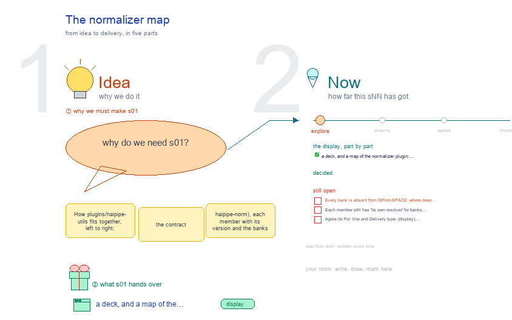

# s01 · The normalizer map <!-- root #b485f9 -->

**Stage:** explore

- For <!-- @for #f78806 -->
  - a deck, and a map of the … <!-- @for/0 #a9878c -->
    a deck, and a map of the normalizer plugin: its contract, members, banks and API lane, for the people who maintain it
- Delivery type <!-- @delivery-type #58a44f -->
  - display <!-- @delivery-type/0 #59b189 -->
- Topic <!-- @topic #7e13bd -->
  - How `plugins/haipipe-utils` fits together, left to right: … <!-- @topic/0 #588053 -->
    How `plugins/haipipe-utils` fits together, left to right: the contract (haipipe-norm), each member with its version and the banks it resolves against, the API lane that serves it, and the Job of b02 that owns it; describe-medication's DrugKey feeds describe-insulin.
  - A bank this SPACE's ExternalStore does not … <!-- @topic/1 #63b588 -->
    A bank this SPACE's ExternalStore does not hold is red, which today is every bank (261009).
- Feeds <!-- @feeds #ffe8e9 -->
  - `reports/` q01_package_description <!-- @feeds/0 #193b05 -->
- Files <!-- @files #6ce6c5 -->
  - [py] [build_s01_norm_map.py](build_s01_norm_map.py) <!-- @files/0 #d20e5e -->
  - delivery/ <!-- @files/1 #404761 -->
  - [excalidraw] [s01-norm-map.excalidraw](s01-norm-map.excalidraw) <!-- @files/2 #84a8a0 -->
  - [md] [s01-norm-map.md](s01-norm-map.md) <!-- @files/3 #9f70d2 -->
  - [png] [s01-norm-map.png](s01-norm-map.png) <!-- @files/4 #25ddd1 -->
    
- Decided <!-- @decided #55615a -->
  - (none yet: a decision is one line, … <!-- @decided/0 #11353b -->
    (none yet: a decision is one line, s01-D01 · <what was decided> (<who> <date>))
- Open <!-- @open #cf9b77 -->
  - Every bank is absent from DrFirst-SPACE: where … <!-- @open/0 #c0450c -->
    Every bank is absent from DrFirst-SPACE: where does each live (j07_banks)?
  - Each member still has 'its own resolver' … <!-- @open/1 #2169ca -->
    Each member still has 'its own resolver' for banks; does it move onto haipipe-norm's paths.py (j01_norm_contract)?
  - Agree its **For:** line and **Delivery type:** … <!-- @open/2 #eb3bab -->
    Agree its **For:** line and **Delivery type:** (display), proposed by the agent 261030?
