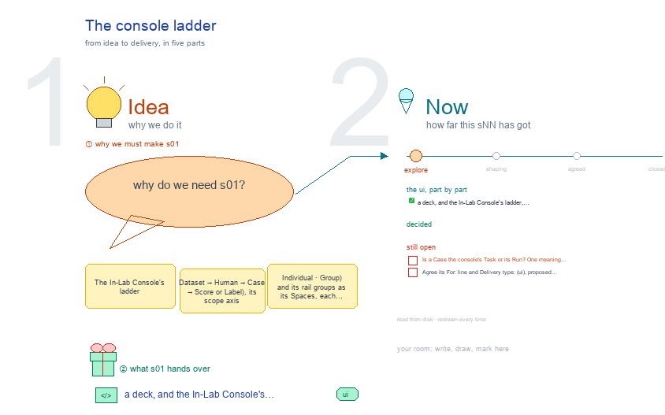

# s01 · The console ladder <!-- root #cc59c3 -->

**Stage:** explore

- For <!-- @for #f78806 -->
  - a deck, and the In-Lab Console's ladder, … <!-- @for/0 #0281f7 -->
    a deck, and the In-Lab Console's ladder, scope axis and rail groups beside the toolkit workbench, for the people who build the console
- Delivery type <!-- @delivery-type #58a44f -->
  - ui <!-- @delivery-type/0 #636117 -->
- Topic <!-- @topic #7e13bd -->
  - The In-Lab Console's ladder (Dataset → Human … <!-- @topic/0 #df862f -->
    The In-Lab Console's ladder (Dataset → Human → Case → Score or Label), its scope axis (Individual · Group) and its rail groups as its Spaces, each read against the toolkit workbench's counterpart; views read from `web/src/views.ts` (261009, g01).
- Feeds <!-- @feeds #ffe8e9 -->
  - `reports/` q01_console_vs_toolkit <!-- @feeds/0 #e4fe4a -->
- Files <!-- @files #6ce6c5 -->
  - [py] [build_s01_console_ladder.py](build_s01_console_ladder.py) <!-- @files/0 #9f3680 -->
  - delivery/ <!-- @files/1 #404761 -->
  - [excalidraw] [s01-console-ladder.excalidraw](s01-console-ladder.excalidraw) <!-- @files/2 #027871 -->
  - [md] [s01-console-ladder.md](s01-console-ladder.md) <!-- @files/3 #d032a5 -->
  - [png] [s01-console-ladder.png](s01-console-ladder.png) <!-- @files/4 #71b282 -->
    
- Decided <!-- @decided #55615a -->
  - (none yet: a decision is one line, … <!-- @decided/0 #11353b -->
    (none yet: a decision is one line, s01-D01 · <what was decided> (<who> <date>))
- Open <!-- @open #cf9b77 -->
  - Is a Case the console's Task or … <!-- @open/0 #9781f8 -->
    Is a Case the console's Task or its Run? One meaning would let both ladders share screens (Q04).
  - Agree its **For:** line and **Delivery type:** … <!-- @open/1 #7b11a4 -->
    Agree its **For:** line and **Delivery type:** (ui), proposed by the agent 261030?
