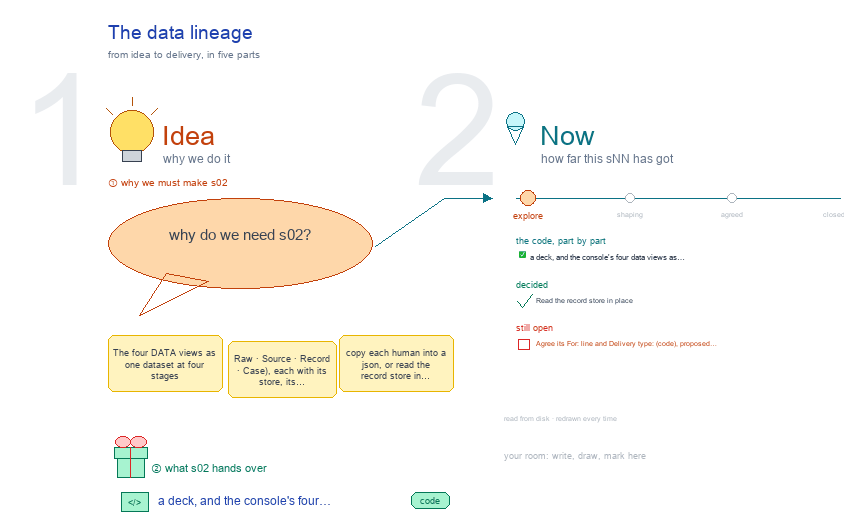

# s02 · The data lineage <!-- root #f430e6 -->

**Stage:** explore

- For <!-- @for #f78806 -->
  - a deck, and the console's four data … <!-- @for/0 #7a8fdd -->
    a deck, and the console's four data views as one dataset at four stages, and the wiring choice, for the people who build the console
- Delivery type <!-- @delivery-type #58a44f -->
  - code <!-- @delivery-type/0 #e6fb06 -->
- Topic <!-- @topic #7e13bd -->
  - The four DATA views as one dataset … <!-- @topic/0 #e98017 -->
    The four DATA views as one dataset at four stages (Raw · Source · Record · Case), each with its store, its transform and its route, and the fork of `diagram/09-workspace-wiring.txt` (copy each human into a json, or read the record store in place), drawn open in g01 and decided in g02: read in place (261009).
- Feeds <!-- @feeds #ffe8e9 -->
  - `reports/` q02_copy_or_read <!-- @feeds/0 #4b0db5 -->
- Files <!-- @files #6ce6c5 -->
  - [py] [build_s02_data_lineage.py](build_s02_data_lineage.py) <!-- @files/0 #6ba721 -->
  - delivery/ <!-- @files/1 #404761 -->
  - passes/ <!-- @files/2 #49b302 -->
  - [excalidraw] [s02-data-lineage.excalidraw](s02-data-lineage.excalidraw) <!-- @files/3 #140a6a -->
  - [md] [s02-data-lineage.md](s02-data-lineage.md) <!-- @files/4 #152f8e -->
  - [png] [s02-data-lineage.png](s02-data-lineage.png) <!-- @files/5 #b9ecdf -->
    
- Decided <!-- @decided #55615a -->
  - s02-D01 · Read the record store in … <!-- @decided/0 #bb204b -->
    s02-D01 · Read the record store in place; the json copy is the fallback where none is mounted (Q02, g02 261009)
- Open <!-- @open #cf9b77 -->
  - Agree its **For:** line and **Delivery type:** … <!-- @open/0 #173eaa -->
    Agree its **For:** line and **Delivery type:** (code), proposed by the agent 261030?
  - (none: the fork is decided; a real … <!-- @open/1 #67a1af -->
    (none: the fork is decided; a real record set behind the data boundary is j05's)
