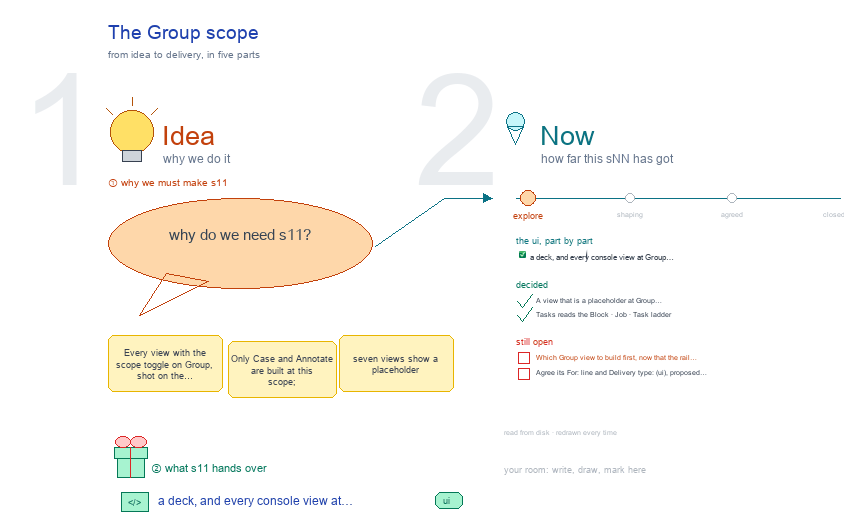

# s11 · The Group scope <!-- root #ef8223 -->

**Stage:** explore

- For <!-- @for #f78806 -->
  - a deck, and every console view at … <!-- @for/0 #2b53be -->
    a deck, and every console view at Group scope, with what each reads on disk, for the people who build the console
- Delivery type <!-- @delivery-type #58a44f -->
  - ui <!-- @delivery-type/0 #636117 -->
- Topic <!-- @topic #7e13bd -->
  - Every view with the scope toggle on … <!-- @topic/0 #5c2d0a -->
    Every view with the scope toggle on Group, shot on the synthetic fixtures, with what each reads on disk.
  - Only Case and Annotate are built at … <!-- @topic/1 #a151fc -->
    Only Case and Annotate are built at this scope; seven views show a placeholder (261009, g01).
- Feeds <!-- @feeds #ffe8e9 -->
  - `reports/` q05_placeholder_views <!-- @feeds/0 #6ce608 -->
- Files <!-- @files #6ce6c5 -->
  - [py] [build_s11_group_scope.py](build_s11_group_scope.py) <!-- @files/0 #e2e67c -->
  - delivery/ <!-- @files/1 #404761 -->
  - passes/ <!-- @files/2 #49b302 -->
  - [excalidraw] [s11-group-scope.excalidraw](s11-group-scope.excalidraw) <!-- @files/3 #8b3864 -->
  - [md] [s11-group-scope.md](s11-group-scope.md) <!-- @files/4 #6cf13c -->
  - [png] [s11-group-scope.png](s11-group-scope.png) <!-- @files/5 #799286 -->
    
  - shots/ <!-- @files/6 #4d5052 -->
- Decided <!-- @decided #55615a -->
  - s11-D01 · A view that is a … <!-- @decided/0 #32bd90 -->
    s11-D01 · A view that is a placeholder at Group leaves the Group rail; seven are hidden (Q05, g02 261009)
  - s11-D02 · Tasks reads the Block · … <!-- @decided/1 #cb2102 -->
    s11-D02 · Tasks reads the Block · Job · Task ladder (Q03, g02 261009)
- Open <!-- @open #cf9b77 -->
  - Which Group view to build first, now … <!-- @open/0 #7ca8f6 -->
    Which Group view to build first, now that the rail shows only built ones (Q05 Next).
  - Agree its **For:** line and **Delivery type:** … <!-- @open/1 #7b11a4 -->
    Agree its **For:** line and **Delivery type:** (ui), proposed by the agent 261030?
