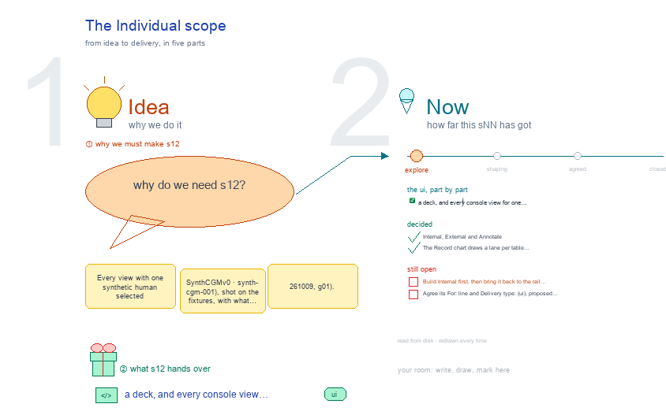

# s12 · The Individual scope <!-- root #cb1ecb -->

**Stage:** explore

- For <!-- @for #f78806 -->
  - a deck, and every console view for … <!-- @for/0 #72e4fd -->
    a deck, and every console view for one synthetic human, with its route and files, for the people who build the console
- Delivery type <!-- @delivery-type #58a44f -->
  - ui <!-- @delivery-type/0 #636117 -->
- Topic <!-- @topic #7e13bd -->
  - Every view with one synthetic human selected … <!-- @topic/0 #48de44 -->
    Every view with one synthetic human selected (SynthCGM_v0 · synth-cgm-001), shot on the fixtures, with what each reads on disk and the route that serves it (261009, g01).
- Feeds <!-- @feeds #ffe8e9 -->
  - `reports/` q01_console_vs_toolkit <!-- @feeds/0 #e4fe4a -->
- Files <!-- @files #6ce6c5 -->
  - [py] [build_s12_individual_scope.py](build_s12_individual_scope.py) <!-- @files/0 #88a702 -->
  - delivery/ <!-- @files/1 #404761 -->
  - passes/ <!-- @files/2 #49b302 -->
  - [excalidraw] [s12-individual-scope.excalidraw](s12-individual-scope.excalidraw) <!-- @files/3 #3acda2 -->
  - [md] [s12-individual-scope.md](s12-individual-scope.md) <!-- @files/4 #d614de -->
  - [png] [s12-individual-scope.png](s12-individual-scope.png) <!-- @files/5 #367809 -->
    
  - shots/ <!-- @files/6 #4d5052 -->
- Decided <!-- @decided #55615a -->
  - s12-D01 · Internal, External and Annotate (placeholders … <!-- @decided/0 #b2d3ff -->
    s12-D01 · Internal, External and Annotate (placeholders at Individual) leave the Individual rail (Q05, g02 261009)
  - s12-D02 · The Record chart draws a … <!-- @decided/1 #9098ec -->
    s12-D02 · The Record chart draws a lane per table with a time column, naming no table (g02 261009)
- Open <!-- @open #cf9b77 -->
  - Build Internal first, then bring it back … <!-- @open/0 #9fef35 -->
    Build Internal first, then bring it back to the rail (Q05 Next).
  - Agree its **For:** line and **Delivery type:** … <!-- @open/1 #7b11a4 -->
    Agree its **For:** line and **Delivery type:** (ui), proposed by the agent 261030?
