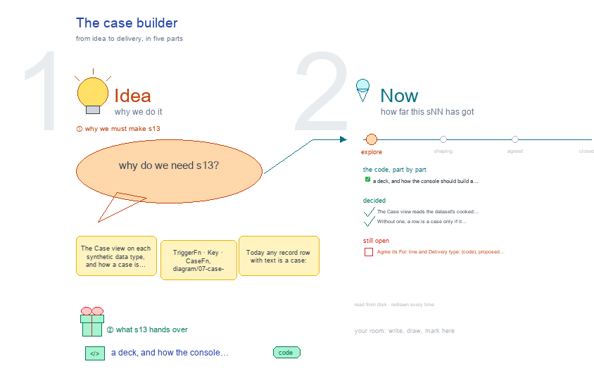

# s13 · The case builder <!-- root #dc4754 -->

**Stage:** explore

- For <!-- @for #f78806 -->
  - a deck, and how the console should … <!-- @for/0 #736ff5 -->
    a deck, and how the console should build a case from a trigger, a key and a case function, for the people who build the console
- Delivery type <!-- @delivery-type #58a44f -->
  - code <!-- @delivery-type/0 #e6fb06 -->
- Topic <!-- @topic #7e13bd -->
  - The Case view on each synthetic data … <!-- @topic/0 #f0b1bc -->
    The Case view on each synthetic data type, and how a case is meant to be built (TriggerFn · Key · CaseFn, `diagram/07-case-builder.txt`).
  - Today any record row with text is … <!-- @topic/1 #11a475 -->
    Today any record row with text is a case: on a timeline that is every reading (261009, g01).
- Feeds <!-- @feeds #ffe8e9 -->
  - `reports/` q01_console_vs_toolkit <!-- @feeds/0 #e4fe4a -->
- Files <!-- @files #6ce6c5 -->
  - [py] [build_s13_case_builder.py](build_s13_case_builder.py) <!-- @files/0 #7b8433 -->
  - delivery/ <!-- @files/1 #404761 -->
  - passes/ <!-- @files/2 #49b302 -->
  - [excalidraw] [s13-case-builder.excalidraw](s13-case-builder.excalidraw) <!-- @files/3 #2a328f -->
  - [md] [s13-case-builder.md](s13-case-builder.md) <!-- @files/4 #cd3323 -->
  - [png] [s13-case-builder.png](s13-case-builder.png) <!-- @files/5 #104e63 -->
    
  - shots/ <!-- @files/6 #4d5052 -->
- Decided <!-- @decided #55615a -->
  - s13-D01 · The Case view reads the … <!-- @decided/0 #17a6a4 -->
    s13-D01 · The Case view reads the dataset's cooked case set (3-CaseStore) when one is mounted (Q02, g02 261009)
  - s13-D02 · Without one, a row is … <!-- @decided/1 #4aa401 -->
    s13-D02 · Without one, a row is a case only if it holds prose; a timeline has no cases until cooked (g02 261009)
- Open <!-- @open #cf9b77 -->
  - Agree its **For:** line and **Delivery type:** … <!-- @open/0 #173eaa -->
    Agree its **For:** line and **Delivery type:** (code), proposed by the agent 261030?
  - (none: both are decided; which TriggerFn cuts … <!-- @open/1 #3a4c56 -->
    (none: both are decided; which TriggerFn cuts a dataset's cases is its Case stage's)
