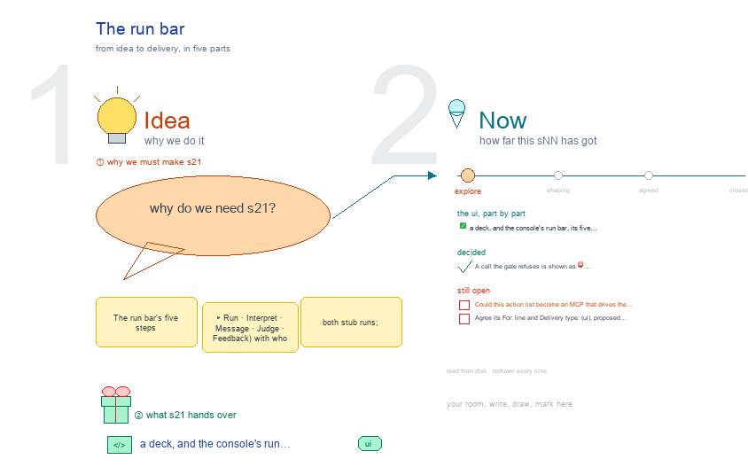

# s21 · The run bar <!-- root #9cb56f -->

**Stage:** explore

- For <!-- @for #f78806 -->
  - a deck, and the console's run bar, … <!-- @for/0 #492136 -->
    a deck, and the console's run bar, its five steps and the chat tools behind it, for the people who build the console
- Delivery type <!-- @delivery-type #58a44f -->
  - ui <!-- @delivery-type/0 #636117 -->
- Topic <!-- @topic #7e13bd -->
  - The run bar's five steps (▶ Run … <!-- @topic/0 #337000 -->
    The run bar's five steps (▶ Run · Interpret · Message · Judge · Feedback) with who does each and its route; both stub runs; and every HaiChat tool with the ConsoleAction it dispatches and its gate, read from `haichat_api.py` (261009, g01).
- Feeds <!-- @feeds #ffe8e9 -->
  - `reports/` q01_console_vs_toolkit <!-- @feeds/0 #e4fe4a -->
- Files <!-- @files #6ce6c5 -->
  - [py] [build_s21_run_bar.py](build_s21_run_bar.py) <!-- @files/0 #70926a -->
  - delivery/ <!-- @files/1 #404761 -->
  - passes/ <!-- @files/2 #49b302 -->
  - [excalidraw] [s21-run-bar.excalidraw](s21-run-bar.excalidraw) <!-- @files/3 #6d01de -->
  - [md] [s21-run-bar.md](s21-run-bar.md) <!-- @files/4 #b4c733 -->
  - [png] [s21-run-bar.png](s21-run-bar.png) <!-- @files/5 #668fd1 -->
    
  - shots/ <!-- @files/6 #4d5052 -->
- Decided <!-- @decided #55615a -->
  - s21-D01 · A call the gate refuses … <!-- @decided/0 #14108d -->
    s21-D01 · A call the gate refuses is shown as ⛔ refused in the drawer, with the gate's reason (g02 261009)
- Open <!-- @open #cf9b77 -->
  - Could this action list become an MCP … <!-- @open/0 #893ead -->
    Could this action list become an MCP that drives the toolkit's workbench (j04 Q02, b01 j05_chat Q02)?
  - Agree its **For:** line and **Delivery type:** … <!-- @open/1 #7b11a4 -->
    Agree its **For:** line and **Delivery type:** (ui), proposed by the agent 261030?
