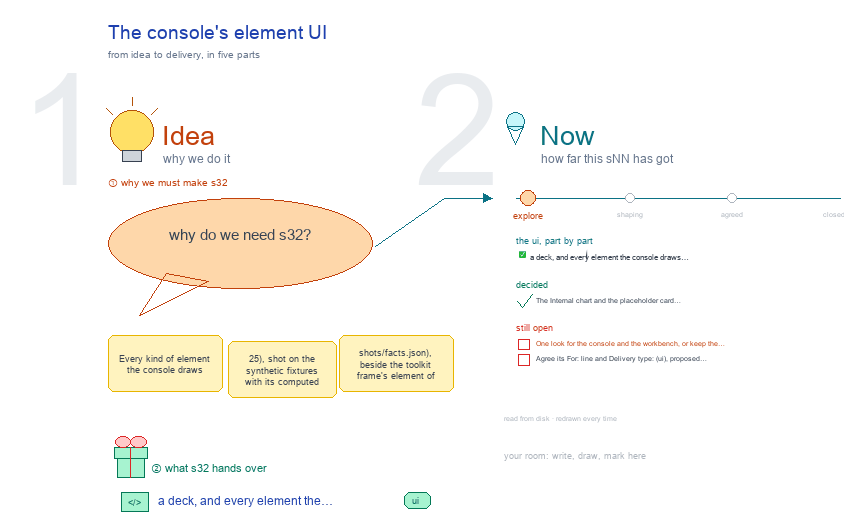

# s32 · The console's element UI <!-- root #3756d7 -->

**Stage:** explore

- For <!-- @for #f78806 -->
  - a deck, and every element the console … <!-- @for/0 #7db26b -->
    a deck, and every element the console draws beside the toolkit's version, so one look is picked, for the people who build the console
- Delivery type <!-- @delivery-type #58a44f -->
  - ui <!-- @delivery-type/0 #636117 -->
- Topic <!-- @topic #7e13bd -->
  - Every kind of element the console draws … <!-- @topic/0 #6461ee -->
    Every kind of element the console draws (25), shot on the synthetic fixtures with its computed style (`shots/facts.json`), beside the toolkit frame's element of the same kind where there is one (from b01 j03 s32's shots), so one look can be judged (261009, g01).
- Feeds <!-- @feeds #ffe8e9 -->
  - `reports/` q04_one_look <!-- @feeds/0 #eecb53 -->
- Files <!-- @files #6ce6c5 -->
  - [py] [build_s32_console_element_ui.py](build_s32_console_element_ui.py) <!-- @files/0 #3735ab -->
  - delivery/ <!-- @files/1 #404761 -->
  - passes/ <!-- @files/2 #49b302 -->
  - [excalidraw] [s32-console-element-ui.excalidraw](s32-console-element-ui.excalidraw) <!-- @files/3 #2c1e34 -->
  - [md] [s32-console-element-ui.md](s32-console-element-ui.md) <!-- @files/4 #c0f919 -->
  - [png] [s32-console-element-ui.png](s32-console-element-ui.png) <!-- @files/5 #f3a58e -->
    
  - shots/ <!-- @files/6 #4d5052 -->
- Decided <!-- @decided #55615a -->
  - s32-D01 · The Internal chart and the … <!-- @decided/0 #a6f3d6 -->
    s32-D01 · The Internal chart and the placeholder card left the gallery: their views are hidden (Q05, g02 261009)
- Open <!-- @open #cf9b77 -->
  - One look for the console and the … <!-- @open/0 #826214 -->
    One look for the console and the workbench, or keep the console's Databricks/Mattermost themes (Q04)?
  - Agree its **For:** line and **Delivery type:** … <!-- @open/1 #7b11a4 -->
    Agree its **For:** line and **Delivery type:** (ui), proposed by the agent 261030?
