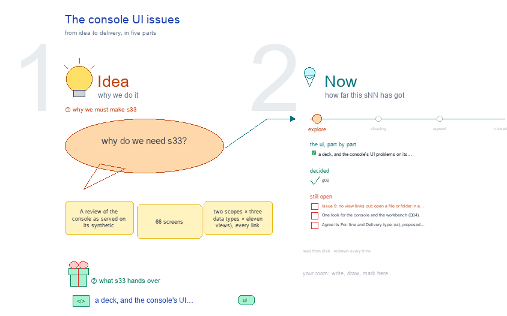

# s33 · The console UI issues <!-- root #c1efb2 -->

**Stage:** explore

- For <!-- @for #f78806 -->
  - a deck, and the console's UI problems … <!-- @for/0 #c26894 -->
    a deck, and the console's UI problems on its synthetic fixtures, ranked worst first, for the people who build the console
- Delivery type <!-- @delivery-type #58a44f -->
  - ui <!-- @delivery-type/0 #636117 -->
- Topic <!-- @topic #7e13bd -->
  - A review of the console as served … <!-- @topic/0 #f76277 -->
    A review of the console as served on its synthetic fixtures: 66 screens (two scopes × three data types × eleven views), every link and request, ranked worst first (where · what is wrong · what it should be · evidence · owner), then what works (261009, g01).
- Feeds <!-- @feeds #ffe8e9 -->
  - `reports/` q01_console_vs_toolkit <!-- @feeds/0 #e4fe4a -->
- Files <!-- @files #6ce6c5 -->
  - [py] [build_s33_console_ui_issue.py](build_s33_console_ui_issue.py) <!-- @files/0 #0938f6 -->
  - delivery/ <!-- @files/1 #404761 -->
  - passes/ <!-- @files/2 #49b302 -->
  - [excalidraw] [s33-console-ui-issue.excalidraw](s33-console-ui-issue.excalidraw) <!-- @files/3 #fd5289 -->
  - [md] [s33-console-ui-issue.md](s33-console-ui-issue.md) <!-- @files/4 #070eed -->
  - [png] [s33-console-ui-issue.png](s33-console-ui-issue.png) <!-- @files/5 #6531be -->
    
- Decided <!-- @decided #55615a -->
  - s33-D01 · g02 (261009) fixed issues 1-5, … <!-- @decided/0 #aef475 -->
    s33-D01 · g02 (261009) fixed issues 1-5, 7, 8, 10-12 and decided 6 (Q05); each row says how
- Open <!-- @open #cf9b77 -->
  - Issue 9: no view links out; open … <!-- @open/0 #c71ef8 -->
    Issue 9: no view links out; open a file or folder in a read-only pop-out.
  - One look for the console and the … <!-- @open/1 #bb11a2 -->
    One look for the console and the workbench (Q04).
  - Agree its **For:** line and **Delivery type:** … <!-- @open/2 #7b11a4 -->
    Agree its **For:** line and **Delivery type:** (ui), proposed by the agent 261030?
