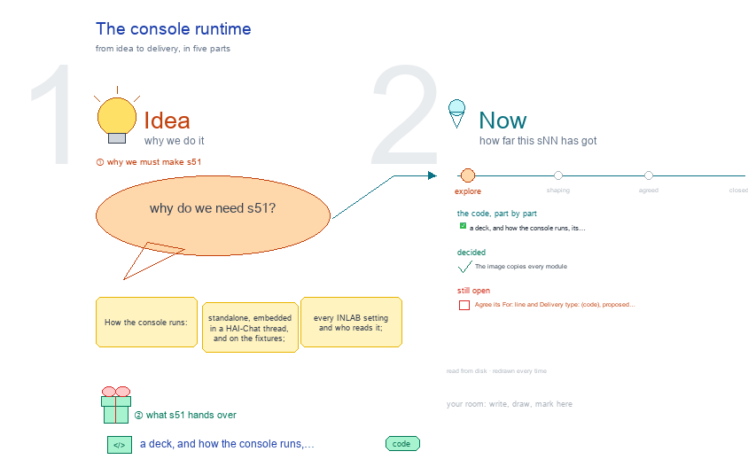

# s51 · The console runtime <!-- root #c85806 -->

**Stage:** explore

- For <!-- @for #f78806 -->
  - a deck, and how the console runs, … <!-- @for/0 #8d1556 -->
    a deck, and how the console runs, its settings, and the routers its image is missing, for the people who build the console
- Delivery type <!-- @delivery-type #58a44f -->
  - code <!-- @delivery-type/0 #e6fb06 -->
- Topic <!-- @topic #7e13bd -->
  - How the console runs: standalone, embedded in … <!-- @topic/0 #549cdf -->
    How the console runs: standalone, embedded in a HAI-Chat thread, and on the fixtures; every INLAB_* setting and who reads it; and the image's contents checked against what `main.py` imports (four routers missing) (261009, g01).
- Feeds <!-- @feeds #ffe8e9 -->
  - `reports/` q01_console_vs_toolkit <!-- @feeds/0 #e4fe4a -->
- Files <!-- @files #6ce6c5 -->
  - [py] [build_s51_console_runtime.py](build_s51_console_runtime.py) <!-- @files/0 #f91559 -->
  - delivery/ <!-- @files/1 #404761 -->
  - passes/ <!-- @files/2 #49b302 -->
  - [excalidraw] [s51-console-runtime.excalidraw](s51-console-runtime.excalidraw) <!-- @files/3 #499cda -->
  - [md] [s51-console-runtime.md](s51-console-runtime.md) <!-- @files/4 #c598c4 -->
  - [png] [s51-console-runtime.png](s51-console-runtime.png) <!-- @files/5 #75a4c8 -->
    
- Decided <!-- @decided #55615a -->
  - s51-D01 · The image copies every module … <!-- @decided/0 #884e64 -->
    s51-D01 · The image copies every module (COPY *.py) and personas/; built and run on the fixtures (g02 261009)
- Open <!-- @open #cf9b77 -->
  - Agree its **For:** line and **Delivery type:** … <!-- @open/0 #173eaa -->
    Agree its **For:** line and **Delivery type:** (code), proposed by the agent 261030?
  - (none: the image starts; on this network … <!-- @open/1 #f6def1 -->
    (none: the image starts; on this network pip needed a trusted package index to build)
