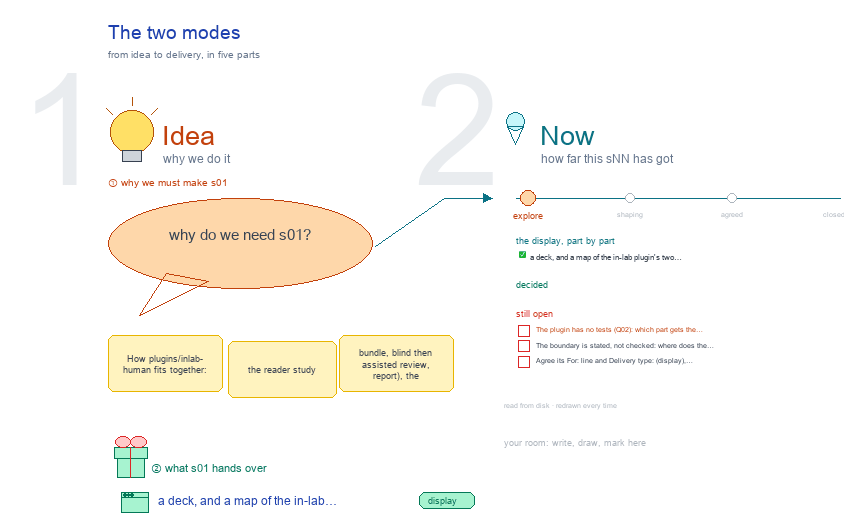

# s01 · The two modes <!-- root #bd41ea -->

**Stage:** explore

- For <!-- @for #f78806 -->
  - a deck, and a map of the … <!-- @for/0 #9cecb8 -->
    a deck, and a map of the in-lab plugin's two modes, reader study and clinician console, for the people who maintain it
- Delivery type <!-- @delivery-type #58a44f -->
  - display <!-- @delivery-type/0 #59b189 -->
- Topic <!-- @topic #7e13bd -->
  - How `plugins/inlab-human` fits together: the reader study … <!-- @topic/0 #7bcb73 -->
    How `plugins/inlab-human` fits together: the reader study (bundle, blind then assisted review, report), the clinician console (its routers and the agent drawer), the endpoint-predict tool both use, and the de-identification boundary in front of them, each with the Job of b03 that owns it.
  - Read from code and docs only; no … <!-- @topic/1 #74fd61 -->
    Read from code and docs only; no case data (261009).
- Feeds <!-- @feeds #ffe8e9 -->
  - `reports/` q01_ownership <!-- @feeds/0 #78d111 -->
- Files <!-- @files #6ce6c5 -->
  - [py] [build_s01_two_modes_map.py](build_s01_two_modes_map.py) <!-- @files/0 #aca676 -->
  - delivery/ <!-- @files/1 #404761 -->
  - [excalidraw] [s01-two-modes-map.excalidraw](s01-two-modes-map.excalidraw) <!-- @files/2 #94a013 -->
  - [md] [s01-two-modes-map.md](s01-two-modes-map.md) <!-- @files/3 #1b852d -->
  - [png] [s01-two-modes-map.png](s01-two-modes-map.png) <!-- @files/4 #42ec01 -->
    
- Decided <!-- @decided #55615a -->
  - (none yet: a decision is one line, … <!-- @decided/0 #11353b -->
    (none yet: a decision is one line, s01-D01 · <what was decided> (<who> <date>))
- Open <!-- @open #cf9b77 -->
  - The plugin has no tests (Q02): which … <!-- @open/0 #ea5ff6 -->
    The plugin has no tests (Q02): which part gets the first suite?
  - The boundary is stated, not checked: where … <!-- @open/1 #6a437f -->
    The boundary is stated, not checked: where does the check run (j05_data_boundary)?
  - Agree its **For:** line and **Delivery type:** … <!-- @open/2 #eb3bab -->
    Agree its **For:** line and **Delivery type:** (display), proposed by the agent 261030?
