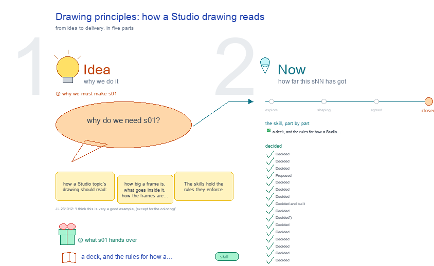

# s01 · Drawing principles: how a Studio drawing reads <!-- root #088128 -->

**Stage:** closed

- For <!-- @for #f78806 -->
  - a deck, and the rules for how … <!-- @for/0 #61e854 -->
    a deck, and the rules for how a Studio drawing reads: frame size, contents, layout, shapes, for the people who write the toolkit skills
- Delivery type <!-- @delivery-type #58a44f -->
  - skill <!-- @delivery-type/0 #34b33e -->
- Topic <!-- @topic #7e13bd -->
  - how a Studio topic's drawing should read: … <!-- @topic/0 #6229f2 -->
    how a Studio topic's drawing should read: how big a frame is, what goes inside it, how the frames are arranged, and which shapes belong to which kind of drawing.
  - The skills hold the rules they enforce … <!-- @topic/1 #0d1e80 -->
    The skills hold the rules they enforce (haipipe-studio "The look", `canvas.py`; excalidraw-report); this topic is where the principles are agreed first, then carried into those skills.
- Feeds <!-- @feeds #ffe8e9 -->
  - none yet <!-- @feeds/0 #02942c -->
- The Excalidraw principles <!-- @the-excalidraw-principles #6a870f -->
  - The skill `excalidraw-studio` holds them; frame ① … <!-- @the-excalidraw-principles/0 #8e26a7 -->
    The skill `excalidraw-studio` holds them; frame ① of the drawing shows them, title and summary in big words, and an open point in red. The words are each branch's `title` and `summary` in the `mindmap:` block below; its `leaves` are the detail, kept here and not drawn (⑦).
- Files <!-- @files #6ce6c5 -->
  - [py] [build_s01_drawing_principles.py](build_s01_drawing_principles.py) <!-- @files/0 #a17b66 -->
  - delivery/ <!-- @files/1 #404761 -->
  - examples/ <!-- @files/2 #edc712 -->
  - history/ <!-- @files/3 #9a00ab -->
  - passes/ <!-- @files/4 #49b302 -->
  - [excalidraw] [s01-drawing-principles.excalidraw](s01-drawing-principles.excalidraw) <!-- @files/5 #eecfd7 -->
  - [md] [s01-drawing-principles.md](s01-drawing-principles.md) <!-- @files/6 #834a21 -->
  - [png] [s01-drawing-principles.png](s01-drawing-principles.png) <!-- @files/7 #832cba -->
    
- What the drawing holds <!-- @what-the-drawing-holds #e0b05d -->
  - Five frames in two acts, each act … <!-- @what-the-drawing-holds/0 #f455df -->
    Five frames in two acts, each act a row named at the left, as b10 s52 does (JL 261012: "I love the act things here as well, we can do it as well"); a named arrow for each step. Each frame is as large as one screen, its key point marked with one slight colour (⑤); in its top right corner, a text frame's density (⑥) or a map's words (⑦).
  - ① 📐 the Excalidraw principles: the first … <!-- @what-the-drawing-holds/1 #17771f -->
    ① 📐 the Excalidraw principles: the first frame; "The Excalidraw principles" in the centre (the key point), the nine asked for in bold and the two standing rules around it, six on the left and five on the right, each its title (46 px) and its one-line summary (32 px), an open point in red (28 px); no small detail (⑦). ② 🔁 the checks: seven stages, each check a short line with the principle it guards and who checks it (canvas.py or check.py, read live, or a person); the loop back to the builder. What each check caught stays in the face. ③ 🧪 four drawings from 261012: b10 s05's tree pass and b10 s05 restored (both drawn as s07, since merged into s05), b10 s52 (the one to copy, highlighted), each checked against the principles; then b10 s51 before and after. ④ 🧰 the skill folders: excalidraw-studio (the key point) and haipipe-studio, the four excalidraw skills, folder trees read from disk. ⑤ 🗂️ s00, a Block's background and index: the one drawing with its own shape; what it reads, what it draws, and what it proposes, new topics (sNN) and new Jobs (jNN), until a person ticks them; b31's own proposals read live.
  - Rebuild: `python build_s01_drawing_principles.py`, then `render_png.py` for the … <!-- @what-the-drawing-holds/2 #b7f45c -->
    Rebuild: `python build_s01_drawing_principles.py`, then `render_png.py` for the preview.
- The principles (the mind map, ①) <!-- @the-principles-the-mind-map #65a06b -->
  - JL's words (261012): "the principle is that … <!-- @the-principles-the-mind-map/0 #a4f84d -->
    JL's words (261012): "the principle is that one frame should be as large as possible, wihtin the frame, we want the workflow map or the mindmap, the frames should be well arrange to form the narrative. These are the principles. No more folder tree for the non folder items."
- Checking a drawing (the workflow, ②) <!-- @checking-a-drawing-the-workflow #fca504 -->
  - Each check names the principle it guards … <!-- @checking-a-drawing-the-workflow/0 #e595be -->
    Each check names the principle it guards and who checks it: a `canvas.py` function (the drawing reads whether it exists, live), a person, or nobody yet (red); the drawing groups them by `stage`, in order.
- The skill folders that hold them (④) <!-- @the-skill-folders-that-hold-them #6d8a97 -->
  - Real folders, so they are drawn as … <!-- @the-skill-folders-that-hold-them/0 #5763e7 -->
    Real folders, so they are drawn as folder trees (principle ④); each tree is read from disk on every build. `holds` says which principles or checks live in that skill.
- s00, a Block's index, and what it proposes (⑤) <!-- @s00-a-block-s-index-and-what-it-proposes #f2ebfd -->
  - Asked 261012: "I think we should have … <!-- @s00-a-block-s-index-and-what-it-proposes/0 #a1e691 -->
    Asked 261012: "I think we should have a new frame for the s00-overview for it as well. s00 should also work in a way for the proposing the sNN and jNN as well." s00 is drawn by haipipe-studio's `block_index.py` from the Block on disk and from its face's yaml (`background`, `index`, `studio_plan`, `studio_proposals`, and, asked for here, `job_proposals`); this frame shows that path and b31's own proposals, read from its s00 face.
- Four drawings from 261012 (③) <!-- @four-drawings-from-261012 #1b2c8d -->
  - Kept in `examples/` as they were that … <!-- @four-drawings-from-261012/0 #0c808d -->
    Kept in `examples/` as they were that day; the verdicts are this topic's reading, one line per principle. The ⑥ lines of s51 and s52, and a green line on what changed since, are read from check.py on their drawings on every build.
  - JL 261012, on b10 s52-host-and-share: "I think … <!-- @four-drawings-from-261012/1 #c9381d -->
    JL 261012, on b10 s52-host-and-share: "I think this is very a good example, (except for the coloring)". Read here as: copy its acts (rows of frames named at the left), one idea a frame sized to what it holds, a mind map or a numbered workflow inside, boxes with an emoji title, a why line and short leaves, named arrows between boxes and between frames, open points red in place. Its colouring is the one thing not to copy: all black, so no frame marks its key point (principle ⑤); if JL meant something else by "the coloring", correct this line. Measured: its six frames hold 74 to 102 words per million px, under the 120 floor, and still read well, because the arrows and boxes carry the meaning: so ⑥'s floor depends on the kind of frame (Open 6).
  - JL 261012, on s51's four frames: "I … <!-- @four-drawings-from-261012/2 #be61e4 -->
    JL 261012, on s51's four frames: "I feel the frame here is of low information density and too many frame? Or it should be good enough, as each frame to be one specific topic." Measured: 69, 87, 69 and 75 words per million px, all under the floor of 120 (922 words in all). Four topics, one a frame, is right (③); the frames are too thin (⑥): 922 words fill about two screens. Two ways out: merge ① and ② (one host, one request: the same path, 525 words, 142 per million px) and ③ with ④ (397 words, 107, plus the route table it dropped); or keep four and put back the facts the 10:03 version held (each Workbench's routes, the Handler's mixins, the Guide by level).
  - Since, the same day: ⑥'s floor became … <!-- @four-drawings-from-261012/3 #b524db -->
    Since, the same day: ⑥'s floor became the floor of a frame's kind (a map frame 70, Open 6), so both pass it; and both were redrawn by their own session with a key point in each frame (s52-D16, s51 "Redrawn 261012"). The verdicts above stay that day's reading; the green line under each says what check.py finds today (s01-D16).
- Decided <!-- @decided #55615a -->
  - s01-D01 · Decided (JL 261012): the four … <!-- @decided/0 #be3c8f -->
    s01-D01 · Decided (JL 261012): the four principles above. A frame is as large as it can be and dense; inside it, a workflow map or a mind map; the frames arranged into one narrative; a folder tree only for real folders and files.
  - s01-D02 · Decided (JL 261012: "I just … <!-- @decided/1 #29be75 -->
    s01-D02 · Decided (JL 261012: "I just mean for the s00 to have the tree, why you make all the others to be the tree as well"): the tree, boxes and emoji shape is s00's alone; the five b10 topics redrawn in it today (s03, s05, s06, s21, and s07, since merged into s05) were restored the same day.
  - s01-D03 · Decided (JL 261012, on b10 … <!-- @decided/2 #b6c4c5 -->
    s01-D03 · Decided (JL 261012, on b10 s05, then s07: "if we want to show the indicator, we can use the red box to circle them and give --> text to explain them, I don't want it to be mislead the UI design"): a screen inside a drawing shows only the screen's own colours; what is proposed, guessed or missing is a red box with a red → note.
  - s01-D04 · Proposed (261012): s01's own drawing … <!-- @decided/3 #a67fc0 -->
    s01-D04 · Proposed (261012): s01's own drawing is four screen-sized frames read left to right, a mind map, a workflow map, the checked examples and the skill folders, so it shows the principles as well as stating them.
  - s01-D05 · Decided (JL 261012: "another principle … <!-- @decided/4 #c6692b -->
    s01-D05 · Decided (JL 261012: "another principle to to use the good font size and slight color to highlight the key point, what even I zoom out, I can see the logics"): principle ⑤, big words for the structure (titles, arrows) and one slight colour for each frame's key point; red stays open, green a change.
  - s01-D06 · Decided (JL 261012: "gurantee which … <!-- @decided/5 #8cc321 -->
    s01-D06 · Decided (JL 261012: "gurantee which frame's information density"): principle ⑥, each frame's density is measured on every build, words per million px, and shown beside the frame; a thin frame is merged.
  - s01-D07 · Decided (JL 261012: "add a … <!-- @decided/6 #9b17cd -->
    s01-D07 · Decided (JL 261012: "add a frame to b31-s01 about what are the skill folder for it"): frame ④, the skill folders that hold the principles, read from disk.
  - s01-D08 · Decided and built (JL 261012: … <!-- @decided/7 #ed2a37 -->
    s01-D08 · Decided and built (JL 261012: "should we also have a excalidraw-studio?", then "Please go ahead and do it"): yes; built as `skills/1_base/excalidraw/excalidraw-studio/` 0.1.0 (SKILL.md, scripts/draw.py, a test), and haipipe-studio's "The look" now points to it (haipipe-studio 0.13.7). A skill `excalidraw-studio` beside excalidraw-report, -slide, -read and -section, owning how a Studio topic's drawing looks: these principles as its SKILL.md, the patterns (mind map, workflow of stages, screen, checked examples, folder tree for folders, the density badge, the key-point colour, the layout by the story), and one set of drawing helpers every builder imports. haipipe-studio keeps the topic: folder, face, numbering, sessions and the writer that keeps a person's marks (`canvas.write`). Why: today the look is split across haipipe-studio's "The look", excalidraw-report's scratch mode and `canvas.py`, every builder keeps its own helpers, and a rule written for s00 reached every topic (261012) because it lived in the skill that owns topics.
  - s01-D09 · Decided (JL 261012: "we should … <!-- @decided/8 #a57979 -->
    s01-D09 · Decided (JL 261012: "we should not put all the frames just always from left to right? it needs a better arrangement"): frames are laid out by the story's shape, a row, a grid or a branch, with a named arrow for each step between them; principle ③ says so. s01's own: two by two, ① → ② → ③, ① → ④.
  - s01-D11 · Decided (JL 261012: "I think … <!-- @decided/9 #eeab61 -->
    s01-D11 · Decided (JL 261012: "I think this is very a good example, (except for the coloring)"): b10 s52-host-and-share is the drawing to copy (acts, one idea a frame, maps with named arrows); its colouring is not. Principle ③ gains acts; ⑥ measures a map frame apart from a text frame.
  - s01-D12 · Decided (JL 261012: "where is … <!-- @decided/10 #3b225d -->
    s01-D12 · Decided (JL 261012: "where is the mind map frame for us to list all the principles summarized in the text?"): each branch of the mind map (①) carries a one-line `summary`, drawn large under its title, so the eight summaries around the centre read as the principles in text, even zoomed out; the details stay small.
  - s01-D13 · Decided (JL 261012: "I love … <!-- @decided/11 #0880cf -->
    s01-D13 · Decided (JL 261012: "I love the act things here as well, we can do it as well"): s01's frames are grouped into acts, a row each, the act named at the left (the `acts:` block); principle ③ says so.
  - s01-D14 · Decided (JL 261012: "I think … <!-- @decided/12 #2c6197 -->
    s01-D14 · Decided (JL 261012: "I think we should have a new frame for the s00-overview for it as well. s00 should also work in a way for the proposing the sNN and jNN as well"): frame ⑤ shows s00, the one drawing with its own shape: what `block_index.py` reads, what it draws, and what it proposes, topics (sNN, through `studio_proposals`, drawn today) and Jobs (jNN, through `job_proposals`, drawn since haipipe-studio 0.13.8), red and dashed until a person ticks them. b31's own s00 face proposes both.
  - s01-D15 · Decided (JL 261012: "for the … <!-- @decided/13 #da2fbf -->
    s01-D15 · Decided (JL 261012: "for the s01, I asked so many times, where is the frame for showing the excalidarw principles????"): frame ① is "The Excalidraw principles", first and top left: each principle's title and summary in big words around one centre, details small; the same list heads this face. Before, it was titled "The principles: a Studio drawing reads as one story", its principles boxed among small details, unreadable zoomed out.
  - s01-D16 · Decided (asked 261012: "could you … <!-- @decided/14 #a033cb -->
    s01-D16 · Decided (asked 261012: "could you message the sessions b10-s05 s00 s51-s52-server-share to make them to follow the drawing principles"): after the three sessions redrew, frame ③'s s51 and s52 lines read check.py on every build: ⑥ against the floor of each frame's kind (s51's line said "under the text floor of 120", wrong for map frames), and a green line on what changed since. The pictures and the other verdicts stay that day's.
  - s01-D17 · Decided (asked 261012, on frame … <!-- @decided/15 #f2f6b4 -->
    s01-D17 · Decided (asked 261012, on frame ④: "I think here we might have the excalidraw-job?"): excalidraw-job is the sixth skill, a Job as one drawing (b31 s06); frame ④ shows five drawing kinds, three a row, with a green line on the new one. The "keeps the topic" label now fits between the two boxes (it ran into the yellow one).
  - s01-D18 · Decided (found 261012 by the … <!-- @decided/16 #694cfa -->
    s01-D18 · Decided (found 261012 by the session that redrew b10 s52: a builder writing with `canvas.write`'s default palette lost every key point): haipipe-studio 0.13.14 adds `canvas.KEY` (#fff3bf) to the studio look; `apply_palette` keeps it and `off_palette` does not report it. Open 5 is settled, and b31 s00's proposed Job j02 (canvas-key-colour) was done without a Job. `Drawing.write` still writes with the palette off, so what a builder draws stays as drawn.
  - s01-D19 · Decided (asked 261012: "add at … <!-- @decided/17 #408cdd -->
    s01-D19 · Decided (asked 261012: "add at least of words, (especially the small versions as possible) when drawing the workflow", and "make the draft to be less of wordy and concise"; principle ⑦, excalidraw-studio 0.3.0): ① gains ⑦, five principles on the left and four on the right; each principle shows its title, its summary and an open point, none under 28 px, and its leaves stay in this face. ② keeps one short line per check (the principle it guards, who checks it) and drops the limits list, the density chart and the caught lines (they stay here); a check for ⑦ is added, and ④ is now flagged by check.py. ⑤ keeps the flow in short lines, b31's made topics in one line and each proposal in a red dashed box. ③'s s51 and s52 lines read ⑦ for a map. The drawing before is in history/ (261012). Open 6 settled.
  - s01-D20 · Decided (asked 261012: "have you … <!-- @decided/18 #e05737 -->
    s01-D20 · Decided (asked 261012: "have you aded s07 excalidraw-task and update it to hte s01 as well?"): frame ④ shows six drawing kinds, three a row: excalidraw-task (b31 s07) joins, with a green line; excalidraw-job's box says two frames, not four (261012)
  - s01-D21 · Stage → closed (JL 261012: … <!-- @decided/19 #4afd0b -->
    s01-D21 · Stage → closed (JL 261012: "we can close s01 now and s00"). The seven principles are agreed and live in excalidraw-studio (0.3.2); this drawing follows them (0 ❌). Opens 1 to 4 settled, so the drawing shows no red open point. A new principle reopens this topic.
  - s01-D22 · Decided (JL 261012, on b01 … <!-- @decided/20 #727dce -->
    s01-D22 · Decided (JL 261012, on b01 s32's Run frame against a hand-moved version: "You can leave some rooms, not all the things nested together, do you know, I think this should be added as one principle as well. I think for a task, we want to salient show the numbers and the values"; then, on a ③ frame: "I don't want this circle back line any more, give me the stair version"): principle ⑧, room between boxes and the numbers big. Each box only as wide as its words; boxes apart, a flow stepping right and down like stairs; a row hangs off the row above by a short straight drop, never a line circling back; a Task's measured values first as a scoreboard. Built in excalidraw-studio 0.3.5 (SKILL.md ⑧, Drawing.room, area_of) and excalidraw-task (rows_of stairs by default).
  - s01-D23 · Decided (JL 261012, on a … <!-- @decided/21 #634683 -->
    s01-D23 · Decided (JL 261012, on a Job's ③ "explained from zero" frame of text boxes: "things like this should be forbiden, so rigid, not vivid, no one have the incentive to zoom in and read"): principle ⑨, vivid, never a wall of text. Every frame leads with something to look at; a frame of only text boxes is forbidden. Built in excalidraw-studio 0.3.6 (SKILL.md ⑨, check.py ⑨: no picture and over 600 words fails) and excalidraw-job (③ text frame off by default; ③ chart_frame from a face's job: chart:).
  - s01-D24 · Decided (JL 261013, on LLMRec's … <!-- @decided/22 #b21dda -->
    s01-D24 · Decided (JL 261013, on LLMRec's Job drawings and the paper's s01-ideation, 19 equal frames in left-aligned rows: "主次分明 … 一个很大的 frame，然后有一些小的 frame 是解释这些大的 frame 的"; "一定要用阶梯状的结构 … 没有留白的 话，很难激发 reader 的思考能力"; "你可以是棋盘，但棋盘上不能落满所有的子"; "你不能每一个都是朝左对齐"; "你的 results 应该是图和表格呀"): ① one main frame, small ones that explain it (大小有致); ③ frames step down and right, never left-aligned; ⑧ a board, never a full board; ⑨ results as charts and tables. Built in excalidraw-studio 0.3.8 (principles, check.py: canvas.explains), haipipe-studio 0.13.19 (canvas.stairs, canvas.explains) and excalidraw-job 0.6.0 (the staircase); first drawn on LLMRec b04 s27 and the paper's s01-ideation.
  - s01-D10 · Decided (JL 261012: "no need … <!-- @decided/23 #5ad250 -->
    s01-D10 · Decided (JL 261012: "no need to put JL, it can be anyone"): a drawing names no one. A principle says when it was asked ("asked 261012"), a check says "a person"; who asked stays in the face's Decided lines, the record, never on the drawing.
- Open <!-- @open #cf9b77 -->
  - Settled 261012 (s01-D21): "as large as possible" … <!-- @open/0 #51547f -->
    Settled 261012 (s01-D21): "as large as possible" is up to the screen limit (2800 x 1600); a long piece read down
  - is one tall frame (`canvas.reads_down`); more than … <!-- @open/1 #280507 -->
    is one tall frame (`canvas.reads_down`); more than that is a second frame in the story.
  - Settled 261012 (s01-D21): the rules live in … <!-- @open/2 #ee4d6f -->
    Settled 261012 (s01-D21): the rules live in excalidraw-studio (its principles, nine since s01-D23, `draw.py`, `check.py`), which
  - haipipe-studio loads before it draws <!-- @open/3 #0ad538 -->
    haipipe-studio loads before it draws; `canvas.py` keeps the checks it runs when a builder writes.
  - Settled 261012 (s01-D21): no check in `canvas.write` <!-- @open/4 #2c0db8 -->
    Settled 261012 (s01-D21): no check in `canvas.write`; `check.py`'s ④ row counts folder-tree lines and asks a
  - person whether they are real folders <!-- @open/5 #4290b1 -->
  - Settled 261012 (s01-D21): b31's board no longer … <!-- @open/6 #80fbcc -->
    Settled 261012 (s01-D21): b31's board no longer excludes the look of a drawing; it names the seven skills.
  - Settled 261012 (s01-D18): `canvas.KEY` (#fff3bf) is part … <!-- @open/7 #ea9263 -->
    Settled 261012 (s01-D18): `canvas.KEY` (#fff3bf) is part of the studio look since haipipe-studio 0.13.14;
  - `canvas.write`'s palette keeps it <!-- @open/8 #68f373 -->
  - Settled 261012 (s01-D19): ⑥ measures a text … <!-- @open/9 #33f37b -->
    Settled 261012 (s01-D19): ⑥ measures a text frame (at least 120 words per million px); a map frame is measured by
  - ⑦ instead, at most 200 words and … <!-- @open/10 #b1ee2f -->
    ⑦ instead, at most 200 words and a quarter of them small, and the map floor of 70 is retired.
  - Settled 261012: excalidraw-studio was created (s01-D08) <!-- @open/11 #4b79fb -->
  - Agree its **For:** line and **Delivery type:** … <!-- @open/12 #09a2ba -->
    Agree its **For:** line and **Delivery type:** (skill), proposed by the agent 261030?
  - (none open: closed 261012, s01-D21) <!-- @open/13 #4c1667 -->
