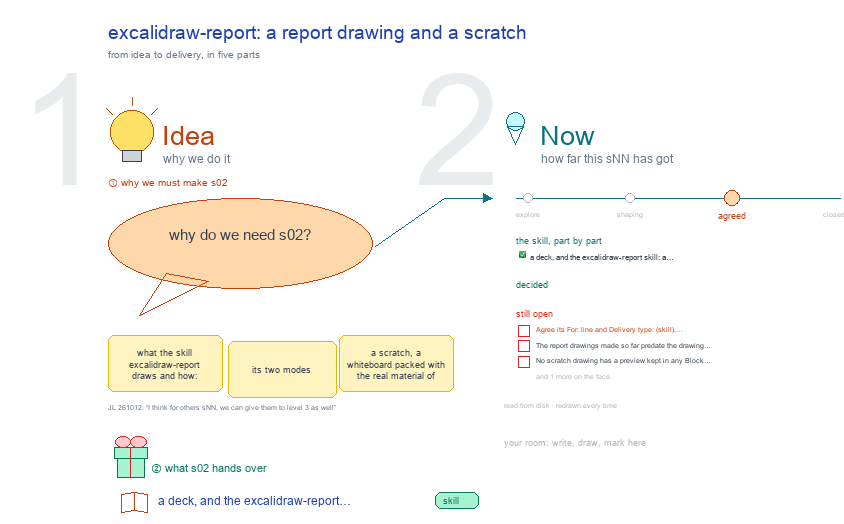

# s02 · excalidraw-report: a report drawing and a scratch <!-- root #ed9c8c -->

**Stage:** agreed

- For <!-- @for #f78806 -->
  - a deck, and the excalidraw-report skill: a … <!-- @for/0 #c122fb -->
    a deck, and the excalidraw-report skill: a scratch and a report drawing, for the people who write the toolkit skills
- Delivery type <!-- @delivery-type #58a44f -->
  - skill <!-- @delivery-type/0 #34b33e -->
- Topic <!-- @topic #7e13bd -->
  - what the skill `excalidraw-report` draws and how: … <!-- @topic/0 #7a4aed -->
    what the skill `excalidraw-report` draws and how: its two modes (a scratch, a whiteboard packed with the real material of a question that a person and an agent mark up together; and a report drawing, a report's answer and its evidence in named frames), the rules each mode follows, the steps and scripts from material to a finished drawing, where its files live, and the drawings it has made in this workspace, checked against the drawing principles of b31 s01.
  - It sits beside s01 (excalidraw-studio, how every … <!-- @topic/1 #fe34d5 -->
    It sits beside s01 (excalidraw-studio, how every Studio drawing reads) and s03 to s05 (the other three drawing skills).
- Feeds <!-- @feeds #ffe8e9 -->
  - none yet <!-- @feeds/0 #02942c -->
- Files <!-- @files #6ce6c5 -->
  - [py] [build_s02_excalidraw_report.py](build_s02_excalidraw_report.py) <!-- @files/0 #51ea03 -->
  - delivery/ <!-- @files/1 #404761 -->
  - passes/ <!-- @files/2 #49b302 -->
  - [excalidraw] [s02-excalidraw-report.excalidraw](s02-excalidraw-report.excalidraw) <!-- @files/3 #8e2e1d -->
  - [md] [s02-excalidraw-report.md](s02-excalidraw-report.md) <!-- @files/4 #9b1d0e -->
  - [png] [s02-excalidraw-report.png](s02-excalidraw-report.png) <!-- @files/5 #ece2d7 -->
    
- What the drawing holds <!-- @what-the-drawing-holds #e0b05d -->
  - Four frames in two acts, each act … <!-- @what-the-drawing-holds/0 #8443b5 -->
    Four frames in two acts, each act a row named at the left (as b10 s52 does); a named arrow for each step; each frame as large as one screen, its key point in the one slight colour, its density measured in its corner.
  - ① 🧠 the skill as one mind … <!-- @what-the-drawing-holds/1 #7b94bf -->
    ① 🧠 the skill as one mind map: the centre says what it draws; branches for its two modes, its rules, its steps, its scripts, the shared canvas, the comment loop and its boundary; each with a one-line summary drawn large. ② 🔁 how a drawing is made: one workflow per mode, step by step with the script named; the scratch's comment loop and the report drawing's rebuild loop are drawn closed. ③ 🧰 the skill folder as a folder tree read from disk, with what each part does, and the facts read from it (version, changelog entries, rules, plot helpers). ④ 🖼️ two drawings it made (a report's roadmap, found on disk; the Studio and Report logic tree of b10 s02), each checked against the drawing principles, one line each.
  - Rebuild: `python build_s02_excalidraw_report.py`, then `render_png.py` for the … <!-- @what-the-drawing-holds/2 #593de2 -->
    Rebuild: `python build_s02_excalidraw_report.py`, then `render_png.py` for the preview.
- The skill (the mind map, ①) <!-- @the-skill-the-mind-map #c9dcb8 -->
- How a drawing is made (the workflows, ②) <!-- @how-a-drawing-is-made-the-workflows #513093 -->
- Where it lives (the folder, ③) <!-- @where-it-lives-the-folder #453e2d -->
  - Real folders, read from disk on every … <!-- @where-it-lives-the-folder/0 #e3fa7d -->
    Real folders, read from disk on every build; the changelog lines are its newest headings, read live. `notes` says what a part does.
- What it made (the pictures, ④) <!-- @what-it-made-the-pictures #fb023b -->
- Decided <!-- @decided #55615a -->
  - s02-D01 · Created (asked 261012: "for the … <!-- @decided/0 #26f127 -->
    s02-D01 · Created (asked 261012: "for the excalidraw report, slide, read, and section, we should have the s02, 03, 04, 05 for them as well"): the topic on excalidraw-report, beside b31 s01 (excalidraw-studio) (JL 261012)
  - s02-D02 · Stage → agreed (JL 261012: … <!-- @decided/1 #9dc56e -->
    s02-D02 · Stage → agreed (JL 261012: "I think for others sNN, we can give them to level 3 as well"): the topic shows what excalidraw-report draws and how; its three open points moved to Later
- Open <!-- @open #cf9b77 -->
  - Agree its **For:** line and **Delivery type:** … <!-- @open/0 #09a2ba -->
    Agree its **For:** line and **Delivery type:** (skill), proposed by the agent 261030?
  - (none open: agreed 261012, s02-D02; 3 points … <!-- @open/1 #bbbf09 -->
    (none open: agreed 261012, s02-D02; 3 points moved to Later)
- Later <!-- @later #56e2f5 -->
  - Not needed now; each comes back as … <!-- @later/0 #09375d -->
    Not needed now; each comes back as a new point if it is wanted.
  - The report drawings made so far predate … <!-- @later/1 #30a223 -->
    The report drawings made so far predate the drawing principles: are they one screen with words of 20 px or more, or do they keep the report mode's own larger canvas?
  - No scratch drawing has a preview kept … <!-- @later/2 #6e3592 -->
    No scratch drawing has a preview kept in any Block (only its builder and `.excalidraw`): keep one `.png` per scratch, so this topic can show it?
  - Should the skill name the one slight … <!-- @later/3 #e2b489 -->
    Should the skill name the one slight key-point colour, or keep the report mode black, red and series colours only?
