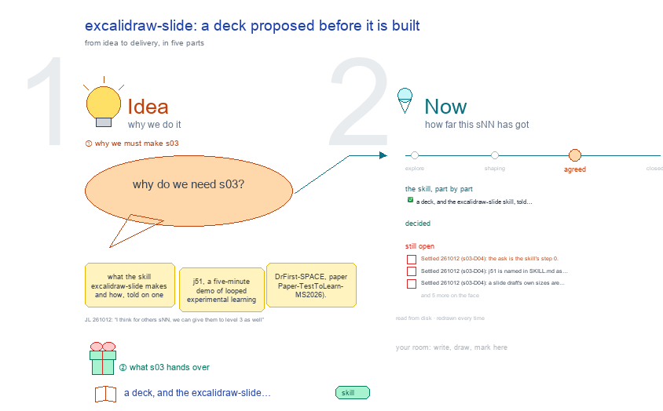

# s03 · excalidraw-slide: a deck proposed before it is built <!-- root #48acfc -->

**Stage:** agreed

- For <!-- @for #f78806 -->
  - a deck, and the excalidraw-slide skill, told … <!-- @for/0 #3a0f5f -->
    a deck, and the excalidraw-slide skill, told on one real slide job, for the people who write the toolkit skills
- Delivery type <!-- @delivery-type #58a44f -->
  - skill <!-- @delivery-type/0 #34b33e -->
- Topic <!-- @topic #7e13bd -->
  - what the skill `excalidraw-slide` makes and how, … <!-- @topic/0 #3a3e92 -->
    what the skill `excalidraw-slide` makes and how, told on one real slide job: j51, a five-minute demo of looped experimental learning (DrFirst-SPACE, paper Paper-TestToLearn-MS2026).
  - Its ask came from a meeting on … <!-- @topic/1 #e8bf04 -->
    Its ask came from a meeting on 2026-10-05 (j51 s01 what they want); its layout was marked and agreed on one canvas (j51 s61 demo layout); one `slides.py` fed the drawing and the deck; the 14-slide deck was shown on 2026-10-08.
  - This topic draws that job, the deck … <!-- @topic/2 #0eeeef -->
    This topic draws that job, the deck it made, its two drawings, and what the skill should take from it.
  - A slide draft keeps its own colours … <!-- @topic/3 #224f64 -->
    A slide draft keeps its own colours by design; this topic's own drawing follows excalidraw-studio's principles.
- Feeds <!-- @feeds #ffe8e9 -->
  - none yet <!-- @feeds/0 #02942c -->
- Files <!-- @files #6ce6c5 -->
  - [py] [build_s03_excalidraw_slide.py](build_s03_excalidraw_slide.py) <!-- @files/0 #c0aa43 -->
  - delivery/ <!-- @files/1 #404761 -->
  - examples/ <!-- @files/2 #edc712 -->
  - history/ <!-- @files/3 #9a00ab -->
  - passes/ <!-- @files/4 #49b302 -->
  - [excalidraw] [s03-excalidraw-slide.excalidraw](s03-excalidraw-slide.excalidraw) <!-- @files/5 #40635a -->
  - [md] [s03-excalidraw-slide.md](s03-excalidraw-slide.md) <!-- @files/6 #9cbbf6 -->
  - [png] [s03-excalidraw-slide.png](s03-excalidraw-slide.png) <!-- @files/7 #953b6b -->
    
- What the drawing holds <!-- @what-the-drawing-holds #e0b05d -->
  - Four frames in two acts, a row … <!-- @what-the-drawing-holds/0 #6a20a1 -->
    Four frames in two acts, a row each, named at the left; every frame has a badge and one key point. Words written `<<name>>` are facts the builder reads from j51's files (its `slides.py`, its two builders, its faces, its `delivery/`). When j51 is not beside Tools-SPACE, the builder reads the snapshot in `examples/j51/`.
- Decided <!-- @decided #55615a -->
  - s03-D01 · Created (asked 261012: "for the … <!-- @decided/0 #3738d3 -->
    s03-D01 · Created (asked 261012: "for the excalidraw report, slide, read, and section, we should have the
  - s02, 03, 04, 05 for them as … <!-- @decided/1 #cefb13 -->
    s02, 03, 04, 05 for them as well. Please go ahead and do it."): the topic on excalidraw-slide, beside b31 s01 (excalidraw-studio)
  - s03-D02 · Redrawn around j51 (asked 261012: … <!-- @decided/2 #09f6d3 -->
    s03-D02 · Redrawn around j51 (asked 261012: "for the s03, it is very bad, I think you should use the examples
  - from .../Paper-TestToLearn-MS2026, there is a slide job, … <!-- @decided/3 #20b6bb -->
    from .../Paper-TestToLearn-MS2026, there is a slide job, and I think you can make it."): Act 1 is j51's job as a map and the 14-slide deck it made; Act 2 is its two drawings and what the skill takes from it. The first drawing (the skill's own files and the b11, b12 drafts) is in `history/`.
  - s03-D03 · The first Open 1 has … <!-- @decided/4 #4209d3 -->
    s03-D03 · The first Open 1 has narrowed, read live 261012: the b11 and b12 drafts now carry every slide field,
  - but each still fails on one error … <!-- @decided/5 #0459df -->
    but each still fails on one error (no OPEN) with three warnings (no AUDIENCE, LENGTH, SHOWN); j51's slides.py passes clean. What is left is Open 7.
  - s03-D04 · The skill updated from j51 … <!-- @decided/6 #8b209f -->
    s03-D04 · The skill updated from j51 (asked 261012: "could you update the skills of the excalidraw-slide?"):
  - excalidraw-slide 0.2.0 has the ask as step … <!-- @decided/7 #2e399f -->
    excalidraw-slide 0.2.0 has the ask as step 0 (ref § The ask, before the draft), j51 as the slide job to copy, screens and figures named by `file` and checked on disk, and a slide draft's own sizes written down (excalidraw-studio 0.2.3's check.py names a slide draft and does not judge them). Opens 1, 2 and 5 settled; the mind map's last branch reads each gap from the skill's files.
  - s03-D05 · Stage → agreed (JL 261012: … <!-- @decided/8 #a5d3ac -->
    s03-D05 · Stage → agreed (JL 261012: "I think for others sNN, we can give them to level 3 as well"): the topic
  - tells excalidraw-slide on j51; its four open … <!-- @decided/9 #ec00d7 -->
    tells excalidraw-slide on j51; its four open points (a deck writer, one drawing kit, j51's slides in Tools, b11 and b12's OPEN) moved to Later
- Open <!-- @open #cf9b77 -->
  - Settled 261012 (s03-D04): the ask is the … <!-- @open/0 #d36bb9 -->
    Settled 261012 (s03-D04): the ask is the skill's step 0.
  - Settled 261012 (s03-D04): j51 is named in … <!-- @open/1 #5dc901 -->
    Settled 261012 (s03-D04): j51 is named in SKILL.md as the slide job to copy.
  - Settled 261012 (s03-D04): a slide draft's own … <!-- @open/2 #9309f3 -->
    Settled 261012 (s03-D04): a slide draft's own sizes are written in SKILL.md, and check.py names it.
  - (none open: agreed 261012, s03-D05; 4 points … <!-- @open/3 #301745 -->
    (none open: agreed 261012, s03-D05; 4 points moved to Later)
- Later <!-- @later #56e2f5 -->
  - Not needed now; each comes back as … <!-- @later/0 #09375d -->
    Not needed now; each comes back as a new point if it is wanted.
  - `build_deck.py` is copied into every topic (the … <!-- @later/1 #c5b48c -->
    `build_deck.py` is copied into every topic (the skill has no deck writer yet); when does it move into the skill?
  - each draft keeps its own drawing kit … <!-- @later/2 #86dceb -->
    each draft keeps its own drawing kit (j51 `_build/sketch.py`, b12 `slide_kit.py`); one in the skill?
  - `examples/j51/` copies DrFirst slides into Tools-SPACE: keep … <!-- @later/3 #9bde4a -->
    `examples/j51/` copies DrFirst slides into Tools-SPACE: keep it out of anything shared beyond the team?
  - b11 and b12 still fail the field … <!-- @later/4 #c9069b -->
    b11 and b12 still fail the field check on one error each (no OPEN): give them OPEN, AUDIENCE, LENGTH and
  - SHOWN, as j51 has? <!-- @later/5 #fe6fad -->
  - Agree its **For:** line and **Delivery type:** … <!-- @later/6 #09a2ba -->
    Agree its **For:** line and **Delivery type:** (skill), proposed by the agent 261030?
