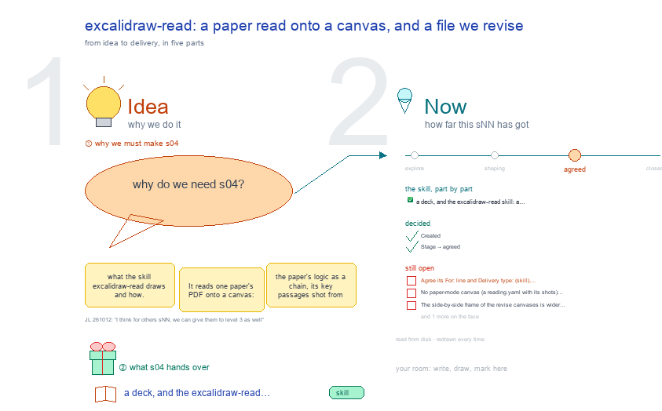

# s04 · excalidraw-read: a paper read onto a canvas, and a file we revise <!-- root #cc08c3 -->

**Stage:** agreed

- For <!-- @for #f78806 -->
  - a deck, and the excalidraw-read skill: a … <!-- @for/0 #4e856e -->
    a deck, and the excalidraw-read skill: a paper's logic and key passages on one canvas, for the people who write the toolkit skills
- Delivery type <!-- @delivery-type #58a44f -->
  - skill <!-- @delivery-type/0 #34b33e -->
- Topic <!-- @topic #7e13bd -->
  - what the skill `excalidraw-read` draws and how <!-- @topic/0 #5580f7 -->
  - It reads one paper's PDF onto a … <!-- @topic/1 #5f535e -->
    It reads one paper's PDF onto a canvas: the paper's logic as a chain, its key passages shot from the PDF with the quoted words highlighted, a comment on each, and how each passage links to a claim of our paper.
  - Its second mode, revise, reads a file … <!-- @topic/2 #ae7ac0 -->
    Its second mode, revise, reads a file we are asked to change (a co-author's Word file) and shoots one picture per section with the planned changes in red.
  - This topic draws both modes in one … <!-- @topic/3 #8e68e9 -->
    This topic draws both modes in one place, beside b31 s01 (the principles of a Studio drawing) and s21 (the revise mode, measured on a real drawing); it does not repeat s21.
  - The version, the ref files, the commands … <!-- @topic/4 #ddbd30 -->
    The version, the ref files, the commands and the three real canvases are read from disk on every build.
- Source <!-- @source #6da13a -->
  - `plugins/haipipe-toolkit/skills/1_base/excalidraw/excalidraw-read/` (SKILL.md, CHANGELOG.md, ref/), and the three … <!-- @source/0 #7f02f9 -->
    `plugins/haipipe-toolkit/skills/1_base/excalidraw/excalidraw-read/` (SKILL.md, CHANGELOG.md, ref/), and the three canvases the revise mode made on 2026-10-11 in WellDoc-SPACE (`examples-0-cowork/Project-SHIFT-Study/cowork/`, b32, b21, b31).
- Feeds <!-- @feeds #ffe8e9 -->
  - no Question yet (b31 has no `reports/`) <!-- @feeds/0 #6f044e -->
- Files <!-- @files #6ce6c5 -->
  - [py] [build_s04_excalidraw_read.py](build_s04_excalidraw_read.py) <!-- @files/0 #57fa67 -->
  - delivery/ <!-- @files/1 #404761 -->
  - passes/ <!-- @files/2 #49b302 -->
  - [excalidraw] [s04-excalidraw-read.excalidraw](s04-excalidraw-read.excalidraw) <!-- @files/3 #3b77b6 -->
  - [md] [s04-excalidraw-read.md](s04-excalidraw-read.md) <!-- @files/4 #13c722 -->
  - [png] [s04-excalidraw-read.png](s04-excalidraw-read.png) <!-- @files/5 #c7635d -->
    
- What the drawing holds <!-- @what-the-drawing-holds #e0b05d -->
- The words of frame ①: the skill as a mind map <!-- @the-words-of-frame-the-skill-as-a-mind-map #d2881b -->
- The words of frame ②: the read mode as a workflow <!-- @the-words-of-frame-the-read-mode-as-a-workflow #011e9a -->
- The words of frame ③: where it lives <!-- @the-words-of-frame-where-it-lives #64ba02 -->
- The words of frame ④: what it made <!-- @the-words-of-frame-what-it-made #cbc4e1 -->
  - All three are revise-mode canvases from 2026-10-11 … <!-- @the-words-of-frame-what-it-made/0 #ef5679 -->
    All three are revise-mode canvases from 2026-10-11 (the SHIFT cowork Blocks, in WellDoc-SPACE). Only the top of each preview is shown. No paper-mode canvas could be found in this workspace (see Open 1).
- Decided <!-- @decided #55615a -->
  - s04-D01 · Created (asked 261012: "for the … <!-- @decided/0 #2ddd36 -->
    s04-D01 · Created (asked 261012: "for the excalidraw report, slide, read, and section, we should have the s02, 03, 04, 05 for them as well"): the topic on excalidraw-read, beside b31 s01 (excalidraw-studio); its revise mode stays in b31 s21.
  - s04-D02 · Stage → agreed (JL 261012: … <!-- @decided/1 #b9e01b -->
    s04-D02 · Stage → agreed (JL 261012: "I think for others sNN, we can give them to level 3 as well"): the topic shows excalidraw-read's read mode, step by step; its three open points moved to Later, and step 5 is the person's step (👤), not an open point.
- Open <!-- @open #cf9b77 -->
  - Agree its **For:** line and **Delivery type:** … <!-- @open/0 #09a2ba -->
    Agree its **For:** line and **Delivery type:** (skill), proposed by the agent 261030?
  - (none open: agreed 261012, s04-D02; 3 points … <!-- @open/1 #94c3dc -->
    (none open: agreed 261012, s04-D02; 3 points moved to Later)
- Later <!-- @later #56e2f5 -->
  - Not needed now; each comes back as … <!-- @later/0 #09375d -->
    Not needed now; each comes back as a new point if it is wanted.
  - No paper-mode canvas (a `reading.yaml` with its … <!-- @later/1 #be56f3 -->
    No paper-mode canvas (a `reading.yaml` with its shots) exists in this workspace; the worked example the skill names (`Knowledge-Base/.../salvi-2024-gpt4-persuasion/`) is not here. Read mode is drawn from its spec and code, not from a measured run.
  - The side-by-side frame of the revise canvases … <!-- @later/2 #c5f192 -->
    The side-by-side frame of the revise canvases is wider than the 2,800 px rule (kept for the three note columns); is that still acceptable under the principles of b31 s01?
  - Read mode has no timing like s21's … <!-- @later/3 #f08620 -->
    Read mode has no timing like s21's seconds per rebuild; should one paper read be measured?
