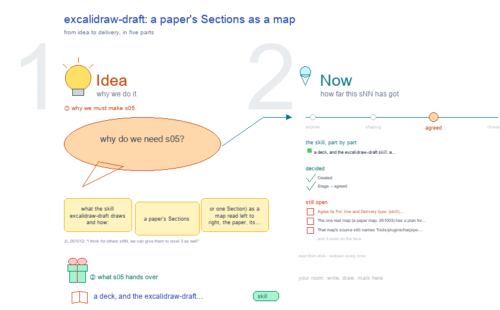

# s05 · excalidraw-draft: a paper's Sections as a map <!-- root #f8e68b -->

**Stage:** agreed

- For <!-- @for #f78806 -->
  - a deck, and the excalidraw-draft skill: a … <!-- @for/0 #82d7fb -->
    a deck, and the excalidraw-draft skill: a paper's Sections as a map read left to right, for the people who write the toolkit skills
- Delivery type <!-- @delivery-type #58a44f -->
  - skill <!-- @delivery-type/0 #34b33e -->
- Topic <!-- @topic #7e13bd -->
  - what the skill `excalidraw-draft` draws and how: … <!-- @topic/0 #43249a -->
    what the skill `excalidraw-draft` draws and how: a paper's Sections (or one Section) as a map read left to right, the paper, its groups, its Sections in board order, each Section's paragraphs, each Bullet a row, then a Text column left empty and an Evidence column with a card per Evidence Item.
  - The map is generated by `ref/excalidraw_section.py` from … <!-- @topic/1 #812ff7 -->
    The map is generated by `ref/excalidraw_section.py` from the Draft plans and Evidence Items, never edited by hand.
  - This topic draws the skill's parts, its … <!-- @topic/2 #562a13 -->
    This topic draws the skill's parts, its workflow, its folder, and the one real map it has made, so a session knows what the map holds and what it leaves out before it redraws one.
- Feeds <!-- @feeds #ffe8e9 -->
  - none yet <!-- @feeds/0 #02942c -->
- Files <!-- @files #6ce6c5 -->
  - [py] [build_s05_excalidraw_section.py](build_s05_excalidraw_section.py) <!-- @files/0 #28a23f -->
  - delivery/ <!-- @files/1 #404761 -->
  - examples/ <!-- @files/2 #edc712 -->
  - passes/ <!-- @files/3 #49b302 -->
  - [excalidraw] [s05-excalidraw-section.excalidraw](s05-excalidraw-section.excalidraw) <!-- @files/4 #ef80d2 -->
  - [md] [s05-excalidraw-section.md](s05-excalidraw-section.md) <!-- @files/5 #688b49 -->
  - [png] [s05-excalidraw-section.png](s05-excalidraw-section.png) <!-- @files/6 #a3f7aa -->
    
- What the drawing holds <!-- @what-the-drawing-holds #e0b05d -->
  - Four frames in two acts, a row … <!-- @what-the-drawing-holds/0 #77ba37 -->
    Four frames in two acts, a row each, the act named at the left, a named arrow for each step (b31 s01 principle ③). Facts (version, functions, counts, the sample map's boxes) are read from disk on every build; `{name}` in a yaml string below is filled by the builder.
  - ① 🧠 the skill as a mind … <!-- @what-the-drawing-holds/1 #481131 -->
    ① 🧠 the skill as a mind map: centre "what it draws"; six branches: the columns, where its words come from, the colours, the depths, what it never does, its script. ② 🔁 the workflow: the inputs (board, plans, evidence items) into the script, then what a run does step by step, and the guard that refuses to replace a hand-edited map. ③ 🧰 the skill folder and the folder its maps are written into, both read from disk, and who owns each input. ④ 🖼️ the one real paper map, its preview, checked against the drawing principles, one line each; red where it fails.
  - Rebuild: `python build_s05_excalidraw_section.py`, then `render_png.py` for the … <!-- @what-the-drawing-holds/2 #275c61 -->
    Rebuild: `python build_s05_excalidraw_section.py`, then `render_png.py` for the preview.
- The skill as a mind map (①) <!-- @the-skill-as-a-mind-map #14aed9 -->
- The workflow (②) <!-- @the-workflow #a2ac9a -->
- Where it lives and what it made (③ ④) <!-- @where-it-lives-and-what-it-made #ece5c2 -->
- Decided <!-- @decided #55615a -->
  - s05-D01 · Created (asked 261012: "for the … <!-- @decided/0 #d43d02 -->
    s05-D01 · Created (asked 261012: "for the excalidraw report, slide, read, and section, we should have the s02, 03, 04, 05 for them as well"): the topic on excalidraw-draft, beside b31 s01 (excalidraw-studio).
  - s05-D02 · Stage → agreed (JL 261012: … <!-- @decided/1 #f57ee8 -->
    s05-D02 · Stage → agreed (JL 261012: "I think for others sNN, we can give them to level 3 as well"): the topic shows what excalidraw-draft draws, on its one real map; its five open points moved to Later.
- Open <!-- @open #cf9b77 -->
  - Agree its **For:** line and **Delivery type:** … <!-- @open/0 #09a2ba -->
    Agree its **For:** line and **Delivery type:** (skill), proposed by the agent 261030?
  - (none open: agreed 261012, s05-D02; 5 points … <!-- @open/1 #8e4d9e -->
    (none open: agreed 261012, s05-D02; 5 points moved to Later)
- Later <!-- @later #56e2f5 -->
  - Not needed now; each comes back as … <!-- @later/0 #09375d -->
    Not needed now; each comes back as a new point if it is wanted.
  - The one real map (a paper map, … <!-- @later/1 #499b96 -->
    The one real map (a paper map, 261003) has a plan for the Abstract only; its other Sections are dashed grey.
  - Draw a Section map with evidence cards … <!-- @later/2 #d28d06 -->
    Draw a Section map with evidence cards from a Section that has a plan, so the Text and Evidence columns are shown by a real drawing, not by SKILL.md's sketch?
  - That map's `source` still names `Tools/plugins/haipipe-toolkit/skills/excalidraw/excalidraw-draft/ref/...`, <!-- @later/3 #f6a168 -->
  - from before the skills moved under `1_base/` <!-- @later/4 #278846 -->
    from before the skills moved under `1_base/`. Redraw it, or let the script write a path that survives a move?
  - `excalidraw-draft/` has no `tests/` folder (excalidraw-studio has … <!-- @later/5 #6adb33 -->
    `excalidraw-draft/` has no `tests/` folder (excalidraw-studio has one). Add a test that builds a map from a
  - small fixture board and counts boxes and … <!-- @later/6 #4cbcc4 -->
    small fixture board and counts boxes and cards?
  - Its words are 13 to 15 px, … <!-- @later/7 #57f056 -->
    Its words are 13 to 15 px, under b31 s01's 20 px floor. Does the floor apply to a generated working map, or
  - only to Studio frames? <!-- @later/8 #2176d5 -->
    only to Studio frames? (recommended: Studio frames only; the map is read zoomed in)
  - The skill says a paper map stops … <!-- @later/9 #97d3c0 -->
    The skill says a paper map stops at paragraphs; should Bullets and cards be reachable by a second drawing
  - per Section, linked from the paper map? <!-- @later/10 #e3bec4 -->
