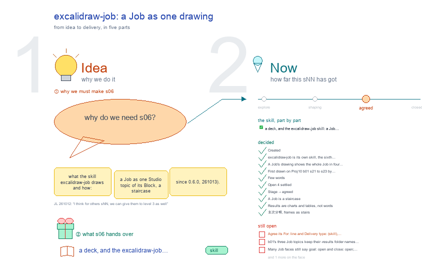

# s06 · excalidraw-job: a Job as one drawing <!-- root #f00713 -->

**Stage:** agreed

- For <!-- @for #f78806 -->
  - a deck, and the excalidraw-job skill: a … <!-- @for/0 #5d4aee -->
    a deck, and the excalidraw-job skill: a Job as one staircase drawing, for the people who write the toolkit skills
- Delivery type <!-- @delivery-type #58a44f -->
  - skill <!-- @delivery-type/0 #34b33e -->
- Topic <!-- @topic #7e13bd -->
  - what the skill `excalidraw-job` draws and how: … <!-- @topic/0 #95a14c -->
    what the skill `excalidraw-job` draws and how: a Job as one Studio topic of its Block, a staircase (since 0.6.0, 261013).
  - The main frame: the Job on top … <!-- @topic/1 #56ad0b -->
    The main frame: the Job on top (why it exists, when it is done), each Task a step lower and further right, its Runs branching from its step (the current one marked 📌, reruns quiet).
  - Each Task's results stand outside the frame, … <!-- @topic/2 #f958da -->
    Each Task's results stand outside the frame, small, level with its step: one sentence, then charts and tables read from its Runs' result files, then the figures the Task already holds.
  - A small frame of its words (terms, … <!-- @topic/3 #2daa76 -->
    A small frame of its words (terms, how sure, what closes each open point) steps down and right.
  - Every number is read from disk on … <!-- @topic/4 #ce89f9 -->
    Every number is read from disk on every build; the face holds words and paths.
  - This topic draws the skill's parts, its … <!-- @topic/5 #fc17de -->
    This topic draws the skill's parts, its workflow, its folder, and the first staircase it drew (Physician-SPACE LLMRec b04 s27), so a session knows what a Job drawing holds before it makes one.
- Feeds <!-- @feeds #ffe8e9 -->
  - none yet <!-- @feeds/0 #02942c -->
- Files <!-- @files #6ce6c5 -->
  - [py] [build_s06_excalidraw_job.py](build_s06_excalidraw_job.py) <!-- @files/0 #e8e0ac -->
  - delivery/ <!-- @files/1 #404761 -->
  - examples/ <!-- @files/2 #edc712 -->
  - passes/ <!-- @files/3 #49b302 -->
  - [excalidraw] [s06-excalidraw-job.excalidraw](s06-excalidraw-job.excalidraw) <!-- @files/4 #563d96 -->
  - [md] [s06-excalidraw-job.md](s06-excalidraw-job.md) <!-- @files/5 #dad6bb -->
  - [png] [s06-excalidraw-job.png](s06-excalidraw-job.png) <!-- @files/6 #dbd214 -->
    
- What the drawing holds <!-- @what-the-drawing-holds #e0b05d -->
  - Four frames as stairs (b31 s01, 261013): … <!-- @what-the-drawing-holds/0 #c463d4 -->
    Four frames as stairs (b31 s01, 261013): ① the skill, the main frame, at the origin; ②, ③ and ④ each lower and further right (`canvas.stairs`), a named arrow into each; no act names down a left edge. Facts (version, functions, tests, the first Jobs' checks) are read from disk on every build; `{name}` in a yaml string below is filled by the builder.
  - ① 🧠 the skill as a mind … <!-- @what-the-drawing-holds/1 #0fc813 -->
    ① 🧠 the skill as a mind map: centre "a Job as a staircase, its results beside it"; the ask, the staircase, its results, its Runs, its words, its script, and what it never does. ② 🔁 the workflow: the Job's files into job_ladder.py, then what one build does. ③ 🧰 the skill folder and the folder a Job topic is written into, both as trees, and who owns each input. ④ 🖼️ a made-up Job drawn as a staircase, its preview and check.py's verdict; the real ones named (Tools is public).
  - Rebuild: `python build_s06_excalidraw_job.py`, then `check.py` on the … <!-- @what-the-drawing-holds/2 #ea0af1 -->
    Rebuild: `python build_s06_excalidraw_job.py`, then `check.py` on the drawing.
- The skill as a mind map (①) <!-- @the-skill-as-a-mind-map #14aed9 -->
- The workflow (②) <!-- @the-workflow #a2ac9a -->
- Where it lives and what it made (③ ④) <!-- @where-it-lives-and-what-it-made #ece5c2 -->
- Decided <!-- @decided #55615a -->
  - s06-D01 · Created (asked 261012: "I want … <!-- @decided/0 #fbbd5f -->
    s06-D01 · Created (asked 261012: "I want a new sNN for the excalidraw-job, which will show the sNN as the excalidraw as the job to make the job's aim plan and results"): the topic on excalidraw-job, beside s02 to s05.
  - s06-D02 · excalidraw-job is its own skill, … <!-- @decided/1 #e32a44 -->
    s06-D02 · excalidraw-job is its own skill, the sixth beside excalidraw-studio, -report, -slide, -read and -section (asked 261012, on s01's skill-folder frame: "I think here we might have the excalidraw-job?") (261012)
  - s06-D03 · A Job's drawing shows the … <!-- @decided/2 #30c52c -->
    s06-D03 · A Job's drawing shows the whole Job in four frames: why, in → Tasks → out, what it concluded, its tables, formulas and pictures (asked 261012: "我想在这个桌上把这个 job 的所有内容都展示出来") (261012)
  - s06-D04 · First drawn on Proj10 b01 … <!-- @decided/3 #502555 -->
    s06-D04 · First drawn on Proj10 b01 s21 to s23 by `adopt`: folders kept, aims and readings drafted from their Task pages; every frame passes check.py (261012)
  - s06-D05 · Few words (asked 261012: "add … <!-- @decided/4 #bc2eff -->
    s06-D05 · Few words (asked 261012: "add at least of words, (especially the small versions as possible) when drawing the workflow"; "make the draft to be less of wordy and concise"): excalidraw-studio's ⑦; the Job drawing is two frames, a Task's detail its own topic (excalidraw-task, built by the Proj10 session); this topic's ① and ② are redrawn short (261012)
  - s06-D06 · Open 4 settled: a workflow … <!-- @decided/5 #b7c4d4 -->
    s06-D06 · Open 4 settled: a workflow of four steps (three arrows) is a map; draw.py's kind() takes three (261012)
  - s06-D07 · Stage → agreed (JL 261012: … <!-- @decided/6 #78ea60 -->
    s06-D07 · Stage → agreed (JL 261012: "I think for others sNN, we can give them to level 3 as well"): the open points move to Later, drawn plain as "⏳ later:" (261012)
  - s06-D08 · A Job is a staircase … <!-- @decided/7 #427069 -->
    s06-D08 · A Job is a staircase (asked 261013, with a hand sketch: "先是 Job，下面跟着 Task 1、Task 2、Task 3 … 相当于一个 阶梯状的图 … 右边就开始说明每一个具体的结果都是什么"; "current ones in the job sNN are very bad"): excalidraw-job 0.6.0, job_ladder.py, the default for every Job; `layout: classic | plain` keeps the old frames (261013)
  - s06-D09 · Results are charts and tables, … <!-- @decided/8 #3984fe -->
    s06-D09 · Results are charts and tables, not words (asked 261013: "你的 results 应该是图和表格呀 … 如果你有 Python 画的图， 也一起扔过来"; "for the task, we might want to add the figures and table from it"): the face's `charts:` and `tables:` are read from the current Run's files; the Task's own figures follow (261013)
  - s06-D10 · 主次分明, frames as stairs (asked … <!-- @decided/9 #ccaa44 -->
    s06-D10 · 主次分明, frames as stairs (asked 261013: "一个很大的 frame，然后有一些小的 frame 是解释这些大的 frame 的 … 你不能 每一个都是朝左对齐"): the staircase is the main frame; its words frame is small (`canvas.explains`) and steps down and right (`canvas.stairs`); this topic's own four frames are placed the same way (261013)
- Open <!-- @open #cf9b77 -->
  - Agree its **For:** line and **Delivery type:** … <!-- @open/0 #09a2ba -->
    Agree its **For:** line and **Delivery type:** (skill), proposed by the agent 261030?
  - (none open: agreed 261012, s06-D07) <!-- @open/1 #79ff11 -->
- Later <!-- @later #56e2f5 -->
  - b01's three Job topics keep their `-results` … <!-- @later/0 #a98e15 -->
    b01's three Job topics keep their `-results` folder names so links still work; rename them `sNN-<jNN>-<job>`
  - with `renamed-from:` in each face, when the … <!-- @later/1 #5a1f76 -->
    with `renamed-from:` in each face, when the old names stop being linked.
  - Many Job faces still say `goal: open` … <!-- @later/2 #bcc2f6 -->
    Many Job faces still say `goal: open` and `close: open`; the aims are drafted in the topics' faces. Move them
  - into the Job faces (haipipe-job's), so ① … <!-- @later/3 #b28140 -->
    into the Job faces (haipipe-job's), so ① reads them from the Job itself.
  - Work Jobs are now drawn with their … <!-- @later/4 #d3e99e -->
    Work Jobs are now drawn with their numbers (Proj10 work/b01, b02, b11, 261012); a Job with pictures of its own
  - (④) is not drawn yet <!-- @later/5 #b98fe2 -->
