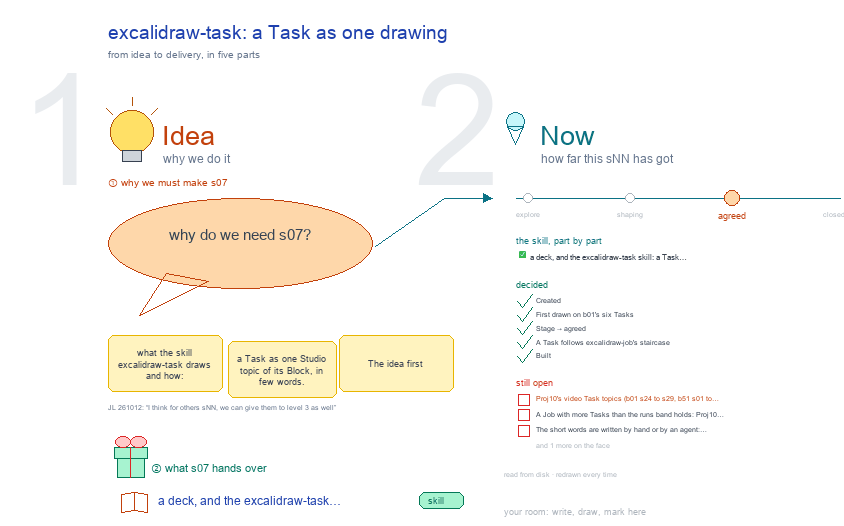

# s07 · excalidraw-task: a Task as one drawing <!-- root #550c32 -->

**Stage:** agreed

- For <!-- @for #f78806 -->
  - a deck, and the excalidraw-task skill: a … <!-- @for/0 #e73497 -->
    a deck, and the excalidraw-task skill: a Task as one drawing in few words, for the people who write the toolkit skills
- Delivery type <!-- @delivery-type #58a44f -->
  - skill <!-- @delivery-type/0 #34b33e -->
- Topic <!-- @topic #7e13bd -->
  - what the skill `excalidraw-task` draws and how: … <!-- @topic/0 #f31d5e -->
    what the skill `excalidraw-task` draws and how: a Task as one Studio topic of its Block, in few words.
  - The idea first (its question as the … <!-- @topic/1 #61fe0d -->
    The idea first (its question as the key point; what it is, how it works, why it matters; its videos in reading order; the questions to be ready for), then one frame per video: its key point, its steps in order, how to say it in an interview, and what to check against the video, in red.
  - The page keeps the full text; the … <!-- @topic/2 #bd63d7 -->
    The page keeps the full text; the face holds the short words.
  - A Job's drawing (excalidraw-job) points to each … <!-- @topic/3 #a2b1c4 -->
    A Job's drawing (excalidraw-job) points to each Task's topic.
- Feeds <!-- @feeds #ffe8e9 -->
  - none yet <!-- @feeds/0 #02942c -->
- Files <!-- @files #6ce6c5 -->
  - [py] [build_s07_excalidraw_task.py](build_s07_excalidraw_task.py) <!-- @files/0 #d9dc42 -->
  - delivery/ <!-- @files/1 #404761 -->
  - examples/ <!-- @files/2 #edc712 -->
  - passes/ <!-- @files/3 #49b302 -->
  - [excalidraw] [s07-excalidraw-task.excalidraw](s07-excalidraw-task.excalidraw) <!-- @files/4 #0b99c2 -->
  - [md] [s07-excalidraw-task.md](s07-excalidraw-task.md) <!-- @files/5 #e7d80e -->
  - [png] [s07-excalidraw-task.png](s07-excalidraw-task.png) <!-- @files/6 #1248f3 -->
    
- What the drawing holds <!-- @what-the-drawing-holds #e0b05d -->
- The skill as a mind map (①) <!-- @the-skill-as-a-mind-map #14aed9 -->
- The workflow (②) <!-- @the-workflow #a2ac9a -->
- Where it lives and what it made (③ ④) <!-- @where-it-lives-and-what-it-made #ece5c2 -->
- Decided <!-- @decided #55615a -->
  - s07-D01 · Created (asked 261012: "I think … <!-- @decided/0 #244f13 -->
    s07-D01 · Created (asked 261012: "I think we even need to have the excalidraw-task as well, to show the details of each tasks as well"): the topic on excalidraw-task, beside s06 (excalidraw-job); the skill is the Proj10 session's.
  - s07-D02 · First drawn on b01's six … <!-- @decided/1 #b5e036 -->
    s07-D02 · First drawn on b01's six Tasks (s24 to s29) and b51's ten (s01 to s10); every b01 frame passes check.py, with the short words written from each page (261012)
  - s07-D03 · Stage → agreed (JL 261012: … <!-- @decided/2 #6cf889 -->
    s07-D03 · Stage → agreed (JL 261012: "I think for others sNN, we can give them to level 3 as well"): the open points move to Later, drawn plain as "⏳ later:" (261012)
  - s07-D04 · A Task follows excalidraw-job's staircase … <!-- @decided/3 #c64592 -->
    s07-D04 · A Task follows excalidraw-job's staircase (JL 261013: "you should also think about how to update the /excalidraw-task as well, we try to follow the same idea"): the Task's question on top, each Run or video a step lower and further right, the current Run marked; each step's results outside the frame, small (charts, curves, tables, its figures, a video's screenshots); a small frame for its words and formulas; transcripts only when asked. Proposed, not yet built (261013)
  - s07-D05 · Built (261013): excalidraw-task 0.5.0, `scripts/task_stairs.py`, … <!-- @decided/4 #9ab43d -->
    s07-D05 · Built (261013): excalidraw-task 0.5.0, `scripts/task_stairs.py`, the default for every Task; `layout: rows | plain` keeps the frames before it. Each step is level with its results block; first drawn as previews on LLMRec b04 j08 t02 (a work Task) and Proj10 b51 t01 (six videos); tests read the staircase (261013)
- Open <!-- @open #cf9b77 -->
  - Proj10's video Task topics (b01 s24 to … <!-- @open/0 #b1d4d6 -->
    Proj10's video Task topics (b01 s24 to s29, b51 s01 to s10) become staircases on their next rebuild: rebuild
  - them in their SPACE and read them; … <!-- @open/1 #4119c4 -->
    them in their SPACE and read them; add `current:` and `charts:` where a work Task has numbers.
- Later <!-- @later #56e2f5 -->
  - A Job with more Tasks than the … <!-- @later/0 #4e82d4 -->
    A Job with more Tasks than the runs band holds: Proj10 numbers Task topics from s31 (b51 took s01 to s10);
  - say it in haipipe-studio's numbering when it … <!-- @later/1 #89ff12 -->
    say it in haipipe-studio's numbering when it settles.
  - The short words are written by hand … <!-- @later/2 #f07512 -->
    The short words are written by hand or by an agent: excalidraw-task could check its own word limits before a
  - build, not only ⑦ after it <!-- @later/3 #2bb986 -->
  - Agree its **For:** line and **Delivery type:** … <!-- @later/4 #09a2ba -->
    Agree its **For:** line and **Delivery type:** (skill), proposed by the agent 261030?
