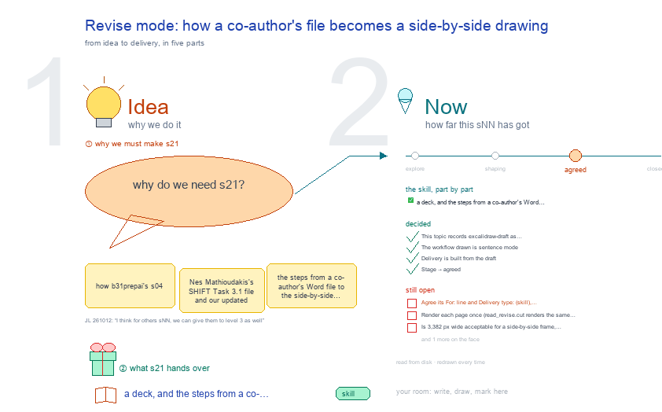

# s21 · Revise mode: how a co-author's file becomes a side-by-side drawing <!-- root #73c466 -->

**Tags:** `Run and Skill`
**Stage:** agreed

- For <!-- @for #f78806 -->
  - a deck, and the steps from a … <!-- @for/0 #ce3a67 -->
    a deck, and the steps from a co-author's Word file to a side-by-side drawing, for the people who write the toolkit skills
- Delivery type <!-- @delivery-type #58a44f -->
  - skill <!-- @delivery-type/0 #34b33e -->
- Topic <!-- @topic #7e13bd -->
  - how b31_prep_ai's s04 (Nes Mathioudakis's SHIFT Task … <!-- @topic/0 #4c54ce -->
    how b31_prep_ai's s04 (Nes Mathioudakis's SHIFT Task 3.1 file and our updated draft, side by side) was drawn on 2026-10-11, as the worked example of excalidraw-draft: the steps from a co-author's Word file to the side-by-side drawing and the tracked Word draft, the script behind each step, and what each step costs, in seconds per rebuild and in rounds with a person (JL 261011: "add a new sNN in Tools/blueprints/Project-PageParts/work/b31_excalidraw to explain how did we draw the things here? what is the workflow are what are the steps? how which steps are most expensive?").
- Source <!-- @source #6da13a -->
  - the worked example `examples-0-cowork/Project-SHIFT-Study/cowork/b31_prep_ai/s04-task31-updated-draft/` (in WellDoc-SPACE), its … <!-- @source/0 #51cf23 -->
    the worked example `examples-0-cowork/Project-SHIFT-Study/cowork/b31_prep_ai/s04-task31-updated-draft/` (in WellDoc-SPACE), its session passes `runs/run-draw-s04/passes/p01-1011` to `p07-1011`, and the scripts named below.
  - The seconds were measured once on 2026-10-11 … <!-- @source/1 #54deb9 -->
    The seconds were measured once on 2026-10-11 on JL's Mac (cProfile of one rebuild); the builder reads them from the yaml blocks here and measures nothing itself.
- Feeds <!-- @feeds #ffe8e9 -->
  - no Question yet (b31 has no `reports/`) <!-- @feeds/0 #6f044e -->
- Files <!-- @files #6ce6c5 -->
  - [py] [build_s21_revise_mode_workflow.py](build_s21_revise_mode_workflow.py) <!-- @files/0 #c05920 -->
  - delivery/ <!-- @files/1 #404761 -->
  - passes/ <!-- @files/2 #49b302 -->
  - [excalidraw] [s21-revise-mode-workflow.excalidraw](s21-revise-mode-workflow.excalidraw) <!-- @files/3 #9e1106 -->
  - [md] [s21-revise-mode-workflow.md](s21-revise-mode-workflow.md) <!-- @files/4 #42327b -->
  - [png] [s21-revise-mode-workflow.png](s21-revise-mode-workflow.png) <!-- @files/5 #100fb8 -->
    
- What the drawing holds <!-- @what-the-drawing-holds #e0b05d -->
- The workflow <!-- @the-workflow #59f59e -->
  - Sentence mode (excalidraw-read 0.3.1, from 2026-10-11): the … <!-- @the-workflow/0 #fbae5e -->
    Sentence mode (excalidraw-read 0.3.1, from 2026-10-11): the middle column is the updated text from the topic's `draft/` folder (haipipe-draft's draft), not a picture of the updated pages; the Word file is built last.
- How s04 got here <!-- @how-s04-got-here #22002e -->
- Decided <!-- @decided #55615a -->
  - s21-D01 · This topic records excalidraw-draft as … <!-- @decided/0 #57017f -->
    s21-D01 · This topic records excalidraw-draft as b31_prep_ai's s04 used it on 2026-10-11: the workflow, its scripts, the seconds per rebuild and the effort, read from yaml in this face (JL 261011).
  - s21-D02 · The workflow drawn is sentence … <!-- @decided/1 #e0bba8 -->
    s21-D02 · The workflow drawn is sentence mode (excalidraw-read 0.3.1): seed a haipipe-draft draft, write and revise it, draw, edit on the drawing and apply, deliver last; picture mode stays in the rounds as how it began.
  - s21-D03 · Delivery is built from the … <!-- @decided/2 #04fe9d -->
    s21-D03 · Delivery is built from the draft (excalidraw-read 0.4.0, now excalidraw-draft; `read_revise.py deliver`): the draft's words against the file's, word by word, become tracked changes, and the build checks that rejecting every change gives the file and accepting every change gives the draft (all three SHIFT Blocks pass, 2026-10-11).
  - s21-D04 · Stage → agreed (JL 261012: … <!-- @decided/3 #661244 -->
    s21-D04 · Stage → agreed (JL 261012: "I think for others sNN, we can give them to level 3 as well"): the topic records revise mode as b31's s04 used it; its open points moved to Later, and the drawing's Open list is drawn as Later, plain.
- Open <!-- @open #cf9b77 -->
  - Agree its **For:** line and **Delivery type:** … <!-- @open/0 #09a2ba -->
    Agree its **For:** line and **Delivery type:** (skill), proposed by the agent 261030?
  - (none open: agreed 261012, s21-D04; 3 points … <!-- @open/1 #1bff26 -->
    (none open: agreed 261012, s21-D04; 3 points moved to Later)
- Later <!-- @later #56e2f5 -->
  - Not needed now; each comes back as … <!-- @later/0 #09375d -->
    Not needed now; each comes back as a new point if it is wanted.
  - Render each page once (`read_revise.cut` renders the … <!-- @later/1 #dfad43 -->
    Render each page once (`read_revise.cut` renders the same page for every section that touches it).
  - Is 3,382 px wide acceptable for a … <!-- @later/2 #6c9157 -->
    Is 3,382 px wide acceptable for a side-by-side frame, or should the pictures shrink?
  - Deliver from the draft: done 2026-10-11 (`read_revise.py … <!-- @later/3 #1e83e1 -->
    Deliver from the draft: done 2026-10-11 (`read_revise.py deliver`); b32 and b21 still point their own delivery
  - scripts at it <!-- @later/4 #218724 -->
