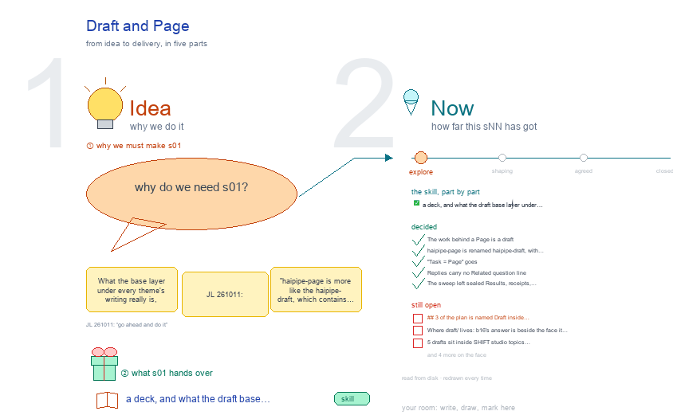

# s01 · Draft and Page <!-- root #418bbd -->

**Tags:** `naming` · `base`
**Stage:** explore

- For <!-- @for #f78806 -->
  - a deck, and what the draft base … <!-- @for/0 #053533 -->
    a deck, and what the draft base layer under every theme's writing is, and its name, for the people who write the toolkit skills
- Delivery type <!-- @delivery-type #58a44f -->
  - skill <!-- @delivery-type/0 #34b33e -->
- Topic <!-- @topic #7e13bd -->
  - What the base layer under every theme's … <!-- @topic/0 #0b265f -->
    What the base layer under every theme's writing really is, and its name.
  - JL 261011: "haipipe-page is more like the … <!-- @topic/1 #39f5ff -->
    JL 261011: "haipipe-page is more like the haipipe-draft, which contains the logic, sentences, and evidence, and have a subfolder of draft to work on." On disk the work already is a draft: the plan's `## 1 · Structure` (logic), its `## 3 · Draft` (sentences) and `<stem>-evidence-items.md` (evidence) all live in `draft/`; the face `<stem>.md` holds only the Opening, the Aims and a copy of the sentences, and the built output goes to the Block's `delivery/`.
  - So the skill became `haipipe-draft`, the word … <!-- @topic/2 #333628 -->
    So the skill became `haipipe-draft`, the word Page stays for what a reader opens, and "Task = Page" went.
- Feeds <!-- @feeds #ffe8e9 -->
  - none (JL 261011: the Studio records this, … <!-- @feeds/0 #3c21b6 -->
    none (JL 261011: the Studio records this, not a Question report)
- Files <!-- @files #6ce6c5 -->
  - [py] [build_s01_draft_and_page.py](build_s01_draft_and_page.py) <!-- @files/0 #2805cf -->
  - delivery/ <!-- @files/1 #404761 -->
  - [excalidraw] [s01-draft-and-page.excalidraw](s01-draft-and-page.excalidraw) <!-- @files/2 #f1bd28 -->
  - [md] [s01-draft-and-page.md](s01-draft-and-page.md) <!-- @files/3 #20e5b6 -->
  - [png] [s01-draft-and-page.png](s01-draft-and-page.png) <!-- @files/4 #6c665d -->
    
- Decided <!-- @decided #55615a -->
  - s01-D01 · The work behind a Page … <!-- @decided/0 #d1dd35 -->
    s01-D01 · The work behind a Page is a draft: its logic (the plan's `## 1 · Structure`), its sentences (`## 3 · Draft`) and its evidence (the Evidence Items), kept in the folder's `draft/`; the Page is the face `<stem>.md` and its built output in the Block's `delivery/` (JL 261011, option A)
  - s01-D02 · `haipipe-page` is renamed `haipipe-draft`, with … <!-- @decided/1 #6698a3 -->
    s01-D02 · `haipipe-page` is renamed `haipipe-draft`, with `haipipe-draft-workflow`, the 8 Run skills `haipipe-draft-<run>` and the 8 agents `haipipe-draft-*-agent`; `/haipipe-page` stays an alias and a `haipipe-page` link keeps old paths working; the Page server (since 261014 `servers/workbench/workbench-task-draft/reader`, s02 and s03), `haipipe-page-task`, `haipipe-page-insight` and the `.haipipe-page-export` marker keep their names because they serve or own a Page face (JL 261011: "go ahead and do it")
  - s01-D03 · "Task = Page" goes: a … <!-- @decided/2 #400516 -->
    s01-D03 · "Task = Page" goes: a Task may hold a draft, and a Task is not a Page; haipipe-task 1.13.0 and haipipe-folder 0.8.0 say so, and b10 records it as s01-D36 (JL 261011, asked in b16)
  - s01-D04 · Replies carry no Related question … <!-- @decided/3 #c2f07a -->
    s01-D04 · Replies carry no Related question line; this Studio topic, not a Question report, records the outcome (JL 261011: "use the Studio only")
  - s01-D05 · The sweep left sealed Results, … <!-- @decided/4 #8a67ed -->
    s01-D05 · The sweep left sealed Results, receipts, chat transcripts and the older Delivery tickets kept as history (`runs/delivery-run/run_delivery_*.sh`) unchanged; generated files were rebuilt by their code (tickets by `write_ticket`, context records by `context-record.py`), and drawings by their builders, twice where the sweep had touched a seed (JL 261011)
- Open <!-- @open #cf9b77 -->
  - `## 3` of the plan is named … <!-- @open/0 #3eee7d -->
    `## 3` of the plan is named Draft inside `<stem>-draft-v<N>.md` inside `draft/`: rename it
  - `## 3 · Sentences`? <!-- @open/1 #701624 -->
    `## 3 · Sentences`? (one parser, `src/plan_layout.py`, plus 82 plan files)
  - Where `draft/` lives: b16's answer is beside … <!-- @open/2 #caa613 -->
    Where `draft/` lives: b16's answer is beside the face it drafts (`tNN/draft/`,
  - `reports/qNN/draft/`), never at a Block or Job … <!-- @open/3 #19cc30 -->
    `reports/qNN/draft/`), never at a Block or Job root, and not moved to the Block like Studio, Related and Delivery; on disk today 102 Task drafts, 6 report drafts, 0 at a root. JL to confirm.
  - 5 drafts sit inside SHIFT studio topics … <!-- @open/4 #b0d1db -->
    5 drafts sit inside SHIFT studio topics (`b31_prep_ai/s04-task31-updated-draft/draft/`
  - and others): stay there, or become a … <!-- @open/5 #07415b -->
    and others): stay there, or become a Task or a report once the text is sent?
  - `page.py adopt` refuses a freshly set-up Page, … <!-- @open/6 #70acee -->
    `page.py adopt` refuses a freshly set-up Page, because its Content is still empty, so a new
  - Page cannot reach Content through adopt <!-- @open/7 #9f5522 -->
  - REACH, Physician and DrFirst Projects still name … <!-- @open/8 #5be406 -->
    REACH, Physician and DrFirst Projects still name `haipipe-page`; they work through the link
  - and the alias; sweep them, then remove … <!-- @open/9 #c01f1e -->
    and the alias; sweep them, then remove the `haipipe-page` link.
  - No code rewrites 13 FairGlucose Sections' `runs/delivery-run/run_delivery_*.sh` … <!-- @open/10 #ce6aef -->
    No code rewrites 13 FairGlucose Sections' `runs/delivery-run/run_delivery_*.sh` or 4 old
  - `board/_assets/board.js` files, so they keep the old … <!-- @open/11 #eaf466 -->
    `board/_assets/board.js` files, so they keep the old name.
  - Agree its **For:** line and **Delivery type:** … <!-- @open/12 #09a2ba -->
    Agree its **For:** line and **Delivery type:** (skill), proposed by the agent 261030?
