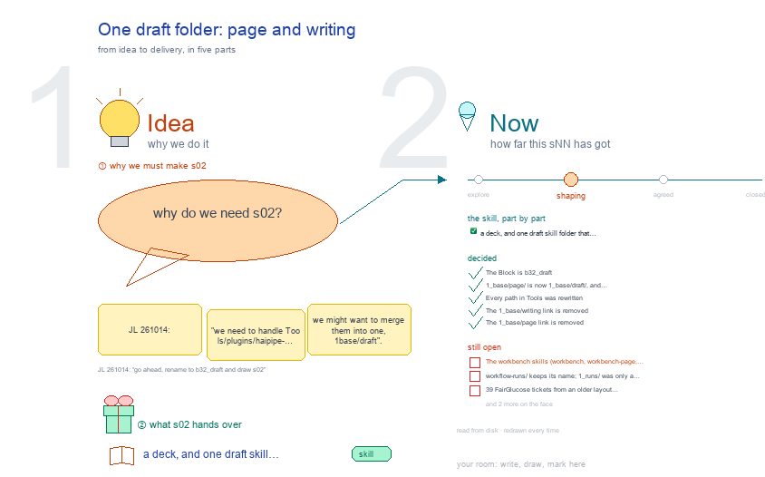

# s02 · One draft folder: page and writing <!-- root #38dc04 -->

**Tags:** `base` · `folders`
**Stage:** shaping

- For <!-- @for #f78806 -->
  - a deck, and one draft skill folder … <!-- @for/0 #756253 -->
    a deck, and one draft skill folder that merges page and writing, for the people who write the toolkit skills
- Delivery type <!-- @delivery-type #58a44f -->
  - skill <!-- @delivery-type/0 #34b33e -->
- Topic <!-- @topic #7e13bd -->
  - JL 261014: "we need to handle Tools/plugins/haipipe-toolkit/skills/1_base/writing … <!-- @topic/0 #fc1db3 -->
    JL 261014: "we need to handle Tools/plugins/haipipe-toolkit/skills/1_base/writing and Tools/plugins/haipipe-toolkit/skills/1_base/page ... we might want to merge them into one, 1_base/draft". s01 renamed the skill (`haipipe-page` became `haipipe-draft`), but its folder stayed `1_base/page/`, and the prose worker `haipipe-writing` sat apart in `1_base/writing/`.
  - This topic draws how the draft's Runs … <!-- @topic/1 #51f1da -->
    This topic draws how the draft's Runs call the writer, who else calls it without a draft, and the one `1_base/draft/` folder both now live in (moved 261014).
- Feeds <!-- @feeds #ffe8e9 -->
  - none (the Studio records this, not a … <!-- @feeds/0 #6e8111 -->
    none (the Studio records this, not a Question report)
- Files <!-- @files #6ce6c5 -->
  - [py] [build_s02_draft_folder_merge.py](build_s02_draft_folder_merge.py) <!-- @files/0 #957cce -->
  - delivery/ <!-- @files/1 #404761 -->
  - passes/ <!-- @files/2 #49b302 -->
  - [excalidraw] [s02-draft-folder-merge.excalidraw](s02-draft-folder-merge.excalidraw) <!-- @files/3 #500bc0 -->
  - [md] [s02-draft-folder-merge.md](s02-draft-folder-merge.md) <!-- @files/4 #60208b -->
  - [png] [s02-draft-folder-merge.png](s02-draft-folder-merge.png) <!-- @files/5 #317e05 -->
    
- The words the drawing reads <!-- @the-words-the-drawing-reads #92c5e5 -->
- Decided <!-- @decided #55615a -->
  - s02-D01 · The Block is `b32_draft` (was … <!-- @decided/0 #c88bd4 -->
    s02-D01 · The Block is `b32_draft` (was `b51_base_draft`), in the b3x row beside `b31_excalidraw`; the old name was swept in this Block, b10's s01 face and its history, three skill CHANGELOGs and one memory note (JL 261014: "go ahead, rename to b32_draft and draw s02")
  - s02-D02 · `1_base/page/` is now `1_base/draft/`, and … <!-- @decided/1 #c53e2c -->
    s02-D02 · `1_base/page/` is now `1_base/draft/`, and `1_base/writing/` is now `1_base/draft/writing/`; `haipipe-writing` keeps its name; links at `1_base/page` and `1_base/writing` keep old paths working (JL 261014: "please go ahead and do it. Tools/plugins/haipipe-toolkit/skills/1_base/page change this to draft")
  - s02-D03 · Every path in Tools was … <!-- @decided/2 #343da5 -->
    s02-D03 · Every path in Tools was rewritten (147 files, `../` links recomputed per file); generated drawings were rebuilt by their builders, never edited; the skill links were remade by `install.sh` globally and in WellDoc, DrFirst, Knowledge, REACH and jluo41-repo (JL 261014)
  - s02-D04 · The `1_base/writing` link is removed: … <!-- @decided/3 #a5a929 -->
    s02-D04 · The `1_base/writing` link is removed: no file in Tools or the six SPACEs and no skill link used it; the writer stays grouped in `draft/writing/` (haipipe-writing with its vendored 1_style and 2_evaluate), not spread across draft/ (JL 261014: "we don't need this anymore ... merge this totally to 1_base/draft")
  - s02-D05 · The `1_base/page` link is removed <!-- @decided/4 #6fe992 -->
    s02-D05 · The `1_base/page` link is removed. Before that: 174 delivery tickets in the other SPACEs were rewritten by haipipe-draft's own `write_ticket` (ticket only, no build; 45 flat ones moved into their Run folders, as every export now does), 8 context records by `context-record.py`, and 16 hand-written files (READMEs, AGENTS.md, build scripts, board.md) by hand; then 19 workbench hosts were restarted with their own arguments on their SPACE's `.venv` (JL 261014: "we should remove this one as well, right?")
- Open <!-- @open #cf9b77 -->
  - The workbench skills (`workbench`, `workbench-page`, `workbench-studio`) are … <!-- @open/0 #fa07ef -->
    The workbench skills (`workbench`, `workbench-page`, `workbench-studio`) are the shared screen
  - that b10 owns: move them out to … <!-- @open/1 #c34c77 -->
    that b10 owns: move them out to `1_base/workbench/` only after b10 agrees.
  - `workflow-runs/` keeps its name <!-- @open/2 #b46885 -->
    `workflow-runs/` keeps its name; `1_runs/` was only a proposal.
  - 39 FairGlucose tickets from an older layout … <!-- @open/3 #7c98ee -->
    39 FairGlucose tickets from an older layout (`runs/delivery-run/run_delivery_*.sh`) still name
  - `1_base/page` and would fail if run; the … <!-- @open/4 #e09ac6 -->
    `1_base/page` and would fail if run; the current tickets beside them (`runs/run-delivery-*/`) work. No code writes the old ones now (s01-D05 kept them as history): delete them, or keep them as history?
  - Not from this move: Physician run notes, … <!-- @open/5 #2ed9a5 -->
    Not from this move: Physician run notes, two `run_delivery.py` scripts and an old `board.js` name
  - `skills/page/haipipe-page`, a path gone since the 1_base … <!-- @open/6 #4884f6 -->
    `skills/page/haipipe-page`, a path gone since the 1_base layout; the 5654 preview host served a folder removed on 261002 and was not restarted.
  - Agree its **For:** line and **Delivery type:** … <!-- @open/7 #09a2ba -->
    Agree its **For:** line and **Delivery type:** (skill), proposed by the agent 261030?
