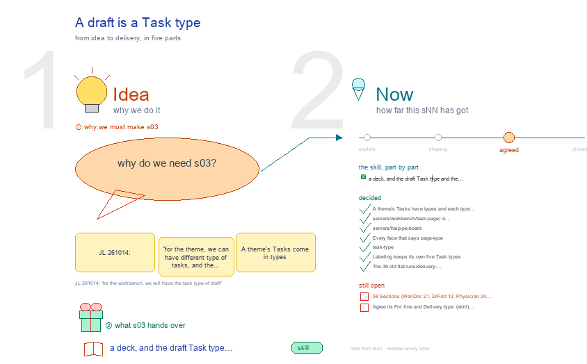

# s03 · A draft is a Task type <!-- root #d3a295 -->

**Tags:** `base` · `workbench`
**Stage:** agreed

- For <!-- @for #f78806 -->
  - a deck, and the draft Task type … <!-- @for/0 #f03aec -->
    a deck, and the draft Task type and the layout it gets in the workbench, for the people who write the toolkit skills
- Delivery type <!-- @delivery-type #58a44f -->
  - skill <!-- @delivery-type/0 #34b33e -->
- Topic <!-- @topic #7e13bd -->
  - JL 261014: "for the theme, we can … <!-- @topic/0 #994150 -->
    JL 261014: "for the theme, we can have different type of tasks, and the tasks can have different layout, for the Tools/plugins/haipipe-toolkit/servers/workbench, we will have the task type of draft".
  - A theme's Tasks come in types (the … <!-- @topic/1 #5b8f8a -->
    A theme's Tasks come in types (the face's `task-type:` line), and each type has its own layout on the shared frame.
  - `draft` is the first type the base … <!-- @topic/2 #508c0a -->
    `draft` is the first type the base lays out for every theme: a Task that writes (a paper Section, a report, an email, a discovery or insight page) opens on `servers/workbench/workbench-task-draft/`, and its theme adds its own Spaces on top.
  - The same day `servers/haipipe-board` (empty) was deleted … <!-- @topic/3 #6b628b -->
    The same day `servers/haipipe-board` (empty) was deleted and `servers/haipipe-page` was folded into `workbench-task-draft/reader/`.
- Feeds <!-- @feeds #ffe8e9 -->
  - none (the Studio records this, not a … <!-- @feeds/0 #6e8111 -->
    none (the Studio records this, not a Question report)
- Files <!-- @files #6ce6c5 -->
  - [py] [build_s03_draft_task_type.py](build_s03_draft_task_type.py) <!-- @files/0 #3e2058 -->
  - delivery/ <!-- @files/1 #404761 -->
  - passes/ <!-- @files/2 #49b302 -->
  - [excalidraw] [s03-draft-task-type.excalidraw](s03-draft-task-type.excalidraw) <!-- @files/3 #7ba5f2 -->
  - [md] [s03-draft-task-type.md](s03-draft-task-type.md) <!-- @files/4 #0c8272 -->
  - [png] [s03-draft-task-type.png](s03-draft-task-type.png) <!-- @files/5 #6e77c5 -->
    
- The words the drawing reads <!-- @the-words-the-drawing-reads #92c5e5 -->
- Decided <!-- @decided #55615a -->
  - s03-D01 · A theme's Tasks have types … <!-- @decided/0 #c4248f -->
    s03-D01 · A theme's Tasks have types and each type has a layout; the base lays out `task-type: draft` for every theme (`frame.task_layouts()`, `frame.task_type`; each type's folder `workbench-task-<type>/`), and a theme's own Spaces go on top (JL 261014: "for the workbench, we will have the task type of draft")
  - s03-D02 · `servers/workbench/task-page/` is `servers/workbench/workbench-task-draft/` <!-- @decided/1 #53580d -->
    s03-D02 · `servers/workbench/task-page/` is `servers/workbench/workbench-task-draft/`; `PAGE_TASK_SUBS`, `PAGE_TASK_RUNS` and `page_task_spaces` are `DRAFT_TASK_SUBS`, `DRAFT_TASK_RUNS` and `draft_task_spaces`; the `/_board/...` addresses stay (JL 261014: "yes, please go ahead and do that")
  - s03-D03 · `servers/haipipe-board` (only `__pycache__`) is deleted <!-- @decided/2 #334a7f -->
    s03-D03 · `servers/haipipe-board` (only `__pycache__`) is deleted; `servers/haipipe-page` is folded into `servers/workbench/workbench-task-draft/reader/` (the standalone server, the reader look, its 4 tests), loaded in the host's old slot so the css order is unchanged (JL 261014: "I think we can delete these two things")
  - s03-D04 · Every face that says `page-type: … <!-- @decided/3 #03fb7a -->
    s03-D04 · Every face that says `page-type: section` (185 in WellDoc, DrFirst, Physician and REACH) says `task-type: draft` on the line above it; `page-type:` stays as the theme's subtype, and `frame.task_action` reads only `task-type: draft`. New Sections get the line from `paper_ladder.py` and the section templates (JL 261014: "Yes, clean them, go ahead and do all")
  - s03-D05 · `task-type: page` is `task-type: evidence`: … <!-- @decided/4 #1f625a -->
    s03-D05 · `task-type: page` is `task-type: evidence`: `task/10_page/haipipe-task-for-page` is `task/10_evidence/haipipe-task-for-evidence`; no face used the old name (JL 261014: "go ahead and do all")
  - s03-D06 · Labeling keeps its own five … <!-- @decided/5 #cd56b2 -->
    s03-D06 · Labeling keeps its own five Task types (`labeling_theme.TYPES`): they mean something only inside a labeling Block, and `frame.task_layouts()` finds the layouts the base gives every theme (JL 261014: "do all")
  - s03-D07 · The 39 old flat `runs/delivery-run/run_delivery_*.sh` … <!-- @decided/6 #0dd7e7 -->
    s03-D07 · The 39 old flat `runs/delivery-run/run_delivery_*.sh` tickets in FairGlucose's 13 Sections are deleted; each Section's `runs/run-delivery-<lane>/` ticket is the one that runs (JL 261014: "clean them")
- Open <!-- @open #cf9b77 -->
  - 58 Sections (WellDoc 21, DrFirst 12, Physician … <!-- @open/0 #63c1a9 -->
    58 Sections (WellDoc 21, DrFirst 12, Physician 24, REACH 1) keep an old web copy in their own
  - `delivery/web/`, from before the web Run wrote … <!-- @open/1 #b01429 -->
    `delivery/web/`, from before the web Run wrote to the Board's `delivery/<version>/<section>/web/`. Each one has a fresh copy there (checked 261015), and nothing writes or reads the old one. The list: the scratchpad's `orphans_ok.txt`. Removing them was held for a person (all are tracked in git).
  - Agree its **For:** line and **Delivery type:** … <!-- @open/2 #09a2ba -->
    Agree its **For:** line and **Delivery type:** (skill), proposed by the agent 261030?
