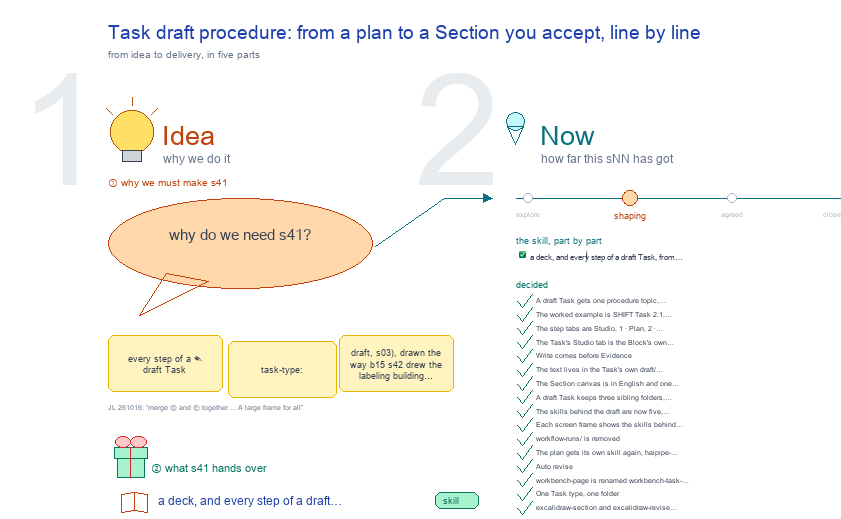

# s41 · Task draft procedure: from a plan to a Section you accept, line … <!-- root #7d4fce -->

**Tags:** `Levels`
**Stage:** shaping

- For <!-- @for #f78806 -->
  - a deck, and every step of a … <!-- @for/0 #7f74da -->
    a deck, and every step of a draft Task, from a plan to a Section accepted line by line, for the people who write the toolkit skills
- Delivery type <!-- @delivery-type #58a44f -->
  - skill <!-- @delivery-type/0 #34b33e -->
- Topic <!-- @topic #7e13bd -->
  - every step of a ✎ draft Task … <!-- @topic/0 #feaa6d -->
    every step of a ✎ draft Task (`task-type: draft`, s03), drawn the way b15 s42 drew the labeling building Task: one workflow map of who does what, one revise pass as a loop, the Task as a tree, and each step's tab as it develops (Operation over Result).
  - A draft Task writes one Section (a … <!-- @topic/1 #bd3401 -->
    A draft Task writes one Section (a paper Section, a proposal's part, a report): it plans, finds its evidence, writes, then revises pass by pass on the Section canvas until the person says done, and its text is built into tex, docx and pdf.
  - The worked example is SHIFT Task 2.1, … <!-- @topic/2 #354044 -->
    The worked example is SHIFT Task 2.1, Section C2 (b21_event_cgm, Codex thread "SHIFT · Event CGM", 261014), whose Section canvas is b21 s05.
  - Asked by JL 261015 ("How do you … <!-- @topic/3 #49b53c -->
    Asked by JL 261015 ("How do you think you can add sNN in b32 to showing the design as well?"; then "Tools/blueprints/Project-Ladder/work/b15_theme_labeling/s42-task-building-procedure <---- you can try to follow this").
  - The draft's grammar and its Runs stay … <!-- @topic/4 #5074da -->
    The draft's grammar and its Runs stay haipipe-draft's; this topic draws its screens.
- Feeds <!-- @feeds #ffe8e9 -->
  - none yet (b32 has no `reports/`) <!-- @feeds/0 #d565b8 -->
- Files <!-- @files #6ce6c5 -->
  - [py] [build_s41_task_draft_procedure.py](build_s41_task_draft_procedure.py) <!-- @files/0 #d58737 -->
  - delivery/ <!-- @files/1 #404761 -->
  - history/ <!-- @files/2 #9a00ab -->
  - passes/ <!-- @files/3 #49b302 -->
  - [excalidraw] [s41-task-draft-procedure.excalidraw](s41-task-draft-procedure.excalidraw) <!-- @files/4 #b53893 -->
  - [md] [s41-task-draft-procedure.md](s41-task-draft-procedure.md) <!-- @files/5 #f7d44a -->
  - [png] [s41-task-draft-procedure.png](s41-task-draft-procedure.png) <!-- @files/6 #90fa20 -->
    
- Decided <!-- @decided #55615a -->
  - s41-D01 · A draft Task gets one … <!-- @decided/0 #544b80 -->
    s41-D01 · A draft Task gets one procedure topic, drawn the way b15 s42 draws the labeling building Task: the workflow map of who does what, one pass as a loop, the Task as a tree, and each step's tab as it develops (JL 261015: "you can try to follow this").
  - s41-D02 · The worked example is SHIFT … <!-- @decided/1 #4115ac -->
    s41-D02 · The worked example is SHIFT Task 2.1, Section C2, and its canvas is b21 s05 as it stands; the drawing reads both from disk (JL 261015, asked after reading the Codex thread "SHIFT · Event CGM").
  - s41-D03 · The step tabs are Studio, … <!-- @decided/2 #e84e41 -->
    s41-D03 · The step tabs are Studio, 1 · Plan, 2 · Evidence, 3 · Write, 5 · Revise, then Delivery: the Studio (talk and sketch the argument) comes before the plan, and Delivery is the last tab (JL 261015: "we should also add Studio before the plan, So it is the Studio, 1, Plan, ..... and Delivery as the last one").
  - s41-D04 · The Task's Studio tab is … <!-- @decided/3 #72084f -->
    s41-D04 · The Task's Studio tab is the Block's own Studio topic for this Task, `<block>/sNN-<topic>/`, and its Delivery tab is the Block's own `delivery/`, under the Task's path (`<block>/delivery/<jNN>/<tNN>/`): the same folders the Block's Studio and Delivery show, never a copy inside the Task (JL 261015: "the Studio will the the sNN tNN for it, they are the same folder, and the Delivery will also be the same Delivery in the block level delivery").
  - s41-D05 · Write comes before Evidence: the … <!-- @decided/4 #c9eb64 -->
    s41-D05 · Write comes before Evidence: the evidence agent reads the written Section as a reader and puts an Evidence card on each claim that needs support, as Codex did on B21 C2 (CITE 1 for S1). The step tabs are Studio, 1 · Plan, 2 · Write, 3 · Evidence, 4 · Display, 5 · Revise, Delivery. Each step's Result is the same Section canvas from that session, filled one column at a time: logic (Studio, Plan), text (Write), evidence (Evidence), edits (Revise) (JL 261015: "we might first need the Write, and then need the Evidence, and then need the revise?"; "I think we might want the good UI to follow what we discussed in the codex session of SHIFT · Event CGM").
  - s41-D06 · The text lives in the … <!-- @decided/5 #48cadb -->
    s41-D06 · The text lives in the Task's own `draft/` subfolder, `<block>/<jNN>/<tNN>/draft/`: the plan (§1), the scratch (§2) and the text (§3), with `evidence/` and `display/` beside it (s41-D08); the map's two state lanes are that folder (JL 261015: "I think we will have the "draft" subfolder in the taskfolder").
  - s41-D07 · The Section canvas is in … <!-- @decided/6 #ba341e -->
    s41-D07 · The Section canvas is in English and one editing unit holds several paragraphs (b21 s05-D07; JL 261015: "one editing unit can have several paragraphs"): left, the Section cut from the old PDF above its logic; middle, one wide text card, the main piece, heavy and large, a sentence after a sentence with no gap; right, the Revise cards with no box, as stairs with a line from each card's sentence; along the bottom, every Evidence card once, in loose rows kept near the text, not a grid; bottom right, under Revise and right of the Evidence, the Displays (figures and tables built on the Evidence) (JL 261016: "freestyle ... the content card is the main"). A Revise card is named by kind (Edit, Review, Section question) and its sentence, not R1-R7, with three rows: Why, Original, Expected (JL 261015: "do not call it Rxx"). Each Evidence card is one topic holding many items: CITE, a discovery Task or Job (papers, and any value or figure a paper reports); WORK, a work Task or Job (our Runs' values, figures and tables); a figure or table is an item of either. Each item is tagged with its sentence, and each paper is read from its Run's result/ by address bNN.jNN.tNN.rNN, title first. The words each item backs are boxed in the text, with the card's name beside them in the margin (JL 261015: "the E should be Exxx"; "one Ecite to have multiple paper"; JL 261016: "Ecite, and Ework", then "just CITE ... WORK", blue external and violet internal; "highlight it as well, and link it to the Evidence card").
  - s41-D08 · A draft Task keeps three … <!-- @decided/7 #8fd166 -->
    s41-D08 · A draft Task keeps three sibling folders, one writer each: `draft/` (the words, haipipe-draft), `evidence/` (`cards.yaml` and `proposals.md`, haipipe-evidence) and `display/` (one unit per figure or table, haipipe-display). Display reads `evidence/`; the draft reads both; the Section canvas only reads all three. Missing evidence becomes a flagged proposal in `evidence/proposals.md` (a new Run, Task, Job or Studio topic, proposed by evidence, for a stated purpose) that a person ticks. haipipe-draft-evidence retires in steps: new pages first, then EMBED moves into haipipe-draft, then Proj21's four Page evidence Runs become cards, then the skill goes (JL 261016: "in the folder of the draft-task, we should have the subfolder of draft, evidence, and display"; "it can just call the evidence and display"). First moved: b21's C2 cards, to `s04-task21-updated-draft/evidence/`.
  - s41-D09 · The skills behind the draft … <!-- @decided/8 #2f08f6 -->
    s41-D09 · The skills behind the draft are now five, and every screen names its own (was b32 s21, folded in here; JL 261016: "maybe no more s21, merge it to the s41"; "Current s21 is very hard to follow"): haipipe-draft (the door: plan, folder, steps; `ref/folder.md` replaced haipipe-folder), haipipe-draft-writing (writes; took in haipipe-writing's drafting, haipipe-sentence and the WRITE Run), haipipe-draft-review (judges, never the writer; took in haipipe-writing's evaluate side and haipipe-draft-check), haipipe-evidence (the door; its two kinds are haipipe-evidence-cite for papers from discovery Runs and haipipe-evidence-work for values from our own Runs) and haipipe-display. Out of `draft/`: the excalidraw skills (`1_base/excalidraw/`), workbench and workbench-page (`1_base/workbench/`), the Studio screen (haipipe-studio), Questions (haipipe-report); no links inside Tools. The full record of those seven moves is `history/s21-draft-skill-map-261016/` (s21-D01 to D07).
  - s41-D10 · Each screen frame shows the … <!-- @decided/9 #19569a -->
    s41-D10 · Each screen frame shows the skills behind it outside its edges: on the left `[skill] ──▶`, the skill that makes what you see; on the right `◀── [skill]`, the one that reads or checks it; dashed when it is a person; each box says what was merged into it. Ⓓ draws the skills as their folders, read from disk on every build: `1_base/<family>/` in the first column, its skills stacked in the next (one level holds many skills, not one per step), a sub-folder such as `workflow-runs/` one column further; the five the draft runs on in the key colour, "+ what it took in" beside each (JL 261016: "for each UI, we should also use <---- [box] and [box] -----> to explain how the skills are merged"; "a new frame to use the stair tree"; then "每个 style 算作一列 … 这一列里是不是可能有几个相同 level 的 skill … 按照这个 folder 的 structure 把这个画出来"). One level further, inside each skill, are the pages that were skills of their own (a page whose first lines say "was the skill X") and the skills kept inside it, such as the humanizers in haipipe-draft-review; Ⓓ holds the draft's skills, Ⓔ the drawing and screen families, each one screen (JL 261016: "where are the old things? … you can unfolder more"). Since then Ⓓ is ONE large frame, read by zooming (`canvas.large`): every family side by side and, last, the code behind the screens, `servers/workbench/` with `workbench-task-draft/` opened file by file (each file's first docstring line), a dashed red "explains" line from its manual `workbench-task-draft` (JL 261016: "merge Ⓓ and Ⓔ together, and also have a tree to show the workbench-task-draft"; "A large frame for all").
  - s41-D11 · `workflow-runs/` is removed; its six … <!-- @decided/10 #bae877 -->
    s41-D11 · `workflow-runs/` is removed; its six Run skills fold into their owners: context, structure and scratch become `haipipe-draft/ref/` pages (the plan's steps: gather, shape, rough notes); revise becomes `haipipe-draft-writing/ref/revise.md` (the writer's before-and-after ledger); evidence (LAND, EMBED) becomes `haipipe-evidence/ref/page-evidence.md`; delivery joins haipipe-delivery. Four `haipipe-draft-*` skills remain: haipipe-draft (the door, the plan), haipipe-draft-writing (writes), haipipe-draft-review (judges, never the writer) and haipipe-draft-workflow (runs the steps, giving the writing and the judging to different agents). Old triggers still land on the right page (JL 261016: "could we remove the workflow-runs, and put the haipipe-draft-xxx to the root?"; "go ahead and update").
  - s41-D12 · The plan gets its own … <!-- @decided/11 #f03efb -->
    s41-D12 · The plan gets its own skill again, `haipipe-draft-logic`: deciding what to say, beside writing (how to say it) and review (is it good). It holds `ref/structure.md` (SHAPE and SURVEY, the Draft's `## 1 · Structure`), `ref/context.md` (what the plan must satisfy) and `ref/scratch.md` (rough thinking, `## 2 · Scratch`), moved out of haipipe-draft, which keeps the door: the folder, the face, building and serving the Page. Run names stay (`run-structure-<slug>`, `run-scratch-<target>`, Page.context), and `/haipipe-draft-structure`, `-context`, `-scratch` land on it. Five remain: haipipe-draft, haipipe-draft-logic, haipipe-draft-writing, haipipe-draft-review, haipipe-draft-workflow (JL 261016: "we should still have haipipe-draft-structure, or we can call it haipipe-draft-logic ... it will work as the plan"; "yes, go ahead and do it").
  - s41-D13 · Auto revise: rounds of haipipe-draft-writing … <!-- @decided/12 #130b5d -->
    s41-D13 · Auto revise: rounds of haipipe-draft-writing (revise) and haipipe-draft-review (a fresh agent each round) until the text is good enough, then one stop. A round applies small fixes to a candidate copy (wording, a broken rule such as a semicolon, a long sentence split with the same meaning) and holds every big one as a decision card for JL: anything that changes a claim, a number, a citation, or the plan (`## 1 · Structure`). It stops when the reviewer's rubric verdict is ready and the anti_slop score is under its threshold, when a round does not improve, or after 3 rounds. Nothing reaches the Draft before JL picks: the Revise area shows the decisions first and the small fixes folded under them (JL 261016: "auto revise ... several rounds of revising until the things are self-evaluated good enough, and give some big decisions in the revise area"; "go ahead and do both").
  - s41-D14 · `workbench-page` is renamed `workbench-task-draft` (0.102.0), … <!-- @decided/13 #5c5328 -->
    s41-D14 · `workbench-page` is renamed `workbench-task-draft` (0.102.0), named after the server folder it explains, `servers/workbench/workbench-task-draft/`; the folder has a README whose first line points to the manual.
  - s41-D15 · One Task type, one folder: … <!-- @decided/14 #9964ce -->
    s41-D15 · One Task type, one folder: `workbench-task-<type>/` holds everything a Task of that type shows, its layout `task_<type>.py` (`TASK_TYPE`, `spaces()`), its views, their assets and tests, and its manual is the skill `workbench-task-<type>`. A type every theme uses sits in `servers/workbench/`, a theme's own type in `servers/workbench-<theme>/`. The draft layout moved out of `frame.py` into `workbench-task-draft/task_draft.py`, and `frame.task_layouts()` finds every such folder (`host_registry.task_folders()`), so a new type is only a new folder (JL 261016: "I want to put the UI assets related to this workbench-task-xxx to this folder ... we can have many other types of the task types later").
  - s41-D16 · `excalidraw-section` and `excalidraw-revise` merge into … <!-- @decided/15 #3cb8a3 -->
    s41-D16 · `excalidraw-section` and `excalidraw-revise` merge into one skill, `excalidraw-draft` (2.0.0), with two modes: Map (`ref/map.md`: a paper's Sections, paragraphs, Bullets and evidence cards, from the plans) and Revise (`ref/revise.md`: a file we change, each section's page beside the updated sentences, the tracked Word file). Both draw a haipipe-draft draft; the old names stay as triggers (JL 261016: "should we make excalidraw-revise and exxcalidraw-section to be merged as the excalidraw-draft?").
  - s41-D17 · No `haipipe-draft-revise`: revising is the … <!-- @decided/16 #84deb1 -->
    s41-D17 · No `haipipe-draft-revise`: revising is the writer's second pass, so it stays in haipipe-draft-writing (`ref/revise.md`, `ref/auto-revise.md`). The order is logic → writing → review → writing (revise); one writer for `draft/`, and the judge is never the writer (JL 261016: "Or it is good to keep, as the revise is a type of writing?").
  - s41-D18 · The labeling Task type is … <!-- @decided/17 #f93f6a -->
    s41-D18 · The labeling Task type is its own folder too: `servers/workbench-labeling/workbench-task-labeling/` holds `task_labeling.py` (the frame's Spaces for a labeling Task by its type, out of `labeling_theme.py`), `labeling.py` (the engine's Labeling workbench and its write door) and its tab's js; its manual is the new skill `workbench-task-labeling`, split out of `workbench-labeling`, which keeps the host, the Board level and the Guide. A theme's own Task type lays out only that theme's Tasks (`frame.task_layouts(theme)`), so a labeling `task-type: eval` never touches a work Task (JL 261016: "go ahead with workbench-task-labeling").
  - s41-D19 · haipipe-draft-writing's `ref/drafting.md` is `ref/writing.md` and … <!-- @decided/18 #acbbce -->
    s41-D19 · haipipe-draft-writing's `ref/drafting.md` is `ref/writing.md` and opens with the rules every sentence is written by: the five sections of `haipipe-draft-review/ref/plain-rules.md`, one line each. The rules stay in that one page, so the writer and the reviewer read the same list (JL 261016: "COULD WE CHANGE THIS TO THE ref/writing.md, and do we have any writing rules here?").
  - s41-D20 · Frame Ⓒ (one revise pass … <!-- @decided/19 #5d133b -->
    s41-D20 · Frame Ⓒ (one revise pass as seven boxes, and the Task as a tree) is dropped: ⑩ ⑪ ⑫ already show the pass as screens, and the loop that matters now is the whole round, Delivery → Render → read the returned file back → Plan again, which is to be drawn after ⑭ (JL 261019, on a screenshot of Ⓒ: "我们是不是不再需要这个了？").
  - s41-D21 · Two loops (JL 261019: "我感觉这里我们应该有所谓的小循环和大循环，对吧？") <!-- @decided/20 #2bc873 -->
    s41-D21 · Two loops (JL 261019: "我感觉这里我们应该有所谓的小循环和大循环，对吧？"). The small loop is a Revise pass, draw → notes → cards → accept → apply, k ← k+1, until ✍ Done?. The big loop is a round: Plan to Send, then the co-authors change the file, we read it back (`-vN`, rendered, their comments) and plan again, n ← n+1. Render comes before Send (you look at the pictures of what goes out) and again on the file that comes back; the real stop is ✍ Another round? answered stop, not Send.
  - s41-D22 · Claim first; evidence is a … <!-- @decided/21 #f19695 -->
    s41-D22 · Claim first; evidence is a side loop, not a stage (replaces the order in D05; JL 261019: "OK，那你改改吧", on Open 5). Once you sign the plan, each Bullet that needs backing gets a card from `cards.py`: have it, ask a Job, ask a person, or soften the claim; you tick the asks in `evidence/proposals.md` and that level's skill makes the Run in its own Job. Writing does not wait: a sentence whose card waits keeps a red box. After Write, the reader pass (D05's place) adds cards for claims the plan missed. A card that comes back enters the small loop at draw(Section), because a number can change the claim.
  - s41-D23 · A new round stays in … <!-- @decided/22 #050779 -->
    s41-D23 · A new round stays in the same Section topic, `sNN-<topic>/`; it never opens a new sNN (JL 261019: "应该还是 当下这个 SNN of section 对吧？ … 我们可以把这几个版本留着"). Before round n+1 is drawn, round n's drawing, its preview and its page pictures move to `history/round-<n>-<yymmdd>/` in that topic, and the drawing is rebuilt from the file that came back. Nothing is written over: the text keeps its versions in `draft/previous/`, the file we sent and the one that came back are `-vN` in `delivery/` and `related/materials/`.
  - s41-D24 · Studio is one thing at … <!-- @decided/23 #0cb98d -->
    s41-D24 · Studio is one thing at every level: the Block's `sNN-<topic>/`. A Job's or a Task's Studio tab opens the same Block Studio, showing the topics in its Job's group; a topic is named by what it is about (s06 section-canvas-c5-timeline), never by a tNN, and no Job or Task keeps a studio/ (JL 261019: "我们这个 studio 其实就是 sNN jNN tNN … 它跟我们这个 block level 的这个 SNN 是一个东西").
  - s41-D25 · The plan and the Studio … <!-- @decided/24 #bcdde1 -->
    s41-D25 · The plan and the Studio are one loop (JL 261019: "这个 plan 有的时候我们可能是在 Studio 里面做，但它也会相应地 去更新 … 这个 plan 其实跟 Studio 是紧密连接的"). What a Studio talk settles is written into the Task's `draft/` §1 by haipipe-draft-logic in the same session, so the 1 · Plan tab already shows it and asks only for what is still open and for your Sign. Studio and Delivery live at the Block and show in the Task too, one place for two uses (D04, D24); the plan stays the Task's own file, fed from the Studio.
  - s41-D26 · Write is a first draft, … <!-- @decided/25 #045e9a -->
    s41-D26 · Write is a first draft, not a finished text (JL 261019: "这个 Write 感觉跟 scratch 一样，就跟写小说、写草稿 一样，没有那么多负担。Evidence 也可以先放着，你一边写，就有人一边帮你去找 evidence"). One text, two views: the Studio shows `draft/` §3 drawn on the Section canvas, to read and mark; the 2 · Write tab shows the same §2 and §3 as a page to type in, one paragraph under its plan line, no rule checks while writing. The evidence agent watches the text and proposes cards in the margin next to the sentence (proposed, not bound); you may ignore them. The writing rules (haipipe-draft-review plain-rules) apply in 5 · Revise.
  - s41-D27 · Every delivery item names the … <!-- @decided/26 #1f0fa4 -->
    s41-D27 · Every delivery item names the one OneDrive file it goes to (JL 261019: "每个 delivery 我们都要 point to 它 具体要到 OneDrive 的哪个地方"). Today the Block names only its OneDrive folders (`onedrive:` in board.md) and each file's place sits inside a Block script (b21 word_versions.py) or a delivery.md row's words. Proposed: one row per item in `delivery/delivery.md`, "Where each item goes" (item, OneDrive file under an `onedrive:` folder, reader); `word_round.py` reads it, so push and pull need no path, and the Delivery view shows "→ OneDrive: <file>" and which version that file holds.
  - s41-D28 · The canvas and the step … <!-- @decided/27 #b2c7e3 -->
    s41-D28 · The canvas and the step tabs are two views of the same files, kept in step through the files, never with each other (JL 261019: "我虽然有 stage 1、2、3、4，但比如我都在这个画布上工作，那我这个 stage 1、2、3、4 的内容 也会对应更新"). The truth is the Task's `draft/` (§1, §2, §3, records/) and `evidence/cards.yaml`. The tabs are rendered from them on every open. The canvas is read back: a sentence typed over on it goes into §3 by its address (code, as Revise mode's `read_revise.py edits --apply`), a ✓ on a card sets its state (code), a red note or sketch becomes a feedback record that haipipe-draft-writing or -logic turns into Revise cards or a §1 change (an agent); then the canvas is rebuilt from the files. Opening a canvas older than its files rebuilds it first.
  - s41-D29 · The step tabs are built … <!-- @decided/28 #47d534 -->
    s41-D29 · The step tabs are built (2026-10-20; JL 261020, on the LLMRec abstract's Work: "I think we need to make this as what we exected to see"; then "Update the /haipipe-paper and /haipipe-draft and then apply it to" the version's Work). `servers/workbench/workbench-task-draft/draft_steps.py` draws the seven tabs, each Operation over Result, read from the Task's files on every open and writing none; `task_draft.py` lays them in Work and, Results only, in Report beside Table and Questions. Description is the face alone; its Plan, Requirement and Records are cards of 1 · Plan (settles Open 3). Revise cards live in `draft/records/<stem>-revise.md` (settles Open 1). A person's own words go in through the Page's Revise boxes, embedded in 2 · Write and 5 · Revise (JL 261020: "How could I write my own changes?"; "it is kind of hard to me to modify the content, right?"). A Job's Work shows each Task's six chips, a click each into that tab. An old link follows `OLD_SUBS`; haipipe-draft 0.135.0 and haipipe-paper 1.15.0 teach the steps and their verbs.
  - s41-D30 · Scratch is planning, so it … <!-- @decided/29 #4fd9df -->
    s41-D30 · Scratch is planning, so it is typed in 1 · Plan, a note under each paragraph (`## 2 · Scratch`, the Page's Scratch view embedded), and 2 · Write drafts `## 3 · Draft` from §1 and its Scratch, keeping every sentence the person typed (JL 261020: "for the scratch, it doesnt work anymore"; "I think we should move the scratch here"). The person's own words go in without a form: a paragraph box has no frame, saves when left or on Cmd+Enter, and Esc puts back what it held (JL 261020: "i don't like the box, could you remove it?"; of Why · Reset · Save: "We might don't need this as well"). A box holds the paragraph one sentence a row, a long one wrapping inside its row ("howto make this each sentence a row?"), typed freely; on save each Bullet takes the sentences that read most like its old Draft (JL 261020: "How could we make the editing to be more easier and free style here?"). Report shows the prompts of 1 · Plan, 2 · Write and 5 · Revise ("for the plan here, I cannot see the input"). Built by the Paper-LLMRecPhy-Quick session on JL's asks, 261020.
  - s41-D31 · Revise works in passes, and … <!-- @decided/30 #61f154 -->
    s41-D31 · Revise works in passes, and each pass starts as the reviewer. A pass is one run's new cards, `## Pass <k> · <date> · on draft v<N>` in `draft/records/<stem>-revise.md`; 5 · Revise shows the text, then the passes newest first (each card old → new, a Section question as now and proposed), then the canvas (JL 261020: "between these two, you should also add a new one about the Revision card, everytime to run you will have many things new"). The prompt first asks the agent to say who it reviews as (the venue's reviewer), what it looks for and how, so structure comes before sentences: a draft that is wrong as a whole becomes a Section question that sends it back to 1 · Plan (JL 261020: "I just fell this draft is totally bad, it should have more paragraphs"; "think about yourself，就是你是一个什么样的 reviewer").
  - s41-D32 · A Revise card is acted … <!-- @decided/31 #75e1a3 -->
    s41-D32 · A Revise card is acted on where it is shown (JL 261020: "你这个 card 也不怎么交互啊，我想要那种可以交互的感觉"): ✓ Accept, ✗ Reject, ✎ Edit (type the Expected words in place) and ↺ Undo, without a reload. A click writes only that card's `State:` (with its time) or `Expected:` into the cards file, and is refused when the card changed on disk since the page showed it. The text is untouched until the pass's "apply the accepted cards" prompt writes them as the next version (settles Open 1, "What Accept writes": the card's state; the version comes with apply).
  - s41-D33 · The cards file keeps one … <!-- @decided/32 #817d06 -->
    s41-D33 · The cards file keeps one pass, the latest; a Revise run rewrites it, carrying over the undecided cards that are still true, and older passes live in git (replaces D31's passes newest first; JL 261020: "we just need one of it ... always keep the latest version"). A card has no box, only the thin line on its left (JL 261020, of the card borders: "I don't want this"). Built by the Paper-LLMRecPhy-Quick session.
  - s41-D35 · Revise reads as the text … <!-- @decided/33 #c3db07 -->
    s41-D35 · Revise reads as the text and its cards side by side (JL 261020: "How do you think we can merge them together, one in the left, and one in the right? so we can link to the original text as well"): the text on the left stays in view, each card on the right sits beside its sentence and lights it on hover. Each item is its own card ("I still want each of them to have a card"); a paragraph-plan question is a table, now against proposed ("You can make it like the table?"); a change over several sentences is a row per sentence, a sentence folded into another shown struck "→ into S6" ("I think this should be sentence by sentence"). The Section canvas may hold, beside ours, how other papers open the same Section, read in a reading topic (excalidraw-draft `examples:`; "In the canvas, could you add other paper's introduction as well?"); first on LLMRec s22 from s26.
- Open <!-- @open #cf9b77 -->
  - B21's draft sits under `s04-task21-updated-draft/draft/`, not under … <!-- @open/0 #a2bb07 -->
    B21's draft sits under `s04-task21-updated-draft/draft/`, not under a Task; a draft Task owns its `draft/`.
  - Agree its **For:** line and **Delivery type:** … <!-- @open/1 #09a2ba -->
    Agree its **For:** line and **Delivery type:** (skill), proposed by the agent 261030?
