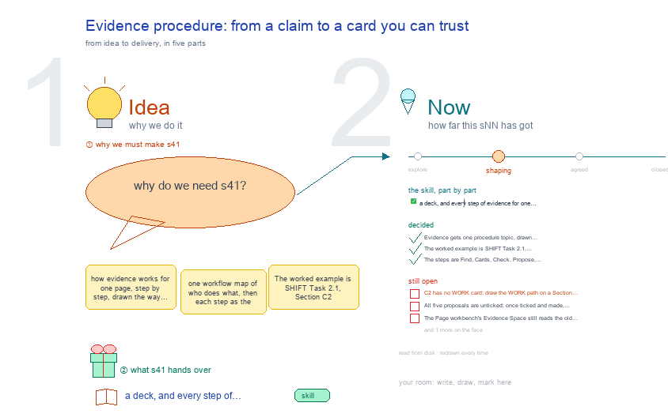

# s41 · Evidence procedure: from a claim to a card you can trust <!-- root #ee63bb -->

**Tags:** `Levels`
**Stage:** shaping

- For <!-- @for #f78806 -->
  - a deck, and every step of evidence … <!-- @for/0 #f0633a -->
    a deck, and every step of evidence for one page, from a claim to a card you can trust, for the people who write the toolkit skills
- Delivery type <!-- @delivery-type #58a44f -->
  - skill <!-- @delivery-type/0 #34b33e -->
- Topic <!-- @topic #7e13bd -->
  - how evidence works for one page, step … <!-- @topic/0 #d91636 -->
    how evidence works for one page, step by step, drawn the way b32 s41 draws the draft Task: one workflow map of who does what, then each step as the screen a person sees, with the prompt to copy and what is still open in red.
  - The worked example is SHIFT Task 2.1, … <!-- @topic/1 #7df55f -->
    The worked example is SHIFT Task 2.1, Section C2 (Project-SHIFT-Study, b21_event_cgm): its six Evidence cards in `s04-task21-updated-draft/evidence/cards.yaml`, the Runs they read in `discovery/b01_shift_proposal_evidence/ j21_task21_citations/`, and the canvas that shows them, b21 s05.
  - Asked by JL 261016 ("for the b33 … <!-- @topic/2 #710c2c -->
    Asked by JL 261016 ("for the b33 and b34, could we have the things like b32-s41? to show how things work step by step?").
  - The card format and the script stay … <!-- @topic/3 #05c5d1 -->
    The card format and the script stay haipipe-evidence's; this topic draws its screens.
- Feeds <!-- @feeds #ffe8e9 -->
  - none yet (b33 has no `reports/`) <!-- @feeds/0 #e98570 -->
- Files <!-- @files #6ce6c5 -->
  - [py] [build_s41_task_evidence_procedure.py](build_s41_task_evidence_procedure.py) <!-- @files/0 #3744dc -->
  - delivery/ <!-- @files/1 #404761 -->
  - [excalidraw] [s41-task-evidence-procedure.excalidraw](s41-task-evidence-procedure.excalidraw) <!-- @files/2 #6f5604 -->
  - [md] [s41-task-evidence-procedure.md](s41-task-evidence-procedure.md) <!-- @files/3 #6d2b2d -->
  - [png] [s41-task-evidence-procedure.png](s41-task-evidence-procedure.png) <!-- @files/4 #c1bd04 -->
    
- Decided <!-- @decided #55615a -->
  - s41-D01 · Evidence gets one procedure topic, … <!-- @decided/0 #5da9f0 -->
    s41-D01 · Evidence gets one procedure topic, drawn the way b32 s41 draws the draft Task: a workflow map, then each step as the screen a person sees, with the prompt to copy and what is still open in red (JL 261016: "for the b33 and b34, could we have the things like b32-s41? to show how things work step by step?").
  - s41-D02 · The worked example is SHIFT … <!-- @decided/1 #97e853 -->
    s41-D02 · The worked example is SHIFT Task 2.1, Section C2: its real cards.yaml, proposals.md, `cards.py check` output and b21 s05's canvas, all read from disk on every build.
  - s41-D03 · The steps are Find, Cards, … <!-- @decided/2 #5ae6f2 -->
    s41-D03 · The steps are Find, Cards, Check, Propose, Show; making the Run belongs to haipipe-discovery or haipipe-task and is drawn as the end of Propose, not as an evidence step.
- Open <!-- @open #cf9b77 -->
  - C2 has no WORK card; draw the … <!-- @open/0 #65e63d -->
    C2 has no WORK card; draw the WORK path on a Section that has one.
  - All five proposals are unticked; once ticked … <!-- @open/1 #46a7b9 -->
    All five proposals are unticked; once ticked and made, redraw ⑩ with the new Runs.
  - The Page workbench's Evidence Space still reads … <!-- @open/2 #8ce8cb -->
    The Page workbench's Evidence Space still reads the old format.
  - Agree its **For:** line and **Delivery type:** … <!-- @open/3 #09a2ba -->
    Agree its **For:** line and **Delivery type:** (skill), proposed by the agent 261030?
