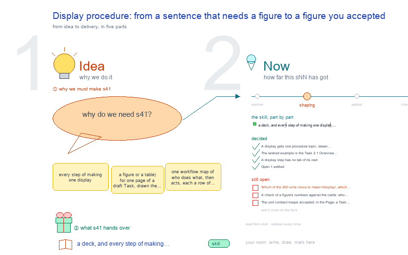

# s41 · Display procedure: from a sentence that needs a figure to a figure … <!-- root #05f9de -->

**Tags:** `Levels`
**Stage:** shaping

- For <!-- @for #f78806 -->
  - a deck, and every step of making … <!-- @for/0 #830c67 -->
    a deck, and every step of making one display, from a sentence that needs it to an accepted figure, for the people who write the toolkit skills
- Delivery type <!-- @delivery-type #58a44f -->
  - skill <!-- @delivery-type/0 #34b33e -->
- Topic <!-- @topic #7e13bd -->
  - every step of making one display (a … <!-- @topic/0 #efd8d0 -->
    every step of making one display (a figure or a table) for one page of a draft Task, drawn the way b32 s41 draws the draft Task: one workflow map of who does what, then acts, each a row of screens.
  - A display is one unit folder, `<task>/display/Display<n>-<slug>/`, … <!-- @topic/1 #d4c99d -->
    A display is one unit folder, `<task>/display/Display<n>-<slug>/`, built on evidence cards, accepted by a person, shown on the Section canvas and copied into delivery only when built.
  - The worked example is the Task 2.1 … <!-- @topic/2 #091183 -->
    The worked example is the Task 2.1 Overview Figure (SHIFT, b21), cited by the sentence "The work will proceed in three steps (Overview Figure)." (C3.P6 · B7 · S7 of `task21-draft-v1.11.md`; the figure itself is Section C8).
  - It is NOT yet a display unit; … <!-- @topic/3 #b97a14 -->
    It is NOT yet a display unit; the drawing says so in red.
  - Asked by JL 261016 ("for the b33 … <!-- @topic/4 #710c2c -->
    Asked by JL 261016 ("for the b33 and b34, could we have the things like b32-s41? to show how things work step by step?").
  - What a display is stays haipipe-display's; this … <!-- @topic/5 #91297f -->
    What a display is stays haipipe-display's; this topic draws its steps.
- Feeds <!-- @feeds #ffe8e9 -->
  - none yet (b34 has no `reports/`) <!-- @feeds/0 #4bcc47 -->
- Files <!-- @files #6ce6c5 -->
  - [py] [build_s41_task_display_procedure.py](build_s41_task_display_procedure.py) <!-- @files/0 #138e48 -->
  - delivery/ <!-- @files/1 #404761 -->
  - [excalidraw] [s41-task-display-procedure.excalidraw](s41-task-display-procedure.excalidraw) <!-- @files/2 #c58db2 -->
  - [md] [s41-task-display-procedure.md](s41-task-display-procedure.md) <!-- @files/3 #277597 -->
  - [png] [s41-task-display-procedure.png](s41-task-display-procedure.png) <!-- @files/4 #45e39a -->
    
- Decided <!-- @decided #55615a -->
  - s41-D01 · A display gets one procedure … <!-- @decided/0 #c01f3b -->
    s41-D01 · A display gets one procedure topic, drawn the way b32 s41 draws the draft Task (JL 261016: "for the b33 and b34, could we have the things like b32-s41?").
  - s41-D02 · The worked example is the … <!-- @decided/1 #4495a9 -->
    s41-D02 · The worked example is the Task 2.1 Overview Figure, shown as not yet a unit, in red.
  - s41-D03 · A display step has no … <!-- @decided/2 #4864cd -->
    s41-D03 · A display step has no tab of its own: it sits in 3 · Evidence (today's Evidence-Display tab folds there, b32 s41 Ⓐ). Replaced by s41-D04.
  - s41-D04 · Open 1 settled: the Display … <!-- @decided/3 #19302d -->
    s41-D04 · Open 1 settled: the Display step is its own tab, 4 · Display, after 3 · Evidence; Revise becomes 5 · Revise (JL 261020: "If we have the display, hwo do we make it? will it be the DISPLAY X? Or we want to have a new display view after the 3 - Evidence? ... Please do it"). A unit is DISPLAY <n>, its folder's number. The tab shows the text a row per sentence with each display beside the first sentence that calls it (by `shown as:`, a Table or Figure in `label:` or its heading, or its `\label`), then each display folded on its own; it reads `display/Display<n>-*/`, else a unit still in a display Run's newest pass. Built in workbench-task-draft `draft_steps._display_step`.
- Open <!-- @open #cf9b77 -->
  - Which of the 260 units move to … <!-- @open/0 #49ce18 -->
    Which of the 260 units move to `<task>/display/`, which are only read.
  - A check of a figure's numbers against … <!-- @open/1 #861217 -->
    A check of a figure's numbers against the cards: who writes it (haipipe-evidence's cards.py, or display).
  - The unit contract keeps `accepted:` in the … <!-- @open/2 #12113d -->
    The unit contract keeps `accepted:` in the Page; a Task unit needs it in its own README.
  - The sentence is C3.P6 · B7 · … <!-- @open/3 #46c0f0 -->
    The sentence is C3.P6 · B7 · S7 but the figure is Section C8: which canvas shows its Display card.
  - Agree its **For:** line and **Delivery type:** … <!-- @open/4 #09a2ba -->
    Agree its **For:** line and **Delivery type:** (skill), proposed by the agent 261030?
