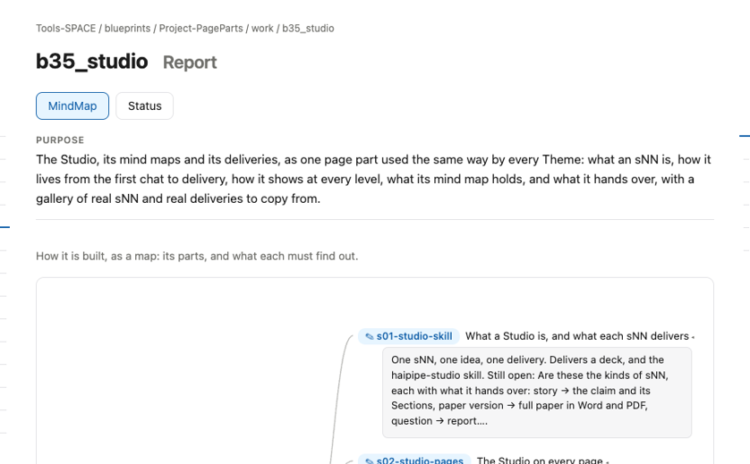
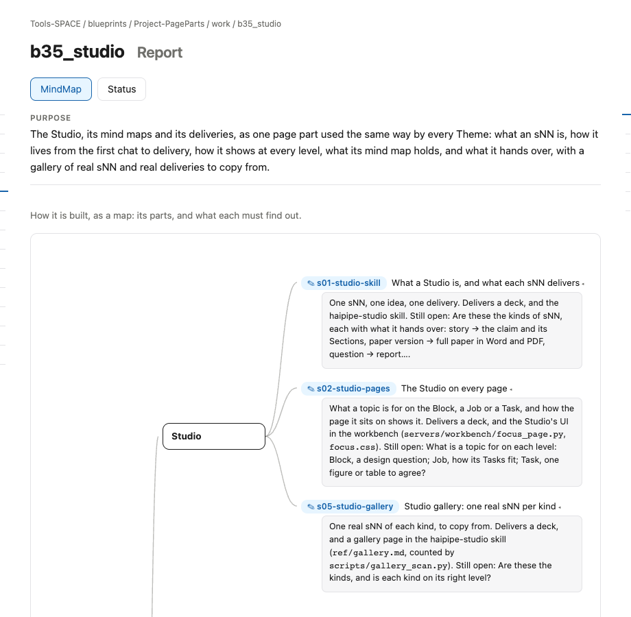

# s11 · Block UI: Report <!-- root #b56730 -->

**Stage:** explore
**Tags:** Block UI

- For <!-- @for #f78806 -->
  - a deck, and the rules for how … <!-- @for/0 #22d238 -->
    a deck, and the rules for how the Studio part shows in a Block's Report (check), for every Theme that builds that page
- Delivery type <!-- @delivery-type #58a44f -->
  - ui <!-- @delivery-type/0 #636117 -->
- Covers <!-- @covers #a6c44a -->
  - where an sNN appears in a Block … <!-- @covers/0 #a9ab96 -->
    where an sNN appears in a Block page's Report, and what it shows there.
- Excluded <!-- @excluded #980495 -->
  - the other eight cells (s11 to s19); … <!-- @excluded/0 #bb465d -->
    the other eight cells (s11 to s19); the page's own content, which each Theme designs (b16, b17).
- Topic <!-- @topic #7e13bd -->
  - how the Studio part shows in a … <!-- @topic/0 #2025fe -->
    how the Studio part shows in a Block page's Report, read from the real page (b35_studio) so every Theme builds it the same way (JL 261031: "please add more subgroup of the UI ... to direct others how to make the UI for the report and work").
- Feeds <!-- @feeds #ffe8e9 -->
  - none: b35 keeps no Questions <!-- @feeds/0 #5c9a70 -->
- Rules <!-- @rules #bb11a8 -->
  - The MindMap: the Block, one node per … <!-- @rules/0 #d7a66d -->
    The MindMap: the Block, one node per Studio group (its Tags), each sNN a leaf under its group; the Jobs after.
  - A leaf is the sNN's name and … <!-- @rules/1 #362140 -->
    A leaf is the sNN's name and title, then one plain paragraph: why, what it delivers, what is still open.
  - Status lists the Studio first, one line … <!-- @rules/2 #09ee26 -->
    Status lists the Studio first, one line per sNN with its title and stage; then the Jobs and their Tasks.
  - No counts; a stage is a word … <!-- @rules/3 #13f1f8 -->
    No counts; a stage is a word (explore, shaping, agreed, closed), a state is ⏳ ✅ ⬜ or 🙋.
- Files <!-- @files #6ce6c5 -->
  - delivery/ <!-- @files/0 #404761 -->
  - [excalidraw] [s11-block-ui-report.excalidraw](s11-block-ui-report.excalidraw) <!-- @files/1 #765711 -->
  - [md] [s11-block-ui-report.md](s11-block-ui-report.md) <!-- @files/2 #e9cde7 -->
  - [png] [s11-block-ui-report.png](s11-block-ui-report.png) <!-- @files/3 #d44745 -->
    
  - [png] [screen.png](screen.png) <!-- @files/4 #986ba8 -->
    
- Decided <!-- @decided #55615a -->
  - (none yet) <!-- @decided/0 #ac326f -->
- Open <!-- @open #cf9b77 -->
  - Should a Job's and a Task's sNN … <!-- @open/0 #c98e86 -->
    Should a Job's and a Task's sNN show in the Block's MindMap too, under their Job?
