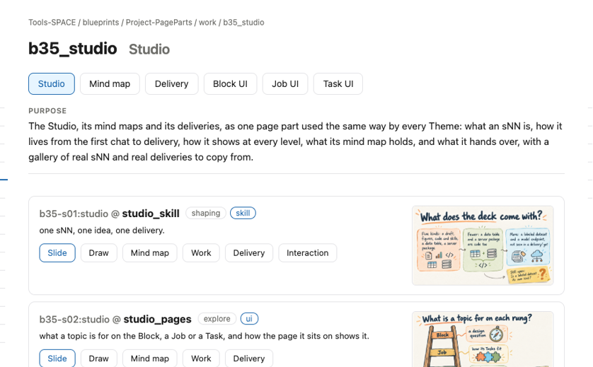
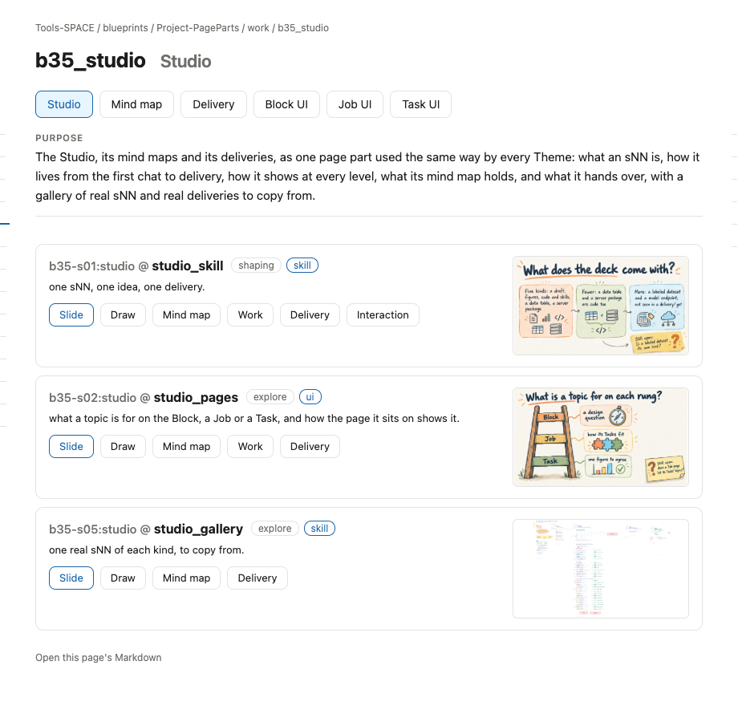

# s13 · Block UI: Studio <!-- root #631e11 -->

**Stage:** explore
**Tags:** Block UI

- For <!-- @for #f78806 -->
  - a deck, and the rules for how … <!-- @for/0 #2b09c0 -->
    a deck, and the rules for how the Studio part shows in a Block's Studio (think), for every Theme that builds that page
- Delivery type <!-- @delivery-type #58a44f -->
  - ui <!-- @delivery-type/0 #636117 -->
- Covers <!-- @covers #a6c44a -->
  - where an sNN appears in a Block … <!-- @covers/0 #2084a0 -->
    where an sNN appears in a Block page's Studio, and what it shows there.
- Excluded <!-- @excluded #980495 -->
  - the other eight cells (s11 to s19); … <!-- @excluded/0 #bb465d -->
    the other eight cells (s11 to s19); the page's own content, which each Theme designs (b16, b17).
- Topic <!-- @topic #7e13bd -->
  - how the Studio part shows in a … <!-- @topic/0 #db2935 -->
    how the Studio part shows in a Block page's Studio, read from the real page (b35_studio) so every Theme builds it the same way (JL 261031: "please add more subgroup of the UI ... to direct others how to make the UI for the report and work").
- Feeds <!-- @feeds #ffe8e9 -->
  - none: b35 keeps no Questions <!-- @feeds/0 #5c9a70 -->
- Rules <!-- @rules #bb11a8 -->
  - Group buttons sit above the Purpose, one … <!-- @rules/0 #e86a67 -->
    Group buttons sit above the Purpose, one per Tag, in `_studio_groups.txt` order; topics with no Tag go last, as Other.
  - One card per sNN: its address, title, … <!-- @rules/1 #269809 -->
    One card per sNN: its address, title, stage and delivery type; its one-line Topic; its drawing on the right.
  - Under the card, its tags: Slide · … <!-- @rules/2 #a51adc -->
    Under the card, its tags: Slide · Draw · Mind map · Work · Delivery · Interaction, each only when it exists.
  - A Block's Studio shows its own sNN … <!-- @rules/3 #89bb1f -->
    A Block's Studio shows its own sNN (at most 9) and those of its Jobs and Tasks.
- Files <!-- @files #6ce6c5 -->
  - delivery/ <!-- @files/0 #404761 -->
  - [excalidraw] [s13-block-ui-studio.excalidraw](s13-block-ui-studio.excalidraw) <!-- @files/1 #359b13 -->
  - [md] [s13-block-ui-studio.md](s13-block-ui-studio.md) <!-- @files/2 #181f0a -->
  - [png] [s13-block-ui-studio.png](s13-block-ui-studio.png) <!-- @files/3 #dffe85 -->
    
  - [png] [screen.png](screen.png) <!-- @files/4 #986ba8 -->
    
- Decided <!-- @decided #55615a -->
  - (none yet) <!-- @decided/0 #ac326f -->
- Open <!-- @open #cf9b77 -->
  - A Task's sNN shows a long address … <!-- @open/0 #ec3c10 -->
    A Task's sNN shows a long address (b35.j02.t02-s11:studio.studio_pages.block_page @ …): show only j02.t02-s11?
