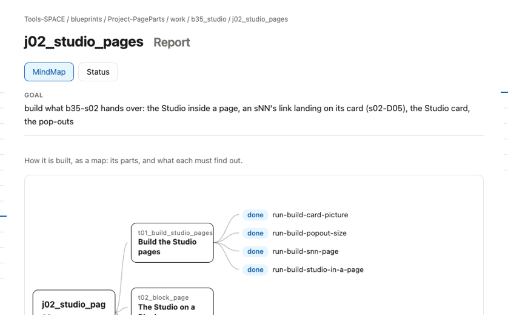
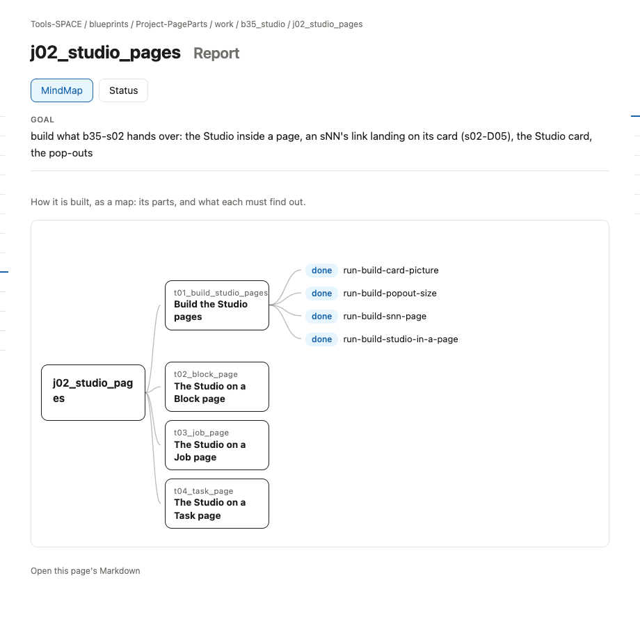

# s14 · Job UI: Report <!-- root #798fdd -->

**Stage:** explore
**Tags:** Job UI

- For <!-- @for #f78806 -->
  - a deck, and the rules for how … <!-- @for/0 #433d72 -->
    a deck, and the rules for how the Studio part shows in a Job's Report (check), for every Theme that builds that page
- Delivery type <!-- @delivery-type #58a44f -->
  - ui <!-- @delivery-type/0 #636117 -->
- Covers <!-- @covers #a6c44a -->
  - where an sNN appears in a Job … <!-- @covers/0 #47d0a7 -->
    where an sNN appears in a Job page's Report, and what it shows there.
- Excluded <!-- @excluded #980495 -->
  - the other eight cells (s11 to s19); … <!-- @excluded/0 #bb465d -->
    the other eight cells (s11 to s19); the page's own content, which each Theme designs (b16, b17).
- Topic <!-- @topic #7e13bd -->
  - how the Studio part shows in a … <!-- @topic/0 #ffa841 -->
    how the Studio part shows in a Job page's Report, read from the real page (j02_studio_pages) so every Theme builds it the same way (JL 261031: "please add more subgroup of the UI ... to direct others how to make the UI for the report and work").
- Feeds <!-- @feeds #ffe8e9 -->
  - none: b35 keeps no Questions <!-- @feeds/0 #5c9a70 -->
- Rules <!-- @rules #bb11a8 -->
  - The MindMap: the Job, then each Task … <!-- @rules/0 #df5150 -->
    The MindMap: the Job, then each Task with its Runs (done or not) and its sNN.
  - Status lists the Job's own sNN first, … <!-- @rules/1 #f6fe0a -->
    Status lists the Job's own sNN first, then its Tasks with their state.
- Files <!-- @files #6ce6c5 -->
  - delivery/ <!-- @files/0 #404761 -->
  - [excalidraw] [s14-job-ui-report.excalidraw](s14-job-ui-report.excalidraw) <!-- @files/1 #2e1fe5 -->
  - [md] [s14-job-ui-report.md](s14-job-ui-report.md) <!-- @files/2 #07fa81 -->
  - [png] [s14-job-ui-report.png](s14-job-ui-report.png) <!-- @files/3 #87d142 -->
    
  - [png] [screen.png](screen.png) <!-- @files/4 #986ba8 -->
    
- Decided <!-- @decided #55615a -->
  - (none yet) <!-- @decided/0 #ac326f -->
- Open <!-- @open #cf9b77 -->
  - Should a Task's sNN show under its … <!-- @open/0 #78df33 -->
    Should a Task's sNN show under its Task in the Job's MindMap?
