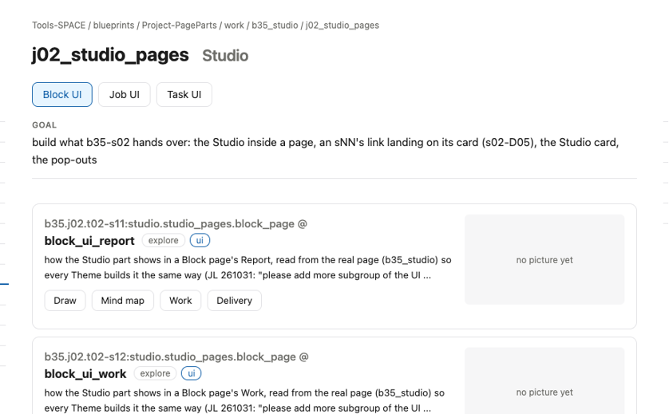
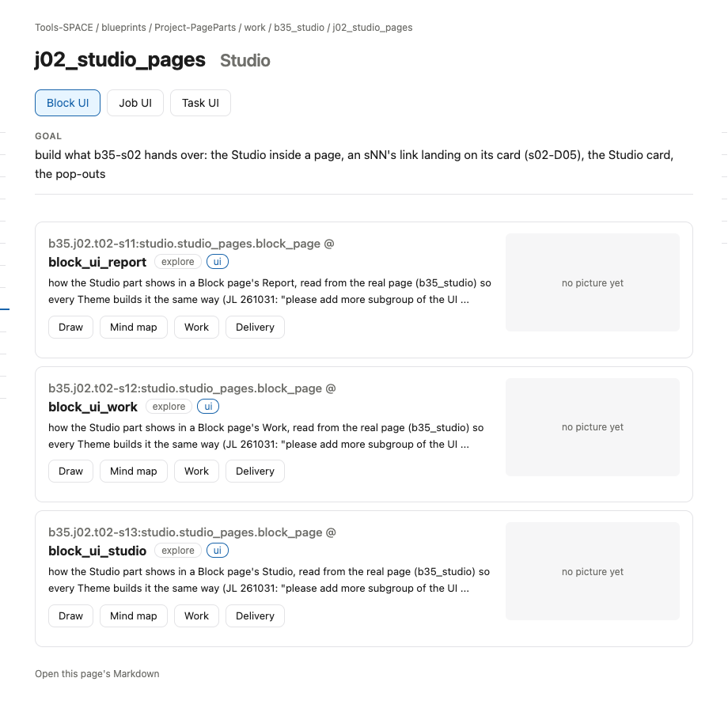

# s16 · Job UI: Studio <!-- root #ba5630 -->

**Stage:** explore
**Tags:** Job UI

- For <!-- @for #f78806 -->
  - a deck, and the rules for how … <!-- @for/0 #5093bb -->
    a deck, and the rules for how the Studio part shows in a Job's Studio (think), for every Theme that builds that page
- Delivery type <!-- @delivery-type #58a44f -->
  - ui <!-- @delivery-type/0 #636117 -->
- Covers <!-- @covers #a6c44a -->
  - where an sNN appears in a Job … <!-- @covers/0 #9e8480 -->
    where an sNN appears in a Job page's Studio, and what it shows there.
- Excluded <!-- @excluded #980495 -->
  - the other eight cells (s11 to s19); … <!-- @excluded/0 #bb465d -->
    the other eight cells (s11 to s19); the page's own content, which each Theme designs (b16, b17).
- Topic <!-- @topic #7e13bd -->
  - how the Studio part shows in a … <!-- @topic/0 #386efa -->
    how the Studio part shows in a Job page's Studio, read from the real page (j02_studio_pages) so every Theme builds it the same way (JL 261031: "please add more subgroup of the UI ... to direct others how to make the UI for the report and work").
- Feeds <!-- @feeds #ffe8e9 -->
  - none: b35 keeps no Questions <!-- @feeds/0 #5c9a70 -->
- Rules <!-- @rules #bb11a8 -->
  - Group buttons come from the Tags of … <!-- @rules/0 #5be868 -->
    Group buttons come from the Tags of the Job's own sNN (at most 5) and of its Tasks' sNN.
  - The cards are the Block's cards: address, … <!-- @rules/1 #cebcad -->
    The cards are the Block's cards: address, title, stage, type, Topic, drawing, tags below.
- Files <!-- @files #6ce6c5 -->
  - delivery/ <!-- @files/0 #404761 -->
  - [excalidraw] [s16-job-ui-studio.excalidraw](s16-job-ui-studio.excalidraw) <!-- @files/1 #ef81f7 -->
  - [md] [s16-job-ui-studio.md](s16-job-ui-studio.md) <!-- @files/2 #923c30 -->
  - [png] [s16-job-ui-studio.png](s16-job-ui-studio.png) <!-- @files/3 #157fd2 -->
    
  - [png] [screen.png](screen.png) <!-- @files/4 #986ba8 -->
    
- Decided <!-- @decided #55615a -->
  - (none yet) <!-- @decided/0 #ac326f -->
- Open <!-- @open #cf9b77 -->
  - Same long address as on the Block … <!-- @open/0 #b9af72 -->
    Same long address as on the Block page: shorten it here too?
